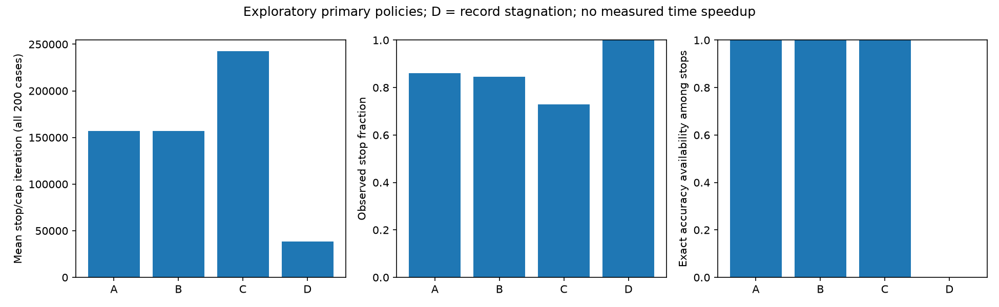

# Frozen exploratory adaptive stopping comparison

Protocol commit `405073957b32c0e71ecde03dad827e93db431280`; SHA-256 `ea31318f8b75cd268d256b81935e6573ff4a8085b3c97de52b233907d0d67b99`.

All 200 previously examined PR #8 cases; no new propagation, parameter selection or independent validation. [Frozen protocol](proposed_protocol.json) and [registration](freeze.json).

Primary B/C use hybrid observation: periodic decisions every 1000 iterations with all archived intermediate transitions summed once. Secondary B/C decide at every published observation. Neither implies stability between observations. D is the **record-stagnation criterion**, not general dominance stability.

## Primary results

| Candidate | Stops / censored | Mean event/cap iteration ± SD | Mean iterations saved (%) | Exact stop accuracy available | Event/cap accuracy difference vs full, mean ± SD (pp); n |
|---|---:|---:|---:|---:|---:|
| A | 172 / 28 | 157,105.7 ± 171,248.0 | 68.58 | 172 / 172 | -0.167 ± 1.643; 200 |
| B | 169 / 31 | 156,755.0 ± 171,472.4 | 68.65 | 169 / 169 | -0.141 ± 1.523; 200 |
| C | 146 / 54 | 242,285.0 ± 190,937.0 | 51.54 | 146 / 146 | -0.091 ± 0.891; 200 |
| D | 200 / 0 | 38,374.4 ± 38,472.8 | 92.33 | 0 / 200 | missing; 0 |

Censored cases contribute cap observations and zero iteration savings, not invented stop times. Cap reference accuracy is identified separately from actual stop accuracy. D missing stop accuracies remain blank; available-subset differences must not be interpreted as a full-cohort comparison.

There are **0 cases** with exact event/cap accuracy available for all four primary policies. Common-case rows are published when nonempty; exclusions can be audited against individual.csv. Each dataset has ten cases, so full-cohort rows weight datasets equally; missing-accuracy subsets need not.

## Complete sensitivity and secondary results

| Configuration | Stops / censored | Mean event/cap iteration | Exact stop accuracies | Paired difference vs full (pp); n |
|---|---:|---:|---:|---:|
| A:original:W0:q0 | 172 / 28 | 157,105.7 | 172 | -0.167; 200 |
| B:hybrid_regular:W1000:q0 | 199 / 1 | 55,505.0 | 199 | -0.203; 200 |
| B:hybrid_regular:W1000:q0.001 | 200 / 0 | 38,080.0 | 200 | -0.250; 200 |
| B:hybrid_regular:W3000:q0 | 169 / 31 | 156,755.0 | 169 | -0.141; 200 |
| B:hybrid_regular:W3000:q0.001 | 180 / 20 | 121,320.0 | 180 | -0.236; 200 |
| B:hybrid_regular:W5000:q0 | 144 / 56 | 223,015.0 | 144 | -0.165; 200 |
| B:hybrid_regular:W5000:q0.001 | 148 / 52 | 194,910.0 | 148 | -0.199; 200 |
| C:hybrid_regular:W1000:q0 | 169 / 31 | 173,635.0 | 169 | -0.096; 200 |
| C:hybrid_regular:W1000:q0.001 | 170 / 30 | 171,880.0 | 170 | -0.098; 200 |
| C:hybrid_regular:W3000:q0 | 146 / 54 | 242,285.0 | 146 | -0.091; 200 |
| C:hybrid_regular:W3000:q0.001 | 151 / 49 | 238,005.0 | 151 | -0.085; 200 |
| C:hybrid_regular:W5000:q0 | 120 / 80 | 289,685.0 | 120 | -0.118; 200 |
| C:hybrid_regular:W5000:q0.001 | 124 / 76 | 283,210.0 | 124 | -0.120; 200 |
| B:all_observations_secondary:W1000:q0 | 199 / 1 | 55,504.0 | 199 | -0.203; 200 |
| B:all_observations_secondary:W1000:q0.001 | 200 / 0 | 38,079.0 | 200 | -0.250; 200 |
| B:all_observations_secondary:W3000:q0 | 169 / 31 | 156,719.8 | 169 | -0.145; 200 |
| B:all_observations_secondary:W3000:q0.001 | 180 / 20 | 121,284.8 | 180 | -0.239; 200 |
| B:all_observations_secondary:W5000:q0 | 144 / 56 | 223,015.0 | 144 | -0.165; 200 |
| B:all_observations_secondary:W5000:q0.001 | 148 / 52 | 194,910.0 | 148 | -0.199; 200 |
| C:all_observations_secondary:W1000:q0 | 169 / 31 | 173,195.0 | 169 | -0.092; 200 |
| C:all_observations_secondary:W1000:q0.001 | 170 / 30 | 171,416.5 | 170 | -0.094; 200 |
| C:all_observations_secondary:W3000:q0 | 146 / 54 | 242,118.7 | 146 | -0.094; 200 |
| C:all_observations_secondary:W3000:q0.001 | 151 / 49 | 237,786.1 | 151 | -0.089; 200 |
| C:all_observations_secondary:W5000:q0 | 120 / 80 | 289,567.2 | 120 | -0.118; 200 |
| C:all_observations_secondary:W5000:q0.001 | 124 / 76 | 283,046.0 | 124 | -0.120; 200 |
| D:record_stagnation_check_grid:W1000:q1e-05 | 200 / 0 | 34,369.7 | 4 | -2.515; 4 |
| D:record_stagnation_check_grid:W1000:q0.0001 | 200 / 0 | 29,225.2 | 4 | -2.515; 4 |
| D:record_stagnation_check_grid:W1000:q0.0005 | 200 / 0 | 23,424.6 | 2 | -4.142; 2 |
| D:record_stagnation_check_grid:W3000:q1e-05 | 200 / 0 | 52,420.8 | 0 | missing; 0 |
| D:record_stagnation_check_grid:W3000:q0.0001 | 200 / 0 | 46,461.4 | 0 | missing; 0 |
| D:record_stagnation_check_grid:W3000:q0.0005 | 200 / 0 | 38,374.4 | 0 | missing; 0 |
| D:record_stagnation_check_grid:W5000:q1e-05 | 200 / 0 | 64,093.5 | 0 | missing; 0 |
| D:record_stagnation_check_grid:W5000:q0.0001 | 200 / 0 | 57,761.2 | 1 | +0.138; 1 |
| D:record_stagnation_check_grid:W5000:q0.0005 | 200 / 0 | 47,197.2 | 1 | -0.510; 1 |

[Individual results](individual.csv), [dataset statistics](dataset_summary.csv), and [overall statistics](overall_summary.csv) retain sample SD, median, range, paired differences vs original A and full reference, window endpoints/counts and counter ages for every configuration. No winning grid cell is selected.

## Interpretation and limits

C cannot stop before A because its conjunction preserves original patience; its additional classification evidence may delay or censor stopping. B measures sampled transition counts with multiplicity, including observed changes followed by reversions. D can stop while classifications or dominance continue moving below their earlier record; small cumulative record gains are not evidence of general dominance stability.

Iterations saved are retrospective processing-budget differences, **not measured time gains**. Archived full-run timings cannot recover candidate prefix wall times or observation overhead. Accuracy comparisons require exact saved instants; no interpolation, future checkpoint substitution or outcome-based threshold adjustments are used.

The primary hybrid includes legacy-event information causally generated by the old observers. It is not equivalent to monitoring only periodic classifications. Secondary timing differs by decision opportunities and by the window-start convention; report actual spans rather than implying equal windows.

All 10,000,000 recorded checks were independently audited; A matched all 200 archived original events/censors. [Validation metadata](validation.json). Synthetic tests cover boundaries, cumulative small gains, censoring, counter resets, intermediate reversions and prefix invariance. No kernels or local checkpoints are required.

## Paired primary-versus-secondary schedules

| Candidate / W / budget | Cases with later periodic decision | Mean iteration difference | Mean paired accuracy difference (pp) |
|---|---:|---:|---:|
| B / 1000 / 0 | 1 / 200 | 1.0 | +0.000 |
| B / 1000 / 0.001 | 1 / 200 | 1.0 | +0.000 |
| B / 3000 / 0 | 2 / 200 | 35.2 | +0.004 |
| B / 3000 / 0.001 | 2 / 200 | 35.2 | +0.004 |
| B / 5000 / 0 | 0 / 200 | 0.0 | +0.000 |
| B / 5000 / 0.001 | 0 / 200 | 0.0 | +0.000 |
| C / 1000 / 0 | 52 / 200 | 440.0 | -0.004 |
| C / 1000 / 0.001 | 67 / 200 | 463.5 | -0.004 |
| C / 3000 / 0 | 30 / 200 | 166.3 | +0.004 |
| C / 3000 / 0.001 | 47 / 200 | 218.9 | +0.004 |
| C / 5000 / 0 | 18 / 200 | 117.8 | +0.000 |
| C / 5000 / 0.001 | 35 / 200 | 164.0 | +0.000 |

Additional decision opportunities cannot postpone the secondary first stop because it includes every primary decision time. Window spans can differ; [all 2400 paired rows](primary_secondary_pairs.csv) retain those spans. No schedule or parameter is selected as a winner.



Reproduce from repository root using Windows pypcc-dev:

```powershell
conda run -n pypcc-dev python docs/compare_adaptive_stopping.py
conda run -n pypcc-dev python docs/summarize_adaptive_stopping.py
```

The first command replays archives; it does not run propagation. The second reads result CSVs only. Both preserve the frozen protocol and source archives.

## Validation and review notes

All **80 local regression tests passed** on Windows pypcc-dev with native Cython.
All 6800 result rows passed iteration-budget identities, censor/missing-accuracy
checks, periodic primary timing, counter-age bounds and C-not-before-A checks.
The 2400 paired schedule rows satisfy secondary-not-after-primary timing.

The original reference cohort has event/cap accuracy differences ranging from
-12.38 to +5.45 percentage points. Primary B ranges from -12.15 to +4.32 pp,
and C from -5.52 to +2.76 pp. Means alone conceal seed-level variation. C's
54 censored cases contribute full-budget reference accuracies, whereas A has
28 and B 31: smaller event/cap mean loss does not independently establish safer
observed stopping. Exact primary D stop accuracy is unavailable in all cases,
so neither a four-way accuracy comparison nor a D accuracy tradeoff is justified.

This is exploratory reuse of previously examined seeds/datasets. The frozen
grid is reported in full; no parameter or candidate is recommended as a winner.
Independent validation, measured stopping overhead and denser observations need
a separately approved future experiment. No production change is proposed.
