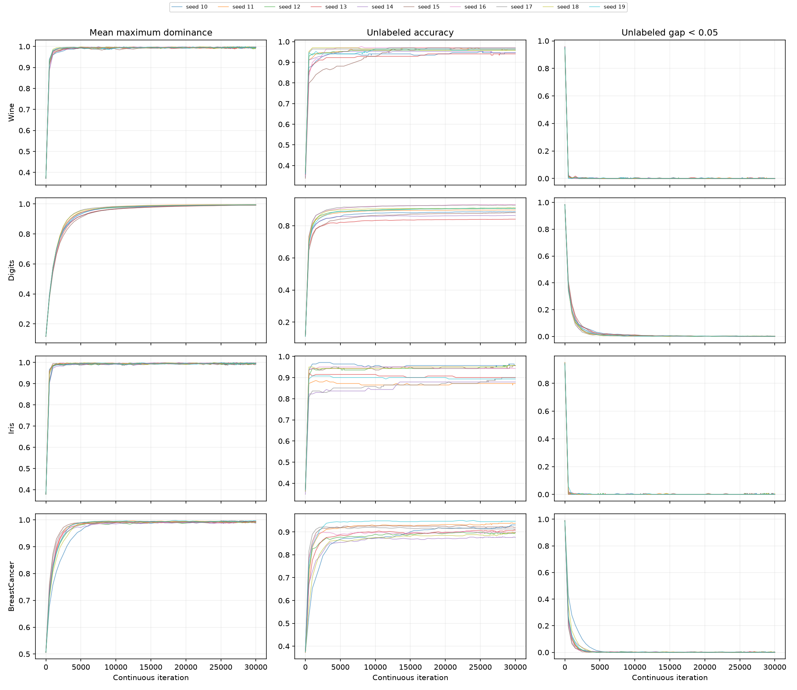
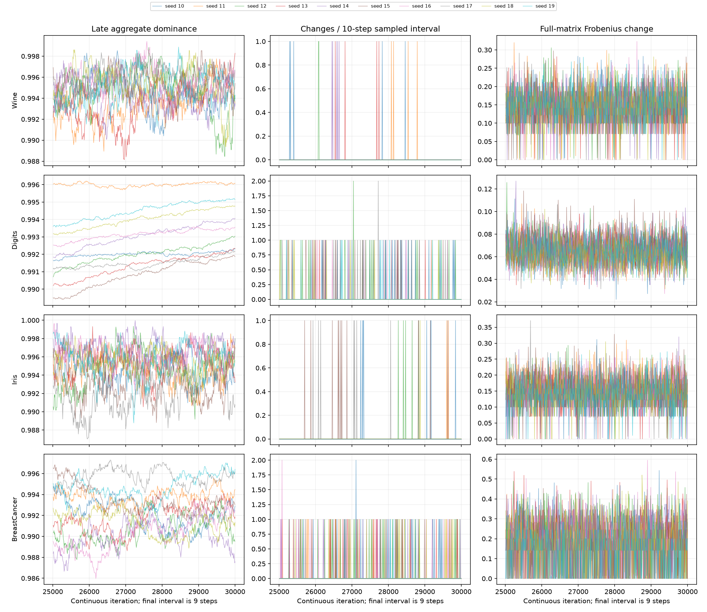

# PR #7: original PCC convergence dynamics

## Observations and central conclusion

Digits and Breast Cancer both reach 30000 iterations, but **not for the same immediate reason**. Digits keeps setting frequent new dominance records while sampled classes are nearly stable. Breast Cancer sets relatively few late records and has a substantially longer required non-improvement interval; four of its ten seeds set no records after 20001, yet none accumulates enough stalled checks before the cap.

Wine and Iris satisfy their shorter original record-plateau criteria much earlier. Continuing their particle dynamics reveals that this does **not** mean their dominance matrices are frozen or their classes permanently settled. They can set later records and change predictions after their hypothetical original stopping event. Sparse checkpoints also conceal reversals in every dataset.

This report diagnoses the original rule. It does not implement, select or tune any alternative stopping threshold, and it does not claim a defect in PCC. All numerical observations below use seeds **10-19, already examined in PR #6**, not independent validation seeds.

## Unchanged protocol and instrumentation

Four datasets use the identical standardized transductive features, shared graph, initial labeled indices and PCC parameters from PR #6: 10-nearest-neighbor construction, three labeled nodes per class, `p_grd=0.5`, `delta_v=0.1`, `deltap=1`, `dexp=2`, `es_chk=2000`. Input/data/graph/label fingerprints are checked against PR #6 before propagation. Only original sequential Numba particle kernels are used. Forty continuous trajectories advance to 30000 with stopping disabled during execution; the original stopping rule is observed in shadow. Thus no actual original run is silently continued after a break; these are explicit uninterrupted diagnostic runs.

At original checks 1, 11, 21, ... the existing serial reduction computes `m_t = mean_i(max_class dominance[i,class])`. Strict `m_t > best` resets the counter; otherwise it increments. Eligibility is `counter > stop_max`. No epsilon changes this comparison. The existing formula is `stop_max=max(1,round(nodes/(particles*k_nn)*round(es_chk*0.1)))`; `es_chk` is not the check interval.

The following table separates the mathematical earliest possible stop on a complete plateau, the actual first shadow event and the uninterrupted diagnostic budget. Earliest-stop arithmetic assumes the first check improves from the initial best of zero.

| Dataset | Nodes / particles | stop_max | Required stalled checks | Earliest possible iteration | First original stops / 10 | Observed first-stop range |
|---|---:|---:|---:|---:|---:|---:|
| Wine | 178 / 9 | 396 | 397 | 3971 | 10 | 7301-16281 |
| Digits | 1797 / 30 | 1198 | 1199 | 11991 | 0 | none by 30000 |
| Iris | 150 / 9 | 333 | 334 | 3341 | 10 | 4741-13111 |
| BreastCancer | 569 / 6 | 1897 | 1898 | 18981 | 0 | none by 30000 |

After an original shadow stop, the uninterrupted trajectory keeps evolving, so later `original_eligible` values can become false again after a new record. These are counterfactual continuation statistics, not behavior of an already terminated original call.

### Sampling and bounded state

- Score and predicted-class changes are observed at every original ten-step check. A final off-schedule observation at 30000 is flagged `original_check=0` and **does not** update the original record/counter.
- Rich matrix/confidence/accuracy checkpoints occur at 1, 501, 1001, ...; every ten steps within +/-500 of the PR #6 stopping event; and every ten steps from 25001 through 29991, plus final 30000. Fine windows are based on previously known events, not on retrospective tuning of a new criterion.
- Rich rows compare classifications to the preceding rich checkpoint, initial classes, and reference classes at 5001, 10001 and 20001. Percentages use all nodes (labeled nodes are fixed); unknown-node accuracy and uncertainty fractions are also explicit.
- Sparse-window bookkeeping records any class changes observed at ten-step checks, and counts nodes that return to their starting class by the next sparse endpoint. A zero endpoint difference is never treated as proof of stability between endpoints.
- Matrix changes are streamed between checkpoints: mean absolute entry change (MAE), Frobenius norm, maximum absolute entry change and maximum per-node row L1 change. Each rich row records its interval length; coarse/fine raw norm values must not be mixed without accounting for interval length.
- Per-node counters accumulate sampled class flips, dominance row-L1 motion and low-gap observations, separately for the whole run and after 20001. Reference labels are saved as compact node-level columns, rather than complete state snapshots at each iteration.
- CSV measurements stream to disk. At most four selected complete states and their RNG vectors are kept temporarily per seed for verification; previous matrices, reference labels and node counters use O(nodes*classes) working memory. These verification states are discarded after checking. Figure generation reads derived CSV statistics after propagation, not a full state history.

### Confidence and distributions

The descriptive margin is `gap_i = largest dominance_i - second-largest dominance_i`. A node has low sampled confidence iff **gap < 0.05** (strictly). This is an explicit diagnostic definition, not a stopping criterion or a calibrated probability of correctness. Both all-node and unlabeled fractions are recorded. Maximum-dominance distributions include minimum, p10, p25, median, p75, p90, maximum and seven fixed histogram bins; gaps include mean, p10 and median.

A `record_gain` is improvement over the running **best**, not the preceding value. `delta_metric` and checkpoint score deltas are recorded separately. `<=1e-12` marks tiny gains for descriptive counting only; no tolerance is applied to original stopping. The first record includes improvement from the original zero best, whereas the first score delta compares with the actual initial dominance metric.

## Aggregate records versus classification stability

The late interval is `(20001,30000]`: 9999 particle iterations, 999 original checks plus the final nine-step off-schedule observation. Record statistics exclude that final off-schedule observation. Means +/- sample SD describe ten previously examined seeds; pooled median gains and reset percentages pool actual record events.

| Dataset | Late record resets / seed | Median positive gain | Tiny gains / all late records | Resets with no sampled class change | Longest observed stall / required |
|---|---:|---:|---:|---:|---:|
| Wine | 1.5 +/- 1.4 | 1.558e-04 | 1 / 15 | 100.0% | 2484 / 397 |
| Digits | 209.6 +/- 61.2 | 1.522e-05 | 1 / 2096 | 96.0% | 408 / 1199 |
| Iris | 1.0 +/- 1.1 | 1.658e-04 | 0 / 10 | 100.0% | 2618 / 334 |
| BreastCancer | 4.7 +/- 4.8 | 1.603e-04 | 0 / 47 | 95.7% | 1746 / 1898 |

**Digits:** every seed keeps setting late records (79-306 resets); 96.0% of those resets occur with no class difference from the preceding ten-step observation. Median positive record gain is approximately `1.52e-5`; only one of 2096 late records is at or below `1e-12`. The dominant mechanism is continued winning-dominance reinforcement without many argmax changes, rather than a flood of machine-precision resets. The longest stall is 408, far below the required 1199 checks.

**Breast Cancer:** late records range from zero to 12 per seed, with zero in seeds 11, 13, 16 and 19. Its required 1898 checks represent 18980 iterations after the last record. Even its longest stall, seed 11's 1746 checks, is insufficient. If that seed produced no further records, its next eligible check would be 31511; this is conditional arithmetic, not an executed extrapolation or a proposed budget. Existing occasional gains are larger (median approximately `1.60e-4`) than Digits' frequent small gains; none of its 47 late records is tiny. Its score also fluctuates below the best while local dominance/class changes continue.

**Wine and Iris:** all original events occur earlier, but continued runs produce respectively 15 and 10 late records. All these late records occur with unchanged classes at the immediately preceding sampled check. They show that the original test is a plateau in historical-best aggregate dominance, not an absorbing state or permanent classification guarantee.

## Local state, uncertainty and concentration

All counts here are sampled class-change events, not individual particle update events. Top 5% means the largest `ceil(0.05*nodes)` node counters within each seed; it is a descriptive concentration measure. Classification-event shares are averaged only over seeds with at least one such event; dominance-motion shares include all seeds. The aggregate CSV uses zero for undefined no-event ratios, so its unconditional share averages differ for Wine/Iris.

| Dataset | Late nodes ever changing / seed | Late class-change events / seed | Top 5% share of class events | Top 5% share of dominance motion | Changed nodes previously gap<0.05 |
|---|---:|---:|---:|---:|---:|
| Wine | 1.4 +/- 1.3 | 6.7 +/- 7.6 | 100.0% | 31.6% | 37.1% |
| Digits | 10.9 +/- 3.6 | 34.2 +/- 14.7 | 100.0% | 40.4% | 99.6% |
| Iris | 1.9 +/- 1.6 | 6.7 +/- 6.1 | 100.0% | 37.2% | 45.5% |
| BreastCancer | 12.5 +/- 3.9 | 37.9 +/- 14.0 | 100.0% | 47.9% | 33.0% |

In Digits, late flips involve about 10.9 nodes of 1797 on average; in Breast Cancer, about 12.5 of 569. All late class-change events in those datasets lie within 5% of nodes. Dominance motion is broader: the top 5% account for only about 40% and 48% of cumulative row-L1 change, respectively. Thus a few changing classes do not imply only a few changing dominance rows.

Prior low-margin exposure strongly accompanies Digits flips (mean per-seed share 99.6%), but much less strongly accompanies Breast Cancer flips (33.0%). This comparison uses the gap at the **previous ten-step observation**. Breast Cancer nodes may enter and leave a narrow-margin state between observations; a low final uncertainty fraction does not prove that all intervening flips came from confident nodes. The observations establish different sampled behavior, not the complete update-level cause.

The normalized matrix measures below use only equal-length ten-step rich intervals 25011..29991. Raw Frobenius magnitude depends on matrix size/class count and is not a dimension-independent comparison.

| Dataset | Mean absolute entry change / ten steps | Mean Frobenius change / ten steps | Mean maximum node L1 change | Intervals with exactly zero matrix change |
|---|---:|---:|---:|---:|
| Wine | 8.127e-04 | 0.1460 | 0.1189 | 0.44% |
| Digits | 1.968e-05 | 0.0653 | 0.0418 | 0.00% |
| Iris | 9.461e-04 | 0.1455 | 0.1194 | 0.64% |
| BreastCancer | 3.893e-04 | 0.1822 | 0.1745 | 14.17% |

Wine and Iris, despite their early original stops, show persistent local dominance fluctuations in the uninterrupted runs. Aggregate mean-max values can remain near their prior best while individual entries move substantially. None of aggregate-record plateau, per-node dominance stationarity and sampled class stability is interchangeable with the other two.

## Sparse snapshots and temporary stability

Across all 60 sparse intervals per seed, including the final shorter interval:

| Dataset | Zero-endpoint-change intervals containing sampled reversals (sum across seeds) | Hidden reverting node-events (sum) |
|---|---:|---:|
| Wine | 37 | 174 |
| Digits | 31 | 809 |
| Iris | 31 | 51 |
| BreastCancer | 62 | 423 |

The second column is direct evidence that predictions can appear unchanged at sparse endpoints and nevertheless change in between. Hidden node-event counts also include reverting nodes in windows where other nodes retain a different class. Per-check unchanged streaks and subsequent-change episodes are recorded in the CSVs. Ten-step observations still cannot detect flips that reverse entirely within those ten iterations; these counts are lower bounds, not complete update-by-update histories.

## Accuracy, seed effects and graph structure

Final sampled values (mean +/- sample SD across seeds):

| Dataset | Mean maximum dominance | All-node low-gap fraction (%) | Unlabeled accuracy (%) |
|---|---:|---:|---:|
| Wine | 0.994902 +/- 0.001747 | 0.000 +/- 0.000 | 95.858 +/- 1.044 |
| Digits | 0.993534 +/- 0.001440 | 0.111 +/- 0.091 | 89.593 +/- 2.828 |
| Iris | 0.995556 +/- 0.002425 | 0.067 +/- 0.211 | 92.199 +/- 3.570 |
| BreastCancer | 0.992583 +/- 0.002746 | 0.035 +/- 0.074 | 91.226 +/- 2.189 |

Near-unit winning dominance and a small low-gap fraction therefore coexist with nonzero classification error. Margin-based confidence is a state descriptor, not validated correctness probability.

Accuracy is retrospective only; it is never used by propagation, the shadow criterion or sampling decisions. Mean net changes after 20001 are approximately -0.059 pp Wine, +0.289 pp Digits, +0.496 pp Iris and +0.409 pp Breast Cancer. These do not move in lockstep with dominance records. Continuing Wine/Iris to 30000 changes mean accuracy relative to their original stopped runs by +0.710 and +0.922 pp, respectively, with substantial seed variation (SD 1.241 and 1.951 pp). Higher dominance does not guarantee higher accuracy, and the criterion is not an accuracy optimizer.

Seed sensitivity is evident even with fixed graphs: Wine's first stop ranges 7301-16281, Iris's 4741-13111; Digits late records range 79-306 and Breast Cancer late records 0-12. All four graphs have a single connected component. Node counts, class counts, numbers of particles and degree distributions differ, and influence the configured patience formula. The graph and fingerprints are held constant within each dataset, so these experiments cannot establish a causal graph-structure dependence separate from dataset, labels, number of classes or stochastic trajectory. Node degrees and change counters are saved for descriptive inspection, not treated as a controlled graph intervention.

## Comparative figures





The expanded late score axes expose small fluctuations and record progress hidden in full-run plots. The final observation covers nine steps, while preceding late fine intervals cover ten; its raw norm must be interpreted accordingly. The complete distributions and reference-checkpoint differences are available in checkpoint CSVs even when not all are plotted.

## Correctness, tests and reproducibility

All **140 selected checkpoint comparisons** pass: for each seed, 5001, 15001 and 30000, plus its original event if distinct. They compare exact positions, strengths, uint8 distances, dominance and own-degree against unchanged monolithic propagation at that prefix. The current thread's Numba NumPy MT index and all 624 state words are compared too. A private runtime read (`_helperlib.rnd_get_state`) obtains this state without drawing, seeding or restoring RNG during the continuous run. Verification propagations run only after the continuous trajectory has finished and cannot affect it. The original event prediction hash matches PR #6 for every seed.

Private Numba RNG introspection is version-specific; software versions are recorded and it may require adaptation on other releases. PCC here uses uniform/integer draws; no Gaussian caching behavior is involved. The observation helper itself is tested to leave RNG untouched. Pure diagnostic tests cover gap/tie distributions, matrix norms, sparse reversal bookkeeping and coarse/fine checkpoint selection. **51 tests passed locally in Windows `pypcc-dev`**, with native Cython available; CI runs the suite on Python 3.10/3.12. Long research experiments remain outside permanent CI.

An independent CSV reconstruction confirmed all 120000 original checks and 40 final off-schedule observations preserve the strict best/counter logic. Input fingerprints match PR #6. The source protocol in metadata retains PR #6 fields for provenance only; `diagnostic_protocol` separately specifies one uninterrupted trajectory per seed, a shadow original criterion and **no alternative criterion**.

```powershell
& 'C:\Users\fbrev\miniforge3\Scripts\conda.exe' run -n pypcc-dev --no-capture-output python docs/diagnose_convergence_dynamics.py --output-dir docs/benchmarks/convergence_dynamics_reproduction
& 'C:\Users\fbrev\miniforge3\Scripts\conda.exe' run -n pypcc-dev --no-capture-output python -m unittest -v tests.test_numpy_regression tests.test_numpy_synchronous tests.test_sequential_safety tests.test_propagation_metrics tests.test_stopping_range_prototype tests.test_convergence_measurements
```

Run from the repository root, without Python `-O` (which disables correctness assertions), using a separate output directory to preserve committed results. Windows and native Cython are checked although all research trajectories use Numba. Diagnostic runtimes include scans and streaming output; they are **not** benchmark speed measurements. Plotting occurs after propagation.

Artifacts: [script](../../diagnose_convergence_dynamics.py), [check-level history](checks.csv), [rich checkpoints](checkpoints.csv), [per-node streaming counters and reference labels](nodes.csv), [per-seed summary](summary.csv), [aggregate statistics](aggregate.csv), [checkpoint state/RNG verification](verification.csv), [versions, parameters and fingerprints](metadata.json).

## Observations, hypotheses and limitations

**Observed:** Digits has frequent mostly non-roundoff record gains with very few changing classes. Breast Cancer has rare larger gains and a longer patience requirement; a lack of late records still need not allow stopping by 30000. Both have concentrated class changes and broader dominance motion. Wine/Iris's earlier plateau events are not permanent local stationarity. Sparse snapshots demonstrably conceal reversals. Every tested trajectory/state/RNG comparison is exact.

**Hypotheses:** recurrent stochastic visits may sustain local dominance exchanges; ongoing reinforcement may raise winning dominance without changing classes. Different class counts imply different per-interaction scales under the unchanged dominance rule, and different node/particle ratios imply different patience. These mechanisms are consistent with the observations but per-particle attribution and controlled graph comparisons were not collected, so they are not established causal explanations.

**Limitations:** seeds were previously examined, graphs are not independently varied, observations are ten-step rather than per-iteration, confidence is descriptive rather than calibrated, and full matrices are not persisted at every checkpoint. Scalar progress need not be useful classification progress; an isolated tiny reset is not proof of a numerical defect. Nothing beyond 30000 was executed, and conditional plateau arithmetic does not predict an actual future stop.

The results are presented for maintainer review. No new stopping criterion or threshold is proposed from this diagnostic study, no production/public API/defaults change, and no prior experimental result is modified.

Test module paths in the command above reflect the current `tests/` layout. The recorded validation results are historical provenance, not a new run.
