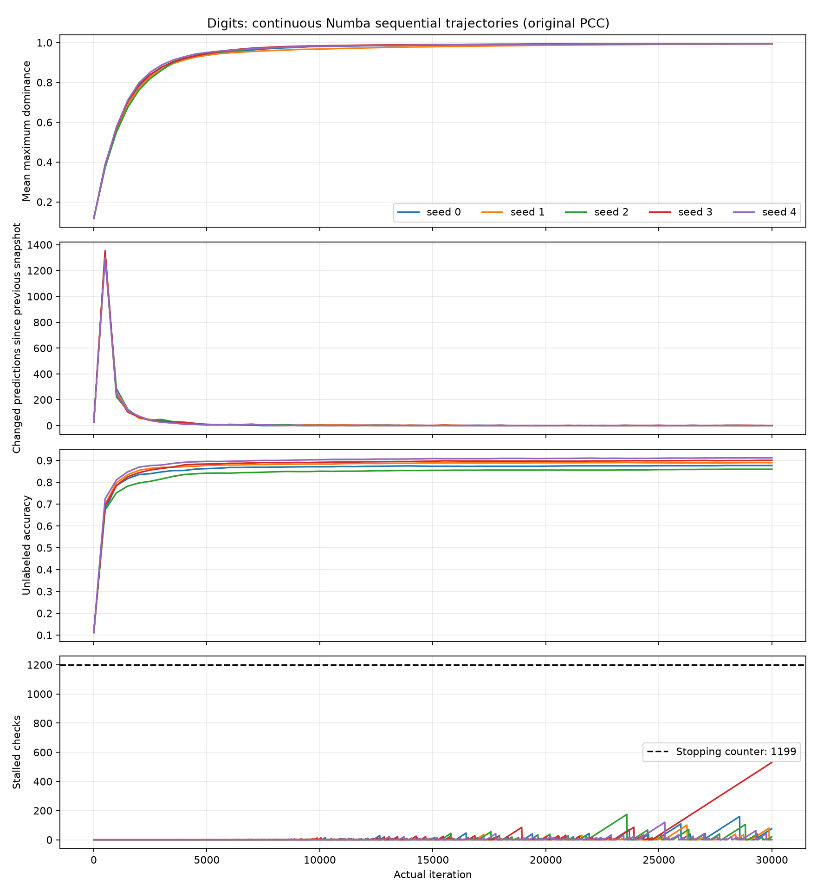
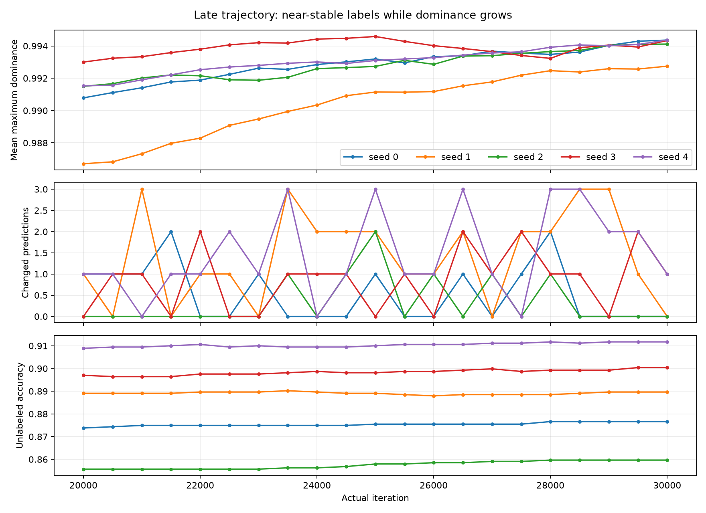
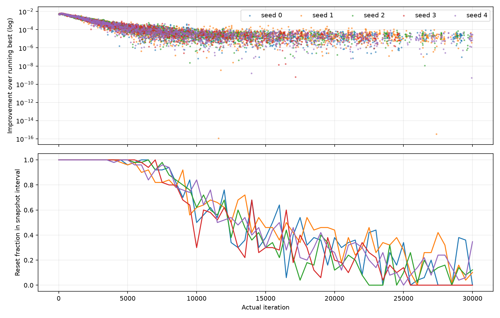

# Digits stopping diagnostic: continuous Numba sequential trajectories

## Finding

**The dominance score keeps setting new records while predicted classes are nearly stable at the sampled checkpoints.** This is observed for all five existing seeds through 30000 iterations. It explains why the original strict-improvement criterion keeps restarting its counter, without implying a PCC defect or motivating a criterion change in this PR.

All five runs reach the cap: 30000 actual iterations and 3000 original stopping checks. The longest observed non-improvement streak is only 530 checks; stopping requires 1199. The score measures average winning dominance, not changes in winning class or classification accuracy. The winning dominance can rise without changing the argmax. Those changes in dominance continue to matter to the original rule even after most predicted labels settle.

## Method and trajectory validation

No production kernel or public API is modified. The optional script calls the existing Numba propagation kernel on **one continuously mutated state**, first for one iteration and then for ten at a time, preserving particle positions, strengths, distances, dominance, own-degree, buffers and Numba thread-local RNG. Each block disables its local stopping observer; the Python diagnostic driver uses the existing compiled `_pcc_calc_mmpot_sequential` and the exact global check schedule and strict comparisons outside the unchanged kernel. Its best score and stall counter continue across every block.

The observer checks after iterations 1, 11, 21, ... exactly as the original propagation loop does. Classification snapshots are after 1, 501, 1001, ... 29501 and the final 30000. The last snapshot is not an original stopping check, so its metric is recorded for analysis without updating the stopping state. This is marked by `original_check=0`. Snapshots retain the original initial labels; accuracy evaluates only the 1767 unlabeled nodes.

For **each seed**, the script additionally executes monolithic propagation from identical initial arrays, once with `return_info=False` and once with `True`. It asserts bitwise equality of final positions, strengths, uint8 distances, dominance and own-degree, and equality of the **next Numba random value**. Counts, stalled counters and stopping reasons match the monolithic metrics. Prediction hashes reproduce the preserved 30000-iteration benchmark. These are explicit continuity/RNG checks, not independent capped runs presented as a trajectory. Independent calls are used only to validate the continuous trajectory.

Input data, graph and initial-label hashes are the same as the previous benchmark; seeds are 0-4, `k_nn=10`, three labels/class, `p_grd=0.5`, `delta_v=0.1`, `deltap=1`, `dexp=2`, `es_chk=2000`, `early_stop=True`, `stop_max=1198`. The 44 existing tests also passed again in Windows `pypcc-dev` with native Cython.

## Late-trajectory measurements

The late window is **after iteration 20001 through 30000**, with 20 classification intervals per seed (nineteen 500-iteration intervals and one 499-iteration final interval). Changes count different predicted labels between interval endpoints; intermediate flips that reverse before the next snapshot are not counted. Accuracy and net score gains also compare endpoints. Record-improvement statistics include every original stopping check within the late window.

| Seed | Total record resets | Longest stalled streak | Late resets | Zero-change intervals / 20 | Mean / max label changes | Net late score gain | Median positive record gain | Final unlabeled accuracy (%) |
|---|---:|---:|---:|---:|---:|---:|---:|---:|
| 0 | 1545 | 160 | 187 | 12 | 0.50 / 2 | 0.003578 | 1.703e-05 | 87.663 |
| 1 | 1664 | 101 | 241 | 5 | 1.45 / 3 | 0.006042 | 1.679e-05 | 88.964 |
| 2 | 1432 | 174 | 116 | 14 | 0.35 / 2 | 0.002614 | 1.974e-05 | 85.965 |
| 3 | 1357 | 530 | 88 | 6 | 0.90 / 2 | 0.001334 | 1.458e-05 | 90.040 |
| 4 | 1533 | 120 | 172 | 3 | 1.50 / 3 | 0.002843 | 1.277e-05 | 91.171 |

Across the 100 late intervals, 40 have no net label changes; the others change at most three nodes, less than 0.17% of unlabeled nodes. There are 804 record resets in this window. Of the 40 zero-change intervals, 31 still contain record resets. Zero endpoint changes therefore coexist with repeated score improvements: label stability and dominance stationarity measure different behavior.

Late median record gains are approximately `1.28e-5` to `1.97e-5`. These are predominantly substantive floating-point changes in dominance, rather than differences at machine precision. Seed 1 also contains one late strict improvement of `3.33e-16`; it correctly triggers a reset under the original comparison. Only one of the 804 late improvements is below `1e-12`, a descriptive reporting cutoff, **not a stopping tolerance**. This example demonstrates numerical sensitivity, but does not explain the majority of resets. It is not evidence that replacing the strict comparison would preserve the original dynamics or be an appropriate fix.

The first checkpoint is counted as a reset because it improves the initial running maximum of zero. Total reset counts include it; late-window counts do not. A reset compares against the running **best** score, not merely the preceding score. CSVs separately report `best_improvement` and `delta_from_previous_check` to avoid conflating them.

## Plots







The first plot shows the rapid early rise and slow tail, and the stall counter remaining below 1199. The late plot expands the score scale while label changes stay small. The log-scale plot shows the magnitudes of positive record improvements; reset frequency is resets divided by original checks within each snapshot interval. No tolerance is applied to this frequency.

## Performance and limitations

Observation is outside the compiled particle loop. Metric scans are the same compiled reduction as the original criterion, at the same frequency, plus a final off-schedule score for reporting. Prediction/accuracy scans occur only at spaced checkpoints. Python dispatch, CSV-row collection and snapshot scans add wall time; there are no compiled-loop callbacks or per-particle logging. No new Numba signatures appear during recorded diagnostics; compilation and warmup are excluded.

In this run the diagnostic/monolithic time ratio ranged from 1.14 to 1.28 (mean 1.22). The diagnostic runs are short and subject to timing noise; these are overhead measurements, not replacement benchmark timings or rigorous repeated performance estimates. Per-seed diagnostic and monolithic times are in `summary.csv`. Plotting, CSV writing, initialization and verification calls are outside the diagnostic timer.

Near-stable endpoint classifications do not prove that each node remains unchanged between snapshots, that predictions are exactly converged, or that further iterations cannot improve accuracy. Dominance is also not a calibrated confidence estimate. The five runs document the original metric's behavior for these cases, not a universal property of PCC. The existing criterion is a record-plateau criterion; it does not directly test stability of classifications.

No per-node attribution of dominance changes was collected, so the diagnostics establish the coexistence of score improvement and label stability without pinpointing which particle updates cause each record. No algorithm, tolerance, stop threshold, NumPy synchronous variant or previous results were changed. Any alternative stopping criterion would be a separately approved change, not a correction implemented here.

## Reproduction and artifacts

Run from the repository root on Windows `pypcc-dev`, with the existing native Cython extension available (the diagnostic uses Numba only). Matplotlib 3.11.2 was added to this environment for standalone PNG/SVG plots; NumPy and Numba versions remain unchanged. No other Conda environment was modified.

```powershell
& 'C:\Users\fbrev\miniforge3\Scripts\conda.exe' run -n pypcc-dev --no-capture-output python docs/diagnose_digits_stopping.py --output-dir docs/benchmarks/digits_stopping_diagnostic_reproduction
```

Run without Python `-O`, which disables validation assertions. A separate output directory preserves the committed CSVs/figures. `--iterations` defaults to 30000 and `--spacing` to 500; spacing must be divisible by ten.

- [Reproducible script](../../diagnose_digits_stopping.py)
- [All 15000 stopping checks](checks.csv): score, delta, best, record gain, reset, counters.
- [305 spaced classification snapshots](snapshots.csv): changed labels, accuracy, score and interval reset frequency.
- [Per-seed summary and continuity validation](summary.csv)
- [Environment and protocol](protocol.json)
- [Previous convergence report](../backend_convergence.md)
- Vector figures: [full trajectories](trajectories.svg), [late trajectories](late_trajectories.svg), [improvements](improvements.svg).
