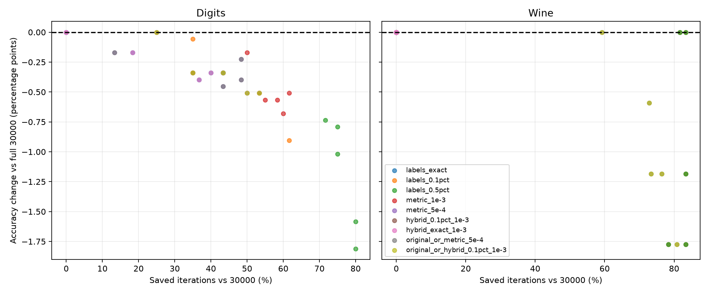

# Exploratory stopping candidates: Digits and Wine

## Scope and evidence

No candidate is implemented in the API or production kernels. This is an exploratory, Numba-sequential-only analysis of stopping rules that can be evaluated without changing particle updates. True labels and accuracy are used only for reporting; no candidate consumes them.

**Digits is retrospective:** the five existing, verified continuous trajectories are reused unchanged. They already reach 30000 iterations under the original criterion. No new Digits propagation was executed.

**Wine required new reference experiments:** previous benchmark runs terminate under the original criterion and contain no intermediate classifications. Five new continuously advanced trajectories use the same data, graph, initial labels, parameters and seeds 0-4, with observation outside unchanged kernels. They continue to 30000 iterations, equivalent to the existing API with `early_stop=False`. This uninterrupted reference allows accuracy comparisons to an actual full 30000-step run rather than mislabeling an earlier original stop as a full run. The original criterion is also observed in shadow; after its first trigger, its counters are hypothetical continuation statistics, not an actual original execution.

Each Wine full trajectory is validated against an uninterrupted monolithic call: final positions, strengths, uint8 distances, dominance, own-degree and the next Numba RNG output are exactly equal. The original-stop prefix is separately validated against an `early_stop=True` monolithic call, including state and RNG, and reproduces the previous Wine iteration count and prediction hash. Independent runs serve only as verification, not as substitute snapshots of a trajectory. Optional diagnostic observer defaults retain their original behavior.

The full Wine reference averages 95.976% unlabeled accuracy, versus 95.030% at the original early stops. The original stop itself therefore loses 0.947 percentage points on average relative to this uninterrupted reference; this is a comparison baseline, not a bug claim or authorization to change PCC.

## Candidate definitions

All candidates use full **500-iteration windows**, three consecutive qualifying windows (1500 iterations of sampled evidence), and no trigger before iteration **5001**. Windows before 5001 can contribute to patience; 5001 is the earliest eligible endpoint. The final 499-iteration interval is excluded from qualification. These parameters form a fixed exploratory grid shared across datasets, not thresholds optimized per seed.

For a classification window, `q` is the fraction of unlabeled nodes whose predicted class differs between its two endpoints. `q=0`, `q<=0.001` and `q<=0.005` are tested. In Digits (1767 unlabeled nodes) those correspond to zero, at most one, or at most eight changed labels. In Wine (169 unlabeled nodes) all three thresholds permit only zero changed labels, so their results coincide.

For scalar dominance variation, `r = max(m_t) - min(m_t)` over **all 51 original metric checks including both endpoints** of a 500-iteration window. Here `m_t` is the mean maximum node dominance calculated by the original Numba reduction, not the complete dominance matrix. Thresholds `1e-3` and `5e-4` are evaluated. The range includes oscillations that would be missed by comparing only endpoint scores. Hybrid windows require both a classification and scalar-range condition; patience applies to the conjunction over the same three windows.

Two additional combinations retain the original trigger: **original OR range<=5e-4**, and **original OR (labels<=0.1% AND range<=1e-3)**. Their estimated stop is the earlier of the original stop and the alternative sampled trigger. When the original fires first, its actual recorded accuracy is used, even if that iteration lies off the 500-step snapshot grid. The OR expression is evaluated retrospectively only.

## Comparative table

Means +/- sample SD across five seeds. Accuracy differences are paired percentage points against an uninterrupted 30000-step reference on the same seed. If a candidate never triggers, its assigned outcome is the full reference (30000, zero saving and zero accuracy difference); such fallback rows are included in the mean. `Stops` counts runs stopping before the cap, including original-trigger fallback for OR combinations. Worst loss is the most negative per-seed difference.

Savings are **iterations avoided**, an estimate of processing savings under roughly constant work per iteration. They are not measured speedups: additional candidate scans, runtime overhead and timing noise are not included. Exact stop/checkpoint and per-seed outcomes are retained in CSVs.

| Dataset | Candidate | Stops / 5 | Estimated iteration | Saved iterations (%) | Accuracy change (pp) | Worst change (pp) |
|---|---|---:|---:|---:|---:|---:|
| Digits | Labels unchanged | 3 | 24300.6 +/- 5761.4 | 19.00 +/- 19.20 | -0.181 +/- 0.185 | -0.396 |
| Digits | Labels <=0.1% changes | 5 | 16301.0 +/- 3510.7 | 45.66 +/- 11.70 | -0.430 +/- 0.312 | -0.905 |
| Digits | Labels <=0.5% changes | 5 | 7101.0 +/- 1084.0 | 76.33 +/- 3.61 | -1.188 +/- 0.484 | -1.811 |
| Digits | Scalar range <=1e-3 | 5 | 12901.0 +/- 1387.4 | 57.00 +/- 4.62 | -0.498 +/- 0.194 | -0.679 |
| Digits | Scalar range <=5e-4 | 5 | 18201.0 +/- 4424.4 | 39.33 +/- 14.75 | -0.317 +/- 0.117 | -0.453 |
| Digits | Labels <=0.1% AND range <=1e-3 | 5 | 17601.0 +/- 3453.3 | 41.33 +/- 11.51 | -0.340 +/- 0.208 | -0.509 |
| Digits | Labels unchanged AND range <=1e-3 | 3 | 24300.6 +/- 5761.4 | 19.00 +/- 19.20 | -0.181 +/- 0.185 | -0.396 |
| Digits | Original OR range <=5e-4 | 5 | 18201.0 +/- 4424.4 | 39.33 +/- 14.75 | -0.317 +/- 0.117 | -0.453 |
| Digits | Original OR hybrid <=0.1% / 1e-3 | 5 | 17601.0 +/- 3453.3 | 41.33 +/- 11.51 | -0.340 +/- 0.208 | -0.509 |
| Wine | Labels unchanged | 5 | 5401.0 +/- 651.9 | 82.00 +/- 2.17 | -0.947 +/- 0.897 | -1.775 |
| Wine | Labels <=0.1% changes | 5 | 5401.0 +/- 651.9 | 82.00 +/- 2.17 | -0.947 +/- 0.897 | -1.775 |
| Wine | Labels <=0.5% changes | 5 | 5401.0 +/- 651.9 | 82.00 +/- 2.17 | -0.947 +/- 0.897 | -1.775 |
| Wine | Scalar range <=1e-3 | 0 | 30000.0 +/- 0.0 | 0.00 +/- 0.00 | +0.000 +/- 0.000 | +0.000 |
| Wine | Scalar range <=5e-4 | 0 | 30000.0 +/- 0.0 | 0.00 +/- 0.00 | +0.000 +/- 0.000 | +0.000 |
| Wine | Labels <=0.1% AND range <=1e-3 | 0 | 30000.0 +/- 0.0 | 0.00 +/- 0.00 | +0.000 +/- 0.000 | +0.000 |
| Wine | Labels unchanged AND range <=1e-3 | 0 | 30000.0 +/- 0.0 | 0.00 +/- 0.00 | +0.000 +/- 0.000 | +0.000 |
| Wine | Original OR range <=5e-4 | 5 | 8239.0 +/- 2419.1 | 72.54 +/- 8.06 | -0.947 +/- 0.675 | -1.775 |
| Wine | Original OR hybrid <=0.1% / 1e-3 | 5 | 8239.0 +/- 2419.1 | 72.54 +/- 8.06 | -0.947 +/- 0.675 | -1.775 |

The original criterion stops Digits 0/5 times (30000 iterations, 0% saving) and Wine 5/5 times (8239 +/- 2419 iterations, 72.54% saving against the uninterrupted reference). No alternative eliminates the processing/accuracy tradeoff on Digits.

## Wine safeguard and interpretation

Classification-only candidates stop Wine at 5401 +/- 652 iterations, 2838 iterations earlier on average than its original stop. Their mean accuracy equals the original stopped accuracy, but that average hides per-seed changes: the worst loss versus original is **0.592 pp**, and their worst loss versus full 30000 is **1.775 pp**. Zero endpoint changes over three intervals do not make such a stop universally safe.

Pure scalar-range and hybrid candidates do **not** trigger on Wine by 30000. They would discard the original processing savings despite retaining full-reference accuracy. Late 500-step scalar ranges have median approximately **0.00394** in Wine versus **0.000280** in Digits. The original rule detects lack of new records, whereas these alternatives test absolute fluctuation: the score can fluctuate below its record and still satisfy the original plateau test. Those are different notions of stationarity, so an absolute threshold does not transfer automatically between datasets.

The two original-OR combinations reproduce the original Wine stopping iterations and accuracy for every recorded seed: no additional saving or accuracy change versus original. The -0.947 pp mean against full 30000 reflects the original criterion's own baseline difference. This is an observed safeguard for these five cases, not a guarantee for unseen cases where an alternative could fire before original.

## Most promising candidates for further study

1. **Original OR scalar range<=5e-4:** Digits saves **39.33%** of iterations with mean loss **0.317 pp** and worst loss **0.453 pp**; Wine is preserved relative to the original stop in all five seeds. It can reuse the scalar metric already checked by PCC and needs no predicted-label comparison. It is the simplest promising candidate in this exploratory grid.
2. **Original OR hybrid (labels<=0.1%, range<=1e-3):** Digits saves **41.33%** with mean loss **0.340 pp** and worst loss **0.509 pp**; it also preserves the observed original Wine outcomes. It explicitly connects the stopping evidence to sampled classification stability, but requires storing/comparing predictions and remains vulnerable to unseen between-snapshot flips.

The metric-only candidate slightly favors accuracy and the hybrid slightly favors iteration savings in these cases; five seeds do not establish statistical superiority. Classification tolerance 0.5% is aggressive (76.33% Digits saving, 1.188 pp mean loss, 1.811 pp worst loss). Exact classification stability is conservative but stops only 3/5 Digits runs. Replacing the original rule with scalar-range or hybrid alone is not recommended: neither fires on Wine here.

The grid was evaluated after these datasets were already inspected; there is no independent holdout for criterion selection. Before choosing an implementation, the maintainer would need an acceptable accuracy-loss budget, independent validation seeds/datasets, and a decision about retaining the original criterion as an OR branch. No such implementation is included.

## What the existing observations support

| Proposed evidence | Available now? | Scope and missing information |
|---|---|---|
| Endpoint classification changes every 500 iterations | Yes, Digits retrospectively; Wine from new reference runs | Does not count intermediate flips or prove stability throughout a window |
| Original scalar metric range, record gains or tolerance-based plateau every 10 iterations | Yes, from check CSVs | Measures an aggregate; positive and negative per-node changes can cancel |
| Exact candidate accuracy at a recorded trigger endpoint | Yes | Accuracy at unrecorded candidate times is unavailable; no interpolation is used |
| OR with original stop | Yes | Uses recorded original trigger count/accuracy; no hypothetical accuracy interpolation |
| Predicted-class stability at every original check | No | Needs new trajectory observations of labels every ten iterations |
| Exact no-change guarantee for all particle iterations | No | Needs classification observations after every iteration or a validated flip counter; spaced endpoints cannot prove it |
| Full dominance-matrix norm/range, per-node variation or margins | No | Requires additional state observations/reductions; scalar histories cannot reconstruct them |
| Practical wall-time speedup of candidate implementations | No | Needs separately authorized implementation/prototype and timing including observation cost |
| Generalization across backends and unseen datasets/seeds | No | This study uses Numba and the five existing seeds only |

More frequent snapshots or full-matrix reductions can in principle be gathered outside the unchanged kernels with the validated continuous-block technique, but incur extra dispatch and scanning. No such fine-grained experiment is claimed here. Recording every iteration efficiently may require separately proposed optional instrumentation; that instrumentation and its validation would need review before any kernel changes. Stored endpoint changes are never treated as evidence that classifications remained unchanged for the entire interval.

## Retrospective versus new executions

- Digits: existing check and snapshot CSVs are read only; candidate stop times, savings and accuracy differences are retrospective estimates.
- Wine: five **new uninterrupted** 30000-step reference trajectories plus monolithic full/prefix verification calls were required to obtain snapshots and full-run accuracy. Candidate evaluation is then retrospective on these new trajectories. No execution was stopped by an alternative criterion.
- Unexecuted studies: finer classification sampling, full dominance-matrix variation, other backends, new seeds, independent threshold selection and actual candidate runtime benchmarks.

## Reproduction and artifacts

Run from the repository root in Windows `pypcc-dev`, with native Cython available and Matplotlib installed as for the prior diagnostic. Do not use Python `-O`, which disables continuity checks. Existing Digits inputs are SHA-256 fingerprinted; Wine inputs and protocol metadata are recorded separately. All earlier benchmark and diagnostic CSVs/figures remain unchanged.

```powershell
& 'C:\Users\fbrev\miniforge3\Scripts\conda.exe' run -n pypcc-dev --no-capture-output python docs/evaluate_stopping_candidates.py --output-dir docs/benchmarks/stopping_candidates_reproduction
```

`--reuse-wine` evaluates already saved Wine inputs in the chosen output directory without new propagation. The 44 regression tests passed again across NumPy, Numba and native Cython. The experiment's internal assertions additionally verify every Wine full trajectory and original-stop prefix against monolithic state/RNG and previous prediction hashes.

- [Reproducible script](../../evaluate_stopping_candidates.py)
- [Individual candidate outcomes](candidate_runs.csv)
- [Candidate summary](candidate_summary.csv)
- [All evaluated scalar/classification windows](windows.csv)
- [New Wine original metric checks](wine_checks.csv)
- [New Wine classification snapshots](wine_snapshots.csv)
- [Wine reference and verification](wine_summary.csv)
- [Protocol and input hashes](protocol.json)



No API, production kernel, PCC update rule or default stopping behavior was changed. The PR remains a draft and the previous results remain references.
