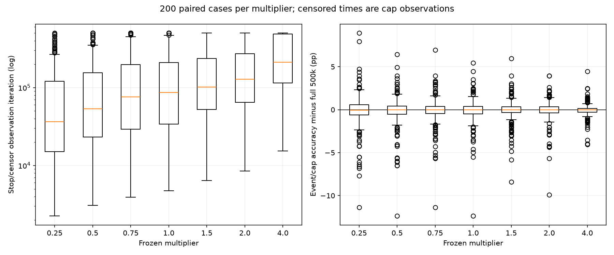
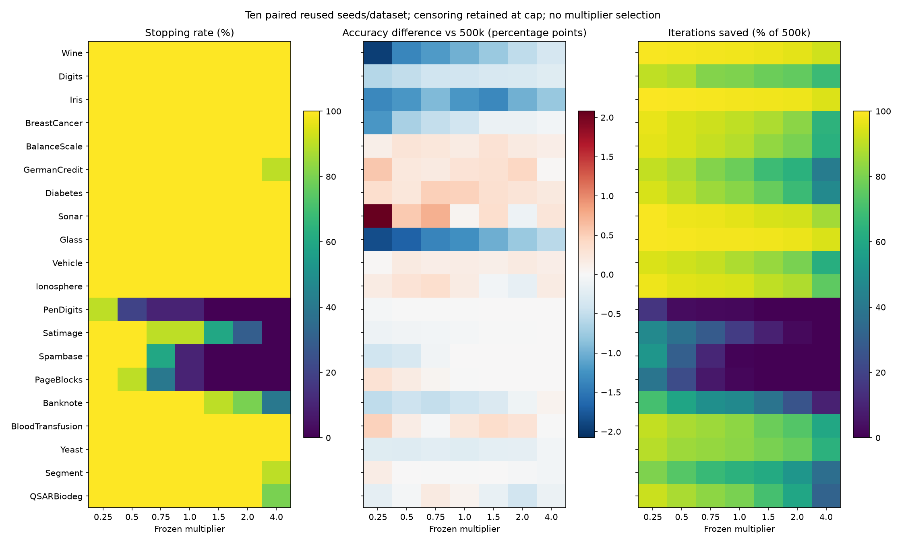
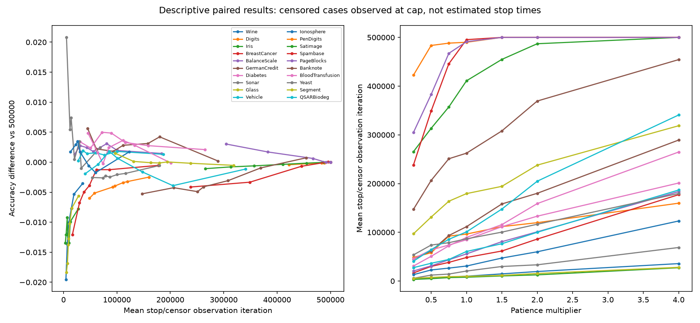
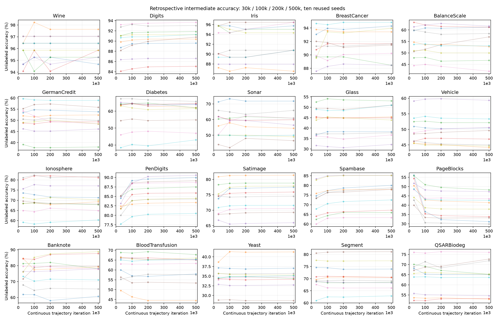

# Full PCC stopping-patience study: paired retrospective results

**Phase 2 completed: 200 continuous logical trajectories, 20 frozen datasets, seeds 10–19, each exactly 500,000 iterations. PR remains draft.**

[Explicit authorization](https://github.com/fbreve/pypcc/pull/8#issuecomment-6115498944). The [phase-1 feasibility report](report.md), inventory, protocol and pilot results are preserved. No production kernel, public API, graph construction, labeling, stopping default or multiplier was changed. Seeds were examined previously and are not independent validation. No dataset was replaced or subsampled, and no best multiplier was selected per dataset.

## Overall paired outcomes

The full-budget reference accuracy, averaged with equal dataset weights, is **66.910%**. The table below includes all 200 cases per multiplier. Censored cases contribute their cap observation, not an invented stopping time; their accuracy is the full-budget reference. Accuracy difference is event/cap minus full 500k, in percentage points (pp). Iteration savings are retrospective and **not measured wall-clock speedups**.

| Multiplier | Stopped / censored | Mean observation iteration | Median | Iterations saved (%) | Mean accuracy (%) | Paired accuracy difference mean ± SD (pp) | Difference range (pp) | Worse / same / better cases |
|---:|---:|---:|---:|---:|---:|---:|---:|---:|
| 0.25 | 199 / 1 | 91,815 | 36,321 | 81.64 | 66.698 | -0.212 ± 2.176 | -11.39 .. +8.91 | 104 / 15 / 81 |
| 0.5 | 191 / 9 | 119,501 | 53,146 | 76.10 | 66.685 | -0.224 ± 1.914 | -12.38 .. +6.44 | 99 / 23 / 78 |
| 0.75 | 180 / 20 | 143,014 | 76,086 | 71.40 | 66.765 | -0.144 ± 1.697 | -11.39 .. +6.93 | 89 / 32 / 79 |
| 1 | 172 / 28 | 157,106 | 86,246 | 68.58 | 66.742 | -0.167 ± 1.643 | -12.38 .. +5.45 | 84 / 41 / 75 |
| 1.5 | 165 / 35 | 176,742 | 101,706 | 64.65 | 66.781 | -0.128 ± 1.447 | -8.42 .. +5.94 | 78 / 55 / 67 |
| 2 | 161 / 39 | 196,768 | 128,056 | 60.65 | 66.792 | -0.117 ± 1.363 | -9.90 .. +3.96 | 74 / 56 / 70 |
| 4 | 150 / 50 | 251,958 | 212,201 | 49.61 | 66.848 | -0.062 ± 0.868 | -4.06 .. +4.46 | 74 / 70 / 56 |

Each dataset has ten trajectories, so the 200 equally weighted rows also give each dataset equal weight. This table describes the trajectory distribution (sample SD); [overall_equal_dataset_summary.csv](overall_equal_dataset_summary.csv) separately describes the distribution of the 20 dataset means. Neither SD is an uncertainty interval from independent validation. Mean/median/SD/min/max and stop/censor rates are retained in CSV.



## Dataset outcomes at original patience (1.0)

Unknown-node micro accuracy is evaluated only retrospectively. Correct-node difference is reported separately from accuracy difference; its scale depends on dataset size. Positive differences mean the hypothetical stopped prediction was better than the later 500k prediction, not that later propagation improved.

| Dataset | Original stopped / censored | Mean stop/cap iteration | Full 500k accuracy mean ± SD (%) | Original event/cap accuracy (%) | Paired difference mean ± SD (pp) | Correct-node difference mean [min, max] | Observed trajectory time mean ± SD (s) |
|---|---:|---:|---:|---:|---:|---:|---:|
| Wine | 10 / 0 | 9,844 | 96.15 ± 0.94 | 95.15 | -1.006 ± 1.451 | -1.7 [-6, +1] | 1.341 ± 0.167 |
| Digits | 10 / 0 | 96,318 | 90.35 ± 2.69 | 89.95 | -0.396 ± 0.562 | -7.0 [-33, +4] | 3.011 ± 0.172 |
| Iris | 10 / 0 | 7,841 | 92.48 ± 3.60 | 91.28 | -1.206 ± 1.922 | -1.7 [-7, +1] | 1.399 ± 0.030 |
| BreastCancer | 10 / 0 | 48,268 | 91.85 ± 2.31 | 91.46 | -0.391 ± 1.493 | -2.2 [-20, +10] | 1.369 ± 0.008 |
| BalanceScale | 10 / 0 | 55,737 | 54.42 ± 6.70 | 54.59 | +0.179 ± 2.280 | +1.1 [-34, +15] | 1.515 ± 0.019 |
| GermanCredit | 10 / 0 | 111,553 | 50.11 ± 5.76 | 50.39 | +0.282 ± 1.416 | +2.8 [-12, +35] | 1.454 ± 0.026 |
| Diabetes | 10 / 0 | 89,500 | 58.90 ± 7.95 | 59.38 | +0.486 ± 1.515 | +3.7 [-19, +23] | 1.405 ± 0.021 |
| Sonar | 10 / 0 | 20,504 | 57.57 ± 7.90 | 57.62 | +0.050 ± 4.903 | +0.1 [-25, +11] | 1.287 ± 0.013 |
| Glass | 10 / 0 | 9,560 | 43.42 ± 7.03 | 42.14 | -1.276 ± 1.913 | -2.5 [-9, +4] | 1.885 ± 0.042 |
| Vehicle | 10 / 0 | 60,664 | 49.62 ± 4.73 | 49.77 | +0.156 ± 0.848 | +1.3 [-14, +10] | 1.745 ± 0.018 |
| Ionosphere | 10 / 0 | 30,767 | 71.19 ± 6.91 | 71.36 | +0.174 ± 1.347 | +0.6 [-5, +8] | 1.365 ± 0.010 |
| PenDigits | 1 / 9 | 490,050 | 86.45 ± 3.26 | 86.44 | -0.006 ± 0.020 | -0.7 [-7, +0] | 5.628 ± 0.139 |
| Satimage | 9 / 1 | 410,930 | 74.34 ± 4.85 | 74.30 | -0.036 ± 0.056 | -2.3 [-10, +1] | 4.139 ± 0.201 |
| Spambase | 1 / 9 | 495,375 | 75.39 ± 7.81 | 75.39 | +0.004 ± 0.014 | +0.2 [+0, +2] | 1.983 ± 0.026 |
| PageBlocks | 1 / 9 | 491,254 | 38.90 ± 6.66 | 38.90 | -0.002 ± 0.006 | -0.1 [-1, +0] | 1.691 ± 0.511 |
| Banknote | 10 / 0 | 262,386 | 76.62 ± 8.85 | 76.21 | -0.410 ± 1.173 | -5.6 [-33, +21] | 0.809 ± 0.072 |
| BloodTransfusion | 10 / 0 | 84,722 | 60.62 ± 7.32 | 60.86 | +0.243 ± 1.192 | +1.8 [-13, +16] | 1.215 ± 0.291 |
| Yeast | 10 / 0 | 86,570 | 34.92 ± 3.17 | 34.67 | -0.248 ± 0.707 | -3.6 [-31, +5] | 2.829 ± 0.208 |
| Segment | 10 / 0 | 179,415 | 70.85 ± 5.35 | 70.84 | -0.013 ± 0.251 | -0.3 [-9, +10] | 2.804 ± 0.164 |
| QSARBiodeg | 10 / 0 | 100,855 | 64.06 ± 8.26 | 64.13 | +0.067 ± 1.796 | +0.7 [-39, +32] | 0.748 ± 0.006 |

All seven multipliers per dataset/seed are in [individual.csv](individual.csv), [dataset_summary.csv](dataset_summary.csv) and the heatmap below. Do not interpret cap times as uncensored stop-time estimates. The mathematically unavoidable Spambase 4.0 censoring is retained in all ten seeds.





## Records, long patience and subsequent changes

Checks exactly reproduce the original serial mean-maximum-dominance reduction and phase 1, 11, 21, …; strict improvements reset the counter, and eligibility requires counter > threshold. Larger multipliers delay the first eligible event or censor it. All multipliers share one continuous trajectory; their hypothetical stops never affect propagation. The full reference is always 500k, even after every predicate fires.

| Dataset | Required original stalled checks | Mean total record resets | Mean records after 30k | Mean last record iteration | Mean longest stalled run (checks) | Mean sampled nodes changing after original stop | Mean sampled nodes returning to stop label |
|---|---:|---:|---:|---:|---:|---:|---:|
| Wine | 397 | 148.3 | 3.9 | 245,806 | 31,498 | 7.9 | 7.2 |
| Digits | 1199 | 1970.4 | 350.3 | 343,883 | 20,148 | 12.1 | 2.6 |
| Iris | 334 | 118.0 | 3.2 | 291,757 | 30,503 | 7.6 | 6.1 |
| BreastCancer | 1898 | 416.6 | 12.0 | 341,144 | 26,854 | 43.3 | 41.9 |
| BalanceScale | 1390 | 616.4 | 37.5 | 319,347 | 23,414 | 55.6 | 39.6 |
| GermanCredit | 3334 | 713.6 | 42.3 | 410,924 | 26,307 | 233.1 | 222.1 |
| Diabetes | 2561 | 601.8 | 35.8 | 283,765 | 26,377 | 108.4 | 99.5 |
| Sonar | 694 | 158.3 | 6.1 | 235,237 | 32,319 | 52.2 | 49.1 |
| Glass | 239 | 257.8 | 8.7 | 370,625 | 23,827 | 24.1 | 3.6 |
| Vehicle | 1411 | 934.3 | 63.9 | 382,235 | 21,166 | 45.9 | 24.9 |
| Ionosphere | 1171 | 301.9 | 9.1 | 324,609 | 24,660 | 39.6 | 39.1 |
| PenDigits | 7329 | 14715.4 | 11717.5 | 489,967 | 3,066 | 16.0 | 3.0 |
| Satimage | 7145 | 7322.3 | 4362.9 | 439,316 | 12,009 | 11.9 | 5.1 |
| Spambase | 15338 | 3741.9 | 1297.7 | 402,439 | 13,036 | 85.0 | 56.0 |
| PageBlocks | 7298 | 9947.3 | 7015.4 | 469,394 | 5,500 | 32.0 | 18.0 |
| Banknote | 4574 | 1882.7 | 693.2 | 415,570 | 16,596 | 39.2 | 31.1 |
| BloodTransfusion | 2494 | 789.2 | 82.0 | 283,895 | 24,728 | 58.1 | 52.2 |
| Yeast | 990 | 2338.9 | 475.1 | 401,257 | 15,809 | 45.9 | 6.9 |
| Segment | 2201 | 3562.2 | 1190.8 | 421,306 | 15,420 | 22.0 | 7.2 |
| QSARBiodeg | 3518 | 932.0 | 63.9 | 316,478 | 25,736 | 125.5 | 110.9 |

Among the 172 observed original stops, **172 cases have subsequently changing nodes at sampled observations**, and **168 cases have sampled returns to the stop-label prediction**. Endpoint classification differences and full-matrix dominance norms are retained separately in individual.csv. A return demonstrates instability at observed times; zero endpoint changes or zero sampled changes do not establish interval-wide stability.

The record log is exact at every original check; classification sampling is every 1000 iterations plus exact events and reference points. Thus small record improvements can be described without claiming that no classification changed between checks. [record_diagnostics.csv](record_diagnostics.csv) separates record frequency/magnitude from available uninterrupted stalled-check runs. Its <=1e-12 gain category is descriptive only and is never a stopping tolerance. Late records, long required runs and graph/label structure are distinct explanations, not interchangeable labels for slow stopping.



## Structure and descriptive strata

The fixed formula is approximately T = 20 / labeled_fraction at k=10 and es_chk=2000, before integer rounding. Therefore associations between patience and labeled fraction partly follow algebraically from the protocol rather than from learned convergence. Size, class count, dimensionality, imbalance and connected components vary together; this study does not isolate causal effects. [stratum_equal_dataset_summary.csv](stratum_equal_dataset_summary.csv) reports binary/multiclass, fixed size groups and labeled-fraction groups with equal dataset weights. Small groups and heterogeneous datasets limit generalization.

## Actual cost and execution incidents

Summed recorded trajectory wall time including dominance observation, prediction checkpoints, CSV and recovery writes: **396.23 s (6.60 min)**. Checkpoint-write time accounts for 34.07 s. These are measured full trajectories, not iteration-based speedup estimates. Per-case timings are in [trajectory_times.csv](trajectory_times.csv); SD reflects seeds/execution conditions, not replicated timing of each seed.

Two commands were interrupted by transient Windows WinError 5 during atomic checkpoint replacement, after 14 and 85 completed cases. The unmodified resumable workflow retained completed cases and exact saved states. An optional I/O-only launcher then added bounded retries (40 attempts, 50ms delay) around checkpoint writes. The final invocation reused 85 cases and finished in **407.14 s**, including setup, verification and plot generation; 4 retry episodes were resolved. The preceding resumed command took 160.86 s before interruption. Initial-attempt total command wall time was not instrumented, so these command times are not a complete end-to-end total. Downtime/lost work after the last checkpoint and the last saved checkpoint I/O timing can be omitted by recovery; no scientific trajectory is reconstructed from independent restarted prefixes.

Largest sampled process high-water mark: 266.1 MiB ([phase2_process_samples.csv](phase2_process_samples.csv)); sampling does not guarantee capture of the final post-plot process peak. Check logs occupy 407.4 MiB uncompressed and **114.2 MiB** as deterministic lossless CSV gzip archives. [archive_manifest.csv](archive_manifest.csv) records raw/compressed sizes and SHA-256 checksums. Raw CSVs and trusted local recovery pickles remain available locally and are ignored by git; compressed CSVs, sample CSVs and complete JSON are archived. Phase-1 feasibility artifacts were not regenerated.

## Correctness and reproducibility

All **100,000,000 executed iterations** and **10,000,000 checks** are accounted for. Independent streaming replay of every recorded check verified strict records, resets, check phase, all seven first events and censoring. Accuracy/count identities and iteration savings were checked in all 1400 result rows. There are **572 successful unchanged-monolithic state/RNG comparisons**, including 30k and 500k for every case and **172 original first-stop comparisons**. See [full_verification.csv](full_verification.csv). Exact state comparisons use no floating tolerance; this is within the same sequential Numba implementation, not an equality demand across backends.

All 200 final checkpoints passed finite/bounded dominance and strength checks, dominance conservation, preservation of labeled nodes, valid positions, uint8 distances/home distances, finite own-degree and saved final-state/RNG identity checks. Maximum dominance-row sum error was 4.34e-13 ([final_invariants.csv](final_invariants.csv)); a 1e-9 invariant-validation tolerance does not alter stopping or propagation.

Environment, observer source versions and approved-protocol hashes are in [full_metadata.json](full_metadata.json). Sources/versions and data/graph/all labeling fingerprints remain in inventory.json. Recovery uses the version-locked private Numba MT API; wrapper retries never draw numbers or mutate state. Deterministic fault injection verifies retry state/RNG/CSV equivalence and bounded failures. The original propagation kernels and public API remain unchanged.

Reproduce/resume on Windows pypcc-dev:

```powershell
conda run -n pypcc-dev python docs/run_stopping_patience_windows.py --full
conda run -n pypcc-dev python docs/report_stopping_patience.py
```

The launcher invokes the existing study_stopping_patience.py --full workflow with only checkpoint I/O retry handling; matching completed cases are skipped. Summaries/figures can be regenerated from completed cases. The postprocessor verifies gzip round trips and checks all raw data before archiving. No long experiment is required by CI. Local/CI regression results are recorded in the PR validation update.

## Observations, hypotheses and limitations

**Observations:** stopping/censor rates, paired accuracy losses/gains, subsequent sampled reversions and dominance endpoint differences are reported separately. Patience changes first-event timing monotonically on the shared trajectory; accuracy is not guaranteed to improve monotonically with more iterations. Forced Spambase 4.0 censoring is a budget/formula consequence.

**Hypotheses to discuss:** datasets with frequent late records may repeatedly restart patience even when sampled classifications change little; large thresholds can delay eligibility even after the last record. Neither dominance records nor larger patience by themselves establish meaningful accuracy progress. Descriptive group associations cannot establish graph/label causes.

**Limitations:** reused seeds, 20 heterogeneous related tasks (Digits/PenDigits share a handwriting domain), only three labels/class, one fixed parameter/graph protocol, cap censoring and sparse classification sampling. Full-matrix norms describe event-to-final endpoint differences, not total motion. Truth is never used for stopping; the 500k result is a reference, not an optimum or ground-truth convergence guarantee. Operational timing includes I/O and recovery incidents but excludes verification from trajectory timing.

**No new default or tuned criterion is proposed.** Review the fixed-grid sensitivity and dataset-specific variation before deciding on another experiment. PR #8 remains draft and master is unchanged.
