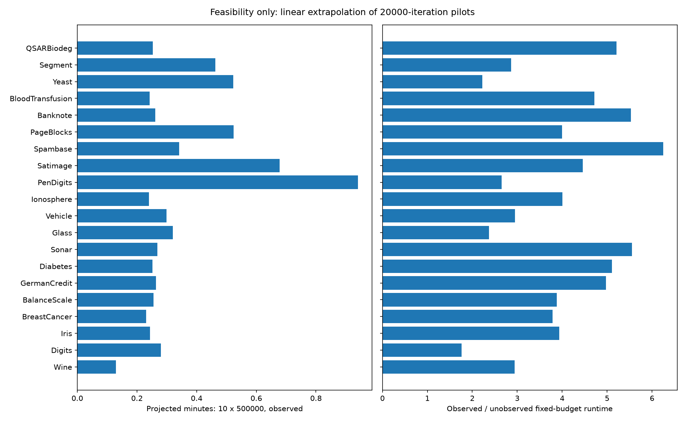

# PCC patience study: frozen protocol and feasibility gate

**Status: phase 1 only. No 500,000-iteration trajectories have started. The 200-trajectory study requires explicit maintainer approval.**

This draft delivers the inventory, protocol, pilot measurements and reusable experimental infrastructure. Dataset-level stopping/accuracy summaries, tradeoff figures and the final research interpretation will follow only after the approved full run. Production kernels, public API, default stopping rule, master and previously committed results are unchanged.

## Frozen inventory and provenance

The inventory/protocol was committed as `ce9860b` before any stopping pilot. Selection covers public real classification problems in medicine, chemistry, credit, astronomy/radio signals, images, pen strokes, documents and protein localization. OpenML IDs and versions are pinned; downloads are checked against source MD5 and archived SHA-256 fingerprints. scikit-learn versions and raw/processed array hashes are recorded. No dataset was replaced after observing outcomes; no rows were subsampled or removed.

Sources: [OpenML dataset access](https://docs.openml.org/data/use/), [OpenML REST API](https://docs.openml.org/ecosystem/Rest/), and the individual dataset links below. The private local `.cache/stopping_patience` directory holds downloads and shared graph arrays; raw datasets and recovery pickles are not committed.

| Dataset / source | Nodes | Features after preprocessing | Classes | Largest/smallest class | Labeled % | Components | Original threshold |
|---|---:|---:|---:|---:|---:|---:|---:|
| [Wine](https://scikit-learn.org/stable/modules/generated/sklearn.datasets.load_wine.html) | 178 | 13 | 3 | 1.48 | 5.056 | 1 | 396 |
| [Digits](https://scikit-learn.org/stable/modules/generated/sklearn.datasets.load_digits.html) | 1797 | 64 | 10 | 1.05 | 1.669 | 1 | 1198 |
| [Iris](https://scikit-learn.org/stable/modules/generated/sklearn.datasets.load_iris.html) | 150 | 4 | 3 | 1.00 | 6.000 | 1 | 333 |
| [BreastCancer](https://scikit-learn.org/stable/modules/generated/sklearn.datasets.load_breast_cancer.html) | 569 | 30 | 2 | 1.68 | 1.054 | 1 | 1897 |
| [BalanceScale](https://www.openml.org/d/11) | 625 | 4 | 3 | 5.88 | 1.440 | 1 | 1389 |
| [GermanCredit](https://www.openml.org/d/31) | 1000 | 61 | 2 | 2.33 | 0.600 | 1 | 3333 |
| [Diabetes](https://www.openml.org/d/37) | 768 | 8 | 2 | 1.87 | 0.781 | 1 | 2560 |
| [Sonar](https://www.openml.org/d/40) | 208 | 60 | 2 | 1.14 | 2.885 | 1 | 693 |
| [Glass](https://www.openml.org/d/41) | 214 | 9 | 6 | 8.44 | 8.411 | 1 | 238 |
| [Vehicle](https://www.openml.org/d/54) | 846 | 18 | 4 | 1.10 | 1.418 | 1 | 1410 |
| [Ionosphere](https://www.openml.org/d/59) | 351 | 34 | 2 | 1.79 | 1.709 | 1 | 1170 |
| [PenDigits](https://www.openml.org/d/32) | 10992 | 16 | 10 | 1.08 | 0.273 | 2 | 7328 |
| [Satimage](https://www.openml.org/d/182) | 6430 | 36 | 6 | 2.45 | 0.280 | 1 | 7144 |
| [Spambase](https://www.openml.org/d/44) | 4601 | 57 | 2 | 1.54 | 0.130 | 6 | 15337 |
| [PageBlocks](https://www.openml.org/d/30) | 5473 | 10 | 5 | 175.46 | 0.274 | 1 | 7297 |
| [Banknote](https://www.openml.org/d/1462) | 1372 | 4 | 2 | 1.25 | 0.437 | 2 | 4573 |
| [BloodTransfusion](https://www.openml.org/d/1464) | 748 | 4 | 2 | 3.20 | 0.802 | 2 | 2493 |
| [Yeast](https://www.openml.org/d/181) | 1484 | 8 | 10 | 92.60 | 2.022 | 3 | 989 |
| [Segment](https://www.openml.org/d/36) | 2310 | 19 | 7 | 1.00 | 0.909 | 1 | 2200 |
| [QSARBiodeg](https://www.openml.org/d/1494) | 1055 | 41 | 2 | 1.96 | 0.569 | 1 | 3517 |

Inventory details, class counts, original/processed features, degree distributions, graph hashes and all 200 labeling fingerprints are in [inventory.json](inventory.json) and [inventory.csv](inventory.csv). All classes have at least four members, so the frozen three-label protocol needs no exception. German Credit is fully one-hot encoded (13 nominal + 7 numeric input fields -> 61 features); numeric missing values use full-matrix medians and categorical missing values an explicit category. The loader normalizes ARFF delimiter whitespace, which SciPy otherwise treats as part of PenDigits nominal targets, without changing observations. PenDigits and Digits are related handwriting tasks, not independent data domains; this is a diversity limitation.

## Protocol and exact stopping semantics

Use the unchanged sequential Numba implementation, 10 seeds **10-19 reused from earlier studies, not independent validation**, one continuous logical trajectory/dataset/seed, 500,000 iterations and seven multipliers: 0.25, 0.5, 0.75, 1.0, 1.5, 2.0, 4.0. No multiplier is optimized separately for a dataset. The four prior datasets match PR #6/#7 processed-data and graph hashes and every seed-specific labeling hash exactly.

Standardize the full transductive feature matrix; build the original PCC graph with `k_nn=10`, `n_jobs=1`; choose three labels per encoded class with `default_rng(seed)`. Set `p_grd=0.5`, `delta_v=0.1`, `deltap=1`, `dexp=2`, `es_chk=2000`. Do not use accuracy for propagation, record resets or stopping.

For n nodes, P particles and k=10, original integer threshold T is:

```text
T = max(1, round((n / (P*k)) * round(es_chk*0.1)))
T_m = T                         if m == 1.0
T_m = max(1, round(T*m))         otherwise
```

Both rounds use Python nearest integer with ties to even. Entirely isolated graphs use T=1, matching production. The actual stop requires **T_m+1 stalled checks**, because the comparison is strictly `counter > T_m`. Clamp-to-one does not mean stopping after a single failed check.

Checks occur after effective iterations **1, 11, 21, ...**, independent of `es_chk`. Start best=0 and counter=0. A strict `metric > best` resets counter=0 and updates best; any other check increments the counter. Preserve the serial Numba reduction for mean maximum dominance. Track the first eligible event for each multiplier, never enforce it and continue even after all seven events. At 500,000, 50,000 original checks were executed; the last is at 499,991. Missing events are right-censored at 500,000.

The data-derived thresholds and minimum possible stopping iterations are frozen mathematical quantities in [patience_thresholds.csv](patience_thresholds.csv), not outcomes used to retune the grid. **Spambase at multiplier 4.0 necessarily cannot stop in the budget:** T=15,337, adjusted threshold=61,348, earliest possible stop=613,491 even with no improvement after the first check. All other dataset/multiplier combinations have a theoretical earliest stop within the cap; this does not guarantee stopping.

At exact events save unknown-node accuracy, correct-node counts, reset/check counts, mean maximum dominance and a bounded dominance/prediction reference. Sample predictions every 1,000 iterations, at every first event and at 30,000 / 100,000 / 200,000 / 500,000. Final rows include changes against the event, full-matrix final-versus-event norms and sampled changes/reversions. No full state is stored every iteration. No additional random draws or reordered particle operations are introduced.

## Feasibility measurements

Windows `pypcc-dev`, Intel Core i7-14700K, 28 logical CPUs; sequential one-process execution. python 3.12.15, numpy 2.4.6, numba 0.68.0, cython 3.2.4, scipy 1.18.1, sklearn 1.9.1, setuptools 84.0.0. Cython was regenerated from `.pyx` and built natively with MSVC 14.44.35207 / Windows SDK 10.0.26100.0; its binary hash and environment are recorded in [feasibility.json](feasibility.json).

All 20 datasets: seed 10, two repetitions of 20,000 iterations, discarded 101-iteration warm-up, alternating unobserved/observed order. [feasibility_runs.csv](feasibility_runs.csv) preserves the 40 individual final-pilot measurements; [feasibility_summary.csv](feasibility_summary.csv) gives means and sample SD. Warm-up/first-kernel cost, graph construction and model initialization are separate from propagation. The first kernel invocation included JIT and cost 0.747 s; it is excluded from throughput.

Observed timing includes steps, serial dominance checks, Python shadow counters, checkpoint accuracy/predictions, streamed CSV and periodic atomic recovery writes. It excludes seeding, initial state copy/validation, verification replays and final summary/plot generation. The unobserved baseline runs the same fixed budget with early stopping disabled; observer/baseline ratios therefore include original-criterion metric reductions, not just logging overhead. They are **not early-stopping speedups**.

| Dataset | Unobserved 20k (s) | Observed 20k mean +/- SD (s) | Observed iterations/s | Projected 10 x 500k (s) |
|---|---:|---:|---:|---:|
| Wine | 0.0106 | 0.0312 +/- 0.0022 | 641,033 | 7.8 |
| Digits | 0.0382 | 0.0674 +/- 0.0026 | 296,830 | 16.8 |
| Iris | 0.0149 | 0.0584 +/- 0.0011 | 342,320 | 14.6 |
| BreastCancer | 0.0147 | 0.0555 +/- 0.0003 | 360,354 | 13.9 |
| BalanceScale | 0.0158 | 0.0613 +/- 0.0012 | 326,126 | 15.3 |
| GermanCredit | 0.0127 | 0.0632 +/- 0.0063 | 316,479 | 15.8 |
| Diabetes | 0.0119 | 0.0606 +/- 0.0040 | 330,003 | 15.2 |
| Sonar | 0.0116 | 0.0645 +/- 0.0129 | 310,039 | 16.1 |
| Glass | 0.0324 | 0.0768 +/- 0.0002 | 260,338 | 19.2 |
| Vehicle | 0.0243 | 0.0717 +/- 0.0014 | 278,949 | 17.9 |
| Ionosphere | 0.0144 | 0.0578 +/- 0.0022 | 346,128 | 14.4 |
| PenDigits | 0.0850 | 0.2258 +/- 0.0250 | 88,590 | 56.4 |
| Satimage | 0.0365 | 0.1627 +/- 0.0024 | 122,961 | 40.7 |
| Spambase | 0.0131 | 0.0818 +/- 0.0034 | 244,380 | 20.5 |
| PageBlocks | 0.0315 | 0.1256 +/- 0.0064 | 159,213 | 31.4 |
| Banknote | 0.0114 | 0.0628 +/- 0.0027 | 318,352 | 15.7 |
| BloodTransfusion | 0.0124 | 0.0583 +/- 0.0025 | 342,887 | 14.6 |
| Yeast | 0.0565 | 0.1256 +/- 0.0031 | 159,236 | 31.4 |
| Segment | 0.0387 | 0.1111 +/- 0.0035 | 180,010 | 27.8 |
| QSARBiodeg | 0.0117 | 0.0608 +/- 0.0005 | 328,678 | 15.2 |



Linear serial projection for all 200 continuous 500k trajectories: **420.8 s (7.0 min)** including instrumentation/checkpoint writes. Two selected monolithic replays per trajectory add approximately 132.0 s; validating each original first stop could add up to 249.1 s in the deliberately conservative bound where every original event is at the cap. Thus the projected upper total including these replays is 13.4 min, before downloading/data setup/JIT. This is an extrapolation, not a measured 500k runtime or confidence interval. Allow **20 minutes** for scheduling variation, later event capture and setup. Seed-dependent branch choices and CPU/disk contention can change throughput; pilots are short and use just one reused seed.

Largest dataset and measured expensive case: PenDigits (10,992 nodes). Maximum measured process working set: **259.7 MiB**, a process lifetime high-water mark that includes imports/JIT; per-dataset rows are not isolated peaks. Largest 20k recovery file: 8.84 MiB. Full-run conservative active-array accounting is 24.8 MiB on top of runtime/library overhead; reserve **1 GiB RAM**. This estimate allows all seven event references and three selected verification snapshots. Plots are generated after measurements.

Projected check CSVs: 444.8 MiB; samples: 5.8 MiB. Conservative retained checkpoint array budget across 200 cases: 516.1 MiB. Together these are approximately 0.94 GiB before source/graph caches, JSON and longer late-iteration CSV fields. Reserve **2 GiB disk**; latest atomic writes require one extra temporary checkpoint, not an accumulating history. Full raw OpenML files total 4.73 MiB. Recovery files belong in the ignored local cache, not archival CSV/JSON results.

A separate fresh-local-cache download trial took **48.4 s** for all 16 OpenML metadata/data pairs ([download_runs.csv](download_runs.csv)); all raw hashes matched the inventory. This does not claim to bypass server/CDN caches or predict outages. Graph construction for all 20 datasets took **0.783 s** in the recorded inventory run. The inventory's load/download column mixed previously cached sources with fresh downloads after parser troubleshooting; use the separate download trial for network budgeting.

Likely costs are the serial per-check dominance scan (especially large graphs), Python dispatch/CSV formatting, OS file access and checkpoint serialization. Measured observed/unobserved ratios range from 1.70 to 6.40. Network access dominates initial graph setup time. No production optimization is introduced. The existing graph builder and asymmetric degree variation are retained; PenDigits, Spambase, Banknote, BloodTransfusion and Yeast have multiple connected components, which are recorded for later descriptive analysis, not used to change labeling.

## Correctness, recovery and limits

**86 selected checkpoint comparisons passed** against unchanged monolithic Numba propagation, with bitwise equality of positions, particle classes/strengths, uint8 distances, dominance and own-degree, and exact MT state equality. These include 5,001 and 20,000 for every pilot and extra first-original-stop comparisons; 6 comparisons also match unchanged `early_stop=True` stopping iterations/states/RNG. [verification.csv](verification.csv) contains the evidence.

Recovery is bounded: atomically replace one latest checkpoint every 10,000 iterations, preserving particle/buffer arrays, observer counters/events, selected verification snapshots, accumulated elapsed time and the current thread's Numba MT state. On resume, restore RNG before steps, truncate CSVs to saved offsets and continue from the global check phase. Completed cases are skipped only when protocol/case identity, runtime/source hashes and budget match. Do not mix software versions across recovery; Numba MT state access uses a private version-specific API, verified here, and PCC uses uniform draws only.

A real PenDigits seed-10 trajectory was interrupted at 10,000, then resumed in a **different Python process** to 20,000. Particle state hash, RNG hash, seven result rows, selected verification evidence and both CSVs matched uninterrupted execution exactly ([recovery_verification.json](recovery_verification.json)). Unit tests also inject trailing partial CSV writes and interruption after the final checkpoint but before the completion marker. Atomic replacement supports process-crash recovery; power-loss durability is not guaranteed. Downtime and lost work after the last checkpoint are excluded from accumulated trajectory time; the last checkpoint write overhead may be lost on restart, a minor timing limitation.

Checkpoint pickles are local trusted recovery state, not cross-platform public datasets. Full-study checkpoints should remain local/ignored; committed outputs are structured CSV/JSON and figures. Streaming saves no per-iteration particle history. The monitor preserves one logical continuous trajectory across dispatch blocks; verification replays are performed only after measurement and never substituted for that trajectory.

Classification changes/reversions are sampled at 1,000-iteration spacing plus event/reference points. Equal endpoint predictions do not prove no changes during an interval. Dominance final-versus-event norms measure endpoint differences, not total movement or absence of fluctuations. Accuracy is micro accuracy over initially unlabeled nodes, calculated only retrospectively. Correct-node differences and accuracy differences are both reported; the sign is event minus full-500k reference. Censored rows have cap accuracy, zero saved iterations and no hypothetical stop iteration. A future average stop/censor observation time includes the cap and is not an uncensored stopping-time estimator.

Statistics code is prepared for per-dataset mean/median/sample-SD/range across ten paired seeds. Overall summaries give each dataset equal weight and explicitly describe dataset means; separate between-dataset SD is not pooled seed variability. Prespecified descriptive strata are binary/multiclass, nodes <1,000 / 1,000-4,999 / >=5,000 and labeled fraction <1% / >=1%. Associations are not causal explanations. Do not pick a best multiplier or change the grid from these results. The final interpretation and any refinement of output summaries await full-study approval.

## Reproduction and validation

Run from repository root with the existing Windows environment:

```powershell
conda run -n pypcc-dev python docs/study_stopping_patience.py --inventory
conda run -n pypcc-dev python docs/study_stopping_patience.py --feasibility
conda run -n pypcc-dev python docs/study_stopping_patience.py --download-check
conda run -n pypcc-dev python docs/study_stopping_patience.py --recovery-check
```

`--inventory` deliberately refuses to overwrite an existing frozen manifest: on a checkout, keep it and let case loading reconstruct missing local caches and verify fingerprints. `--download-check` requires a fresh local trial directory to avoid reporting cached reads as downloads. `--feasibility` may regenerate only these new pilot artifacts. The full-study entry point `--full` is prepared but **must not be executed before explicit approval**; it cannot be reached from the feasibility mode. Reinvoking it after interruption reuses matching completed cases and resumes matching active checkpoints.

Local validation: **61 deterministic tests passed** in Windows `pypcc-dev`, including NumPy sequential/synchronous compatibility, Numba and freshly compiled native Cython, safety, propagation metrics, range prototype and diagnostics. Ten new small tests cover formula/rounding, strict records, resets, first stop, censoring, unknown-only accuracy counts, state/RNG preservation, MT restore, exact recovery, final-checkpoint recovery, equal dataset weighting and ARFF parsing. Long studies and network access are not in CI. The regression workflow includes these tests for Python 3.10 and 3.12; PR CI status is reported separately after publication.

## Review decision

The frozen study is technically feasible within the stated operating allowances. Observations here establish throughput/correctness, not the scientific merits of any patience multiplier. The only outcome-independent conclusion is forced 4x censoring on Spambase under the specified cap. Runtime scaling and sparse classification sampling remain limitations. **Please review the frozen inventory/protocol and feasibility estimates, then explicitly approve or defer the 200-trajectory phase. No full trajectories, tuning or production changes have been performed.**
