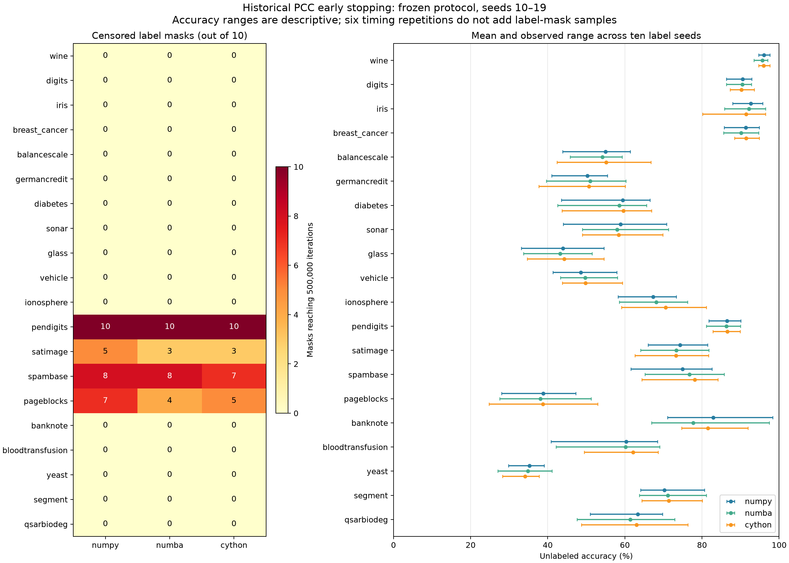

# Complete historical early-stopping campaign

The existing immutable campaign completed **3,600 measured fits, 1,200 prescribed
warm-ups, 200 fixtures and 600 fixture/backend groups**, covering all twenty frozen
historical datasets and label seeds 10–19. Each fixture/backend has six measured
repetitions covering all six balanced backend permutations. No measurements remain
pending. **3120 fits stopped early; 480 (13.33%)
reached the 500,000-iteration cap and are valid censored observations.**

All 3,600 results passed the comprehensive integrity/correctness audit. There were
3,600 unique started attempts, no failures or retries, no ambiguous outcomes and
no discarded timing observations. Draft PR #17 remains a draft. Historical fixed
results, README performance tables, algorithm defaults and published Release are
unchanged.

## Protocol, authorization and provenance

Seeds 10 and 11 were completed under their prior individual authorizations.
Before seed 12, all 720 results passed strict live-environment audit and the saved
seed-11 scientific audit. All 5,002 existing campaign files matched their original
SHA-256 inventory. Seeds 12–19 then ran sequentially; each stage completed and
passed strict audit before the next stage started. Every earlier checkpoint file
was checked byte-for-byte after every stage. Historical campaign, pilot and earlier
provenance/snapshot inventories were independently preserved.

Campaign root: `.cache/performance/windows-full-early-stopping-01`.
Plan SHA-256: `08ee758ffdfc8f11b605c99374955b9d18c087b71ad488cd98aff59a148e7433`.
Specification SHA-256: `3e3105c9c148cf5743569f7449dd32c05e680fbb9e796bd6e2883acb9d080d1c`.
Original runtime source commit: `0bda57de73410d1b306c958231478517ae54f60b`.
Remaining-stage resume commit: `0773bcb265c9752f71509ed2da43f089bad216b1`.
Source hashes, compiled Cython binary, dependency versions, hardware/thread
environment and RNG policies continued to match the original campaign identity.
No rebuild, graph reconstruction, parameter tuning or protocol change occurred.
The environment was clean at each launch; data/report commits are distinguished
from the unchanged runtime source identity.

For each seed 12 through 19, the exact existing controller command was:

```console
python -m benchmarks.resumable --action resume --stage-seed SEED --root .cache/performance/windows-full-early-stopping-01 --execute
```

`SEED` was supplied explicitly, once in order, as 12, 13, 14, 15, 16, 17, 18, 19.
There was no runtime cutoff or automatic retry. Checkpoints remained at complete-fit
boundaries. Each uninterrupted stage used 120 fresh two-iteration warm-ups and
360 measured fits.

Original PCC parameters remain `p_grd=0.5`, `delta_v=0.1`, `deltap=1.0`,
`dexp=2`, `es_chk=2000`, early stopping enabled and cap 500,000. Three historical
labeled nodes per class, full-data StandardScaler and frozen symmetric ordered
Euclidean ten-neighbor graphs were reused. NumPy/Numba initialization used the
original backend-specific seed-0 policy; Cython retained its original reset to
xorshift state 123456789. Backend RNGs and trajectories are intentionally distinct.

## Audit evidence

The existing controller validated checksummed plan, event chain, fixtures, results,
sessions, warm-ups and summary generations. All 200 fixtures matched the frozen
historical raw/scaled/truth/ordered-graph/label fingerprints and PR #16 fixtures.
Later masks reused validated seed-10 preprocessing and graph arrays and selected
only their prescribed historical labels. Task IDs and permutation/position balance
were verified against the immutable complete matrix.

Actual fits retained the established invariant checks, backend identity/no-fallback
checks and Numba steady-state compilation checks. All six measured repetitions
within each fixture/backend agreed exactly on the six state hashes, effective
iteration count, stopping reason and unlabeled accuracy. Sequential dynamics and
floating-point semantics were not changed to force agreement between backends.
Stopping counters/reasons and cap semantics were validated by the existing strict
row validator. Capped runs were retained, not retried or described as convergence.

## Runtime and overhead

Total native stage runtime was **12.455 h (44839.509 s)**.
Propagation totaled 12.323 h (44364.295 s); measured total-fit time
totaled 12.324 h (44365.939 s). Native wall minus measured fit time was
473.570 s, including warm-ups,
fixture work, seed helper, model setup, validation, checkpoints and controller
audits/summaries. Warm-up fit time was 10.916 s.
Preflight, post-stage preservation audits, snapshots and report generation are
outside these native process times and preserved separately in provenance.

The result-validation/publication windows total
22.531 s;
median/IQR/range are 0.004380; 0.002556; 0.001002–0.044334 s.
These intervals include validation and overlap the overhead residual; pure
filesystem I/O was not separately timed. Do not add overlapping timers.

| Seed | Native wall s | Propagation s | Measured fit s | Early stops | Censored | Wall minus fit s |
|---|---:|---:|---:|---:|---:|---:|
| 10 | 3987.743 | 3975.915 | 3976.067 | 324 | 36 | 11.676 |
| 11 | 3334.422 | 3321.086 | 3321.229 | 336 | 24 | 13.193 |
| 12 | 3581.420 | 3565.699 | 3565.848 | 300 | 60 | 15.572 |
| 13 | 3381.310 | 3361.413 | 3361.568 | 306 | 54 | 19.742 |
| 14 | 3513.527 | 3489.687 | 3489.848 | 306 | 54 | 23.679 |
| 15 | 3706.929 | 3679.768 | 3679.925 | 306 | 54 | 27.004 |
| 16 | 6631.651 | 6578.512 | 6578.694 | 312 | 48 | 52.957 |
| 17 | 6866.163 | 6747.161 | 6747.364 | 312 | 48 | 118.799 |
| 18 | 6258.151 | 6124.441 | 6124.627 | 306 | 54 | 133.523 |
| 19 | 3578.194 | 3520.613 | 3520.769 | 312 | 48 | 57.426 |

The authorized remaining stages took **10.421 h (37517.344 s)**, compared with
the two-seed stage-wall estimate 8.136 h (29288.662 s)
and its observed-stage range
7.410 h (26675.380 s)–
8.862 h (31901.943 s).
The historical median-rate cap scenario was
24.298 h (87471.288 s); the conservative cap-work
scenario was 42.796 h (154064.312 s). These were planning
scenarios rather than limits or predictions of stopping on later masks. Every
stage audit preserved updated remaining-runtime scenarios; after seed 19 the
remaining measured workload is zero.

The remaining stages exceeded the original observed-stage mean estimate by
**28.10%**.
Their UTC start-to-final-exit span was 37807.096 s,
including 288.193 s
of recorded between-stage audit/preflight gaps. UTC timestamps and monotonic
process timers are distinct measurements. Initial preflight and final reporting
are excluded. Minimum available RAM and disk during these stages were
45.33 GiB and
700.87 GiB;
no resource stop condition occurred.

## Matched comparison with PR #16: fixed 10,000 iterations

The same 200 frozen fixtures, label masks and backend-specific RNG policies
permit descriptive pairing with PR #16. Production PCC source is unchanged.
The baseline executes exactly 10,000 iterations; this campaign runs to the
original stopping criterion or a 500,000 cap. These are different work budgets,
and this comparison does not isolate a causal effect of the stopping rule.

**PageBlocks accuracy declined in every one of the 30 mask/backend pairs.**
Mean changes (early-stopping/capped endpoint minus fixed-10,000 endpoint) were
**−22.4973 pp NumPy, −22.1693 pp Numba and −22.1088 pp Cython**.
Individual losses ranged from **9.1975 to 37.8160 pp**. Both genuinely early-
stopped and capped results contribute; cap hits are not convergence observations.

**Spambase improved in every one of the 30 pairs**, with mean changes of
**+8.1567/+8.5180/+8.4266 pp** for NumPy/Numba/Cython. Individual gains range
from **1.2405 to 15.4298 pp**, again mixing early-stopped and capped endpoints.

These observations establish endpoint differences after much longer propagation,
not causality or predictive optimality of the dominance-based stopping criterion.
There are no saved intermediate accuracy trajectories isolating when changes
occurred. Backend trajectories, numerical paths and stopping work differ.
Label-mask sensitivity remains substantial, especially Banknote and Sonar;
their large differences occur without any cap hits. Ten masks share a dataset
and graph, and six timing repetitions do not add independent accuracy samples.

Macro accuracy gains across all datasets are only +0.4888/+0.3883/+0.5317 pp,
which conceal the PageBlocks deterioration. The complete 60 dataset/backend
paired summaries are retained in [matched_fixed.csv](benchmarks/early_stopping_full/results/matched_fixed.csv).
Accuracy remains transductive on unlabeled nodes, not held-out inductive accuracy.

For native backends, fixed total-fit time was 11.515 s Numba versus 10.031 s
Cython; here it is 357.409 s versus 742.385 s. Numba executed more iterations
(190.86 million versus 186.97 million), so fewer iterations cannot explain its
advantage. PenDigits accounts for 293.181 s (76%) of Cython's additional
propagation time; Satimage and PageBlocks add 50.836 and 34.993 s. Together these
explain 98% of the aggregate difference. PenDigits used identical capped budgets.
Early-stopping mode adds whole-dominance reductions every ten iterations, while
fixed mode omits them. Check costs, state-dependent work and execution conditions
were not separately measured; the binary's original build log is unavailable.
These complete-fit observations do not identify an isolated kernel speedup.
PR #16 used three cyclic execution orders, each twice; this campaign uses all
six balanced permutations. Sessions, work budgets and order designs differ,
so their timing ratios also do not isolate the cost of enabling stopping checks.

## Backend totals

Accuracies below are macro averages over the 200 dataset/label-mask groups,
giving equal weight to each group. Repeated timings do not create additional
independent accuracy samples. Accuracy is measured on unlabeled nodes of the
historical transductive fixtures; these are not held-out inductive test sets.

| Backend | Fits | Early stops | Censored | Propagation total s | Fit total s | Macro unlabeled accuracy % |
|---|---:|---:|---:|---:|---:|---:|
| numpy | 1200 | 1020 | 180 (15.00%) | 43265.642 | 43266.145 | 67.0433 |
| numba | 1200 | 1050 | 150 (12.50%) | 356.843 | 357.409 | 66.5520 |
| cython | 1200 | 1050 | 150 (12.50%) | 741.810 | 742.385 | 67.3255 |

## Dataset/backend convergence, accuracy and timing



[Standalone SVG figure](benchmarks/early_stopping_full/results/convergence_accuracy.svg).

Each row contains ten label masks and sixty measured timings. Iterations show
median and range across masks, retaining caps at their observed lower bound.
Aggregated iteration medians in this table are rounded to whole iterations;
exact values remain in the JSON audit and actual stopping counts appear below.
Accuracy shows mean ± sample SD and range across the ten masks, in percent.
Propagation/fit show median; IQR; min–max across all sixty measurements, in seconds.
This pooled timing variability includes both label-mask-dependent work and
within-mask timing noise. The complete per-mask six-repetition statistics below
separate these effects. No accuracy-weighted retuning or parameter selection was
performed. Censor fractions measure cap hits, not failure rates.

| Dataset | Backend | Censored masks | Iterations median; range | Accuracy mean ± SD; range % | Propagation median; IQR; range s | Fit median; IQR; range s |
|---|---|---:|---:|---:|---:|---:|
| wine | numpy | 0/10 | 10196; 6071–14621 | 96.0947 ± 0.8909; 94.6746–97.6331 | 1.373350; 1.885622; 0.606500–3.693674 | 1.373528; 1.885734; 0.606741–3.693962 |
| wine | numba | 0/10 | 9456; 5961–13231 | 95.6805 ± 1.3961; 93.4911–97.0414 | 0.007464; 0.003838; 0.003286–0.018407 | 0.007763; 0.003827; 0.003469–0.018808 |
| wine | cython | 0/10 | 10136; 6701–13461 | 95.9763 ± 0.9980; 94.6746–97.6331 | 0.005201; 0.000961; 0.002827–0.009360 | 0.005456; 0.000908; 0.003009–0.009657 |
| digits | numpy | 0/10 | 87161; 55331–122261 | 90.5772 ± 1.8966; 86.3045–92.9259 | 39.107071; 36.438316; 18.835625–77.978282 | 39.107438; 36.438611; 18.836024–77.978919 |
| digits | numba | 0/10 | 100756; 72821–134341 | 90.4584 ± 2.4142; 86.3045–92.8127 | 0.246213; 0.068348; 0.171653–0.382435 | 0.246699; 0.068216; 0.172052–0.383053 |
| digits | cython | 0/10 | 94696; 65421–105621 | 90.2151 ± 2.2956; 87.2666–93.5484 | 0.253508; 0.134533; 0.168440–0.442473 | 0.254242; 0.134653; 0.168853–0.443178 |
| iris | numpy | 0/10 | 8486; 4761–11131 | 92.6241 ± 3.1399; 87.9433–95.7447 | 1.039142; 0.418525; 0.517098–2.847260 | 1.039422; 0.418319; 0.517891–2.847561 |
| iris | numba | 0/10 | 8176; 5031–10301 | 92.1277 ± 3.9339; 85.8156–96.4539 | 0.005353; 0.001788; 0.002739–0.010466 | 0.005596; 0.001893; 0.002924–0.010887 |
| iris | cython | 0/10 | 7826; 5171–11521 | 91.4184 ± 4.6860; 80.1418–96.4539 | 0.004134; 0.001927; 0.002132–0.008589 | 0.004393; 0.002002; 0.002324–0.009080 |
| breast_cancer | numpy | 0/10 | 47511; 37441–65061 | 91.3854 ± 2.4458; 85.7904–94.8490 | 3.644538; 1.972128; 2.557840–10.859372 | 3.644985; 1.972124; 2.558036–10.859698 |
| breast_cancer | numba | 0/10 | 52516; 35031–96081 | 90.1243 ± 2.7608; 85.6128–94.6714 | 0.030926; 0.020221; 0.014687–0.050324 | 0.031281; 0.020337; 0.014888–0.050578 |
| breast_cancer | cython | 0/10 | 54676; 39831–111541 | 91.4387 ± 2.1508; 88.4547–94.8490 | 0.019772; 0.009889; 0.012324–0.048085 | 0.020055; 0.009869; 0.012555–0.048406 |
| balancescale | numpy | 0/10 | 51121; 34221–80831 | 55.0000 ± 5.6005; 43.8312–61.3636 | 5.642416; 3.593164; 3.199113–16.312238 | 5.642672; 3.593487; 3.199324–16.312662 |
| balancescale | numba | 0/10 | 43441; 26811–67991 | 54.1883 ± 5.0414; 45.7792–59.2532 | 0.027220; 0.012845; 0.018037–0.053337 | 0.027745; 0.012940; 0.018230–0.053747 |
| balancescale | cython | 0/10 | 38056; 31871–70371 | 55.1461 ± 7.2761; 42.3701–66.7208 | 0.025293; 0.012738; 0.016580–0.057717 | 0.025594; 0.012635; 0.016825–0.058141 |
| germancredit | numpy | 0/10 | 109176; 78711–157941 | 50.3018 ± 4.5843; 41.0463–55.4326 | 8.270936; 4.669063; 5.474103–22.181846 | 8.271250; 4.668994; 5.474358–22.182362 |
| germancredit | numba | 0/10 | 105316; 63461–148881 | 51.0161 ± 6.0621; 39.6378–60.2616 | 0.052503; 0.031362; 0.031631–0.097232 | 0.052818; 0.031374; 0.031952–0.097688 |
| germancredit | cython | 0/10 | 95926; 59341–177101 | 50.7042 ± 6.3147; 37.7264–60.0604 | 0.038128; 0.027005; 0.022810–0.117901 | 0.038398; 0.026998; 0.023170–0.118303 |
| diabetes | numpy | 0/10 | 64371; 43671–142361 | 59.4357 ± 8.1514; 43.5696–66.5354 | 5.872581; 5.301397; 2.978121–12.209522 | 5.872799; 5.301403; 2.978323–12.209852 |
| diabetes | numba | 0/10 | 79711; 42711–127541 | 58.5433 ± 8.2297; 42.5197–65.6168 | 0.041861; 0.018728; 0.019534–0.076106 | 0.042165; 0.018863; 0.019913–0.076495 |
| diabetes | cython | 0/10 | 73591; 49681–112311 | 59.6457 ± 8.0837; 43.7008–66.9291 | 0.025348; 0.017645; 0.016537–0.058422 | 0.025624; 0.017545; 0.016779–0.058806 |
| sonar | numpy | 0/10 | 21041; 11931–36341 | 58.9109 ± 9.2792; 44.0594–70.7921 | 1.467104; 1.479370; 0.797477–4.984023 | 1.467309; 1.479509; 0.797661–4.984316 |
| sonar | numba | 0/10 | 17726; 11431–26131 | 58.0198 ± 7.0930; 49.0099–71.2871 | 0.009134; 0.003507; 0.004707–0.018254 | 0.009462; 0.003455; 0.004889–0.018607 |
| sonar | cython | 0/10 | 17311; 10171–29061 | 58.3663 ± 7.8533; 49.0099–69.8020 | 0.005569; 0.004623; 0.002914–0.015569 | 0.005738; 0.004562; 0.003084–0.015909 |
| glass | numpy | 0/10 | 12751; 8671–14151 | 43.9796 ± 6.7421; 33.1633–54.5918 | 2.609505; 1.214659; 1.665236–7.302126 | 2.609741; 1.214687; 1.665417–7.302447 |
| glass | numba | 0/10 | 10271; 5971–12081 | 43.2143 ± 6.4985; 33.6735–51.5306 | 0.011342; 0.006360; 0.006090–0.025022 | 0.011634; 0.006284; 0.006269–0.025355 |
| glass | cython | 0/10 | 10426; 5401–14821 | 44.2857 ± 7.0565; 34.6939–54.5918 | 0.012544; 0.005428; 0.005273–0.023061 | 0.012818; 0.005515; 0.005577–0.023487 |
| vehicle | numpy | 0/10 | 56191; 39101–101171 | 48.5851 ± 4.7794; 41.3669–57.9137 | 9.055497; 7.679897; 5.164474–20.917329 | 9.055803; 7.679895; 5.164733–20.917713 |
| vehicle | numba | 0/10 | 59576; 32891–93311 | 49.6882 ± 4.5138; 43.2854–58.0336 | 0.051473; 0.027342; 0.029036–0.085396 | 0.051946; 0.027191; 0.029276–0.085853 |
| vehicle | cython | 0/10 | 58991; 34571–90361 | 49.7962 ± 4.8666; 43.7650–59.3525 | 0.054519; 0.014721; 0.028262–0.079281 | 0.054778; 0.014768; 0.028563–0.079700 |
| ionosphere | numpy | 0/10 | 27376; 18691–41901 | 67.3333 ± 4.3597; 58.2609–73.3333 | 2.193304; 1.259800; 1.180646–8.095574 | 2.193526; 1.259767; 1.180838–8.095920 |
| ionosphere | numba | 0/10 | 33046; 21691–50381 | 68.1159 ± 5.3307; 58.5507–76.2319 | 0.017002; 0.009926; 0.009553–0.042902 | 0.017232; 0.010028; 0.009761–0.043292 |
| ionosphere | cython | 0/10 | 30901; 24901–57631 | 70.6087 ± 7.1225; 59.1304–81.1594 | 0.011229; 0.004237; 0.007772–0.033619 | 0.011537; 0.004341; 0.008036–0.034023 |
| pendigits | numpy | 10/10 | 500000; 500000–500000 | 86.4696 ± 2.8677; 81.7643–90.0474 | 177.244066; 12.419576; 159.920738–501.118865 | 177.245223; 12.419946; 159.921821–501.121518 |
| pendigits | numba | 10/10 | 500000; 500000–500000 | 86.3063 ± 2.7093; 81.1531–89.9653 | 2.083330; 0.192667; 1.863745–3.922550 | 2.084982; 0.192403; 1.865131–3.924636 |
| pendigits | cython | 10/10 | 500000; 500000–500000 | 86.6037 ± 2.6433; 82.8134–89.9015 | 6.809619; 0.275633; 6.178884–10.892155 | 6.810959; 0.275804; 6.180097–10.894411 |
| satimage | numpy | 5/10 | 499970; 324861–500000 | 74.2795 ± 5.2708; 66.0636–81.4566 | 103.270178; 10.249292; 74.100554–224.203582 | 103.270838; 10.249803; 74.101556–224.204445 |
| satimage | numba | 3/10 | 473166; 302431–500000 | 73.3656 ± 6.0160; 64.0986–81.7374 | 0.921359; 0.158778; 0.615202–2.477852 | 0.922022; 0.158771; 0.616009–2.478996 |
| satimage | cython | 3/10 | 468731; 307411–500000 | 73.2642 ± 6.3950; 62.6482–81.6594 | 1.985551; 0.561590; 1.104252–2.899494 | 1.986465; 0.561814; 1.104939–2.900659 |
| spambase | numpy | 8/10 | 500000; 421591–500000 | 74.9750 ± 7.4133; 61.5669–82.6115 | 35.692417; 2.492884; 28.589286–98.005838 | 35.692807; 2.492885; 28.589725–98.006400 |
| spambase | numba | 8/10 | 500000; 419561–500000 | 76.7269 ± 7.7532; 65.2448–85.7671 | 0.388838; 0.025114; 0.309968–0.647778 | 0.389302; 0.025054; 0.310563–0.648451 |
| spambase | cython | 7/10 | 500000; 407361–500000 | 78.1371 ± 6.0385; 64.3743–84.1567 | 0.448473; 0.052822; 0.330463–0.848488 | 0.449003; 0.052766; 0.330851–0.849267 |
| pageblocks | numpy | 7/10 | 500000; 418541–500000 | 38.7926 ± 7.1709; 28.0322–47.2884 | 86.278750; 5.327436; 75.215323–241.695971 | 86.279281; 5.327532; 75.215859–241.697520 |
| pageblocks | numba | 4/10 | 482371; 427851–500000 | 38.0964 ± 8.0316; 27.5009–51.2459 | 0.757531; 0.080139; 0.645428–1.499986 | 0.758203; 0.079961; 0.645983–1.500901 |
| pageblocks | cython | 5/10 | 499690; 374001–500000 | 38.7688 ± 9.2660; 24.7527–52.9132 | 1.286337; 0.318543; 0.894613–2.609979 | 1.287046; 0.318644; 0.895212–2.610949 |
| banknote | numpy | 0/10 | 257441; 130321–414131 | 82.8990 ± 9.8012; 71.0835–98.3163 | 18.412275; 10.482325; 8.952421–39.482391 | 18.412501; 10.482334; 8.952651–39.482765 |
| banknote | numba | 0/10 | 241191; 176931–431681 | 77.7526 ± 9.1609; 66.9107–97.4378 | 0.132982; 0.081875; 0.083767–0.344015 | 0.133294; 0.081908; 0.084126–0.344442 |
| banknote | cython | 0/10 | 245316; 184871–372461 | 81.5227 ± 6.0414; 74.6706–91.9473 | 0.116584; 0.038241; 0.072742–0.248447 | 0.116949; 0.038216; 0.073044–0.248869 |
| bloodtransfusion | numpy | 0/10 | 84301; 45301–133761 | 60.3639 ± 8.6588; 40.8356–68.4636 | 7.027562; 3.030364; 4.427700–20.715442 | 7.027798; 3.030431; 4.427929–20.715766 |
| bloodtransfusion | numba | 0/10 | 74716; 51141–139541 | 60.1752 ± 7.9836; 42.1833–69.0027 | 0.036121; 0.011453; 0.022146–0.090632 | 0.036504; 0.011558; 0.022371–0.090975 |
| bloodtransfusion | cython | 0/10 | 90586; 54441–126821 | 62.1024 ± 6.0841; 49.4609–68.5984 | 0.033392; 0.009793; 0.017193–0.071705 | 0.033754; 0.009862; 0.017463–0.072095 |
| yeast | numpy | 0/10 | 98996; 72771–131551 | 35.2613 ± 2.7328; 29.8487–39.0646 | 33.964787; 4.169721; 24.705811–124.579228 | 33.965196; 4.169710; 24.706209–124.579811 |
| yeast | numba | 0/10 | 104601; 74631–126831 | 34.8762 ± 3.7979; 27.0289–41.1279 | 0.232064; 0.071391; 0.150657–0.388478 | 0.232529; 0.071450; 0.151156–0.389138 |
| yeast | cython | 0/10 | 87451; 75351–132871 | 34.1472 ± 2.7436; 28.2669–37.7579 | 0.277280; 0.105214; 0.196540–0.380527 | 0.277779; 0.105176; 0.197004–0.381186 |
| segment | numpy | 0/10 | 152216; 86841–284941 | 70.2709 ± 5.6226; 64.0454–80.6466 | 39.766389; 32.723384; 20.089427–103.253425 | 39.766814; 32.723651; 20.089771–103.254038 |
| segment | numba | 0/10 | 141306; 97831–277401 | 71.1533 ± 5.3045; 63.7396–81.1271 | 0.255446; 0.135277; 0.148277–0.530713 | 0.255991; 0.135359; 0.148684–0.531227 |
| segment | cython | 0/10 | 138861; 85691–232581 | 71.3412 ± 5.0942; 64.3949–80.0349 | 0.325973; 0.154324; 0.159440–0.606279 | 0.326538; 0.154292; 0.160198–0.607230 |
| qsarbiodeg | numpy | 0/10 | 113666; 90421–168701 | 63.3270 ± 5.9290; 51.0010–69.7807 | 8.309759; 4.341867; 6.123361–31.163549 | 8.310033; 4.341864; 6.123568–31.163897 |
| qsarbiodeg | numba | 0/10 | 138341; 74921–156131 | 61.4109 ± 9.4147; 47.5691–72.9266 | 0.071900; 0.015606; 0.035907–0.104823 | 0.072161; 0.015639; 0.036255–0.105244 |
| qsarbiodeg | cython | 0/10 | 118566; 59501–179611 | 63.0219 ± 9.4493; 48.7131–76.3584 | 0.051658; 0.025246; 0.023921–0.112357 | 0.051949; 0.025205; 0.024287–0.112757 |

Censoring occurred only on PenDigits (180 fits), Satimage (66), Spambase
(138) and PageBlocks (96). PenDigits was capped for every backend and mask.
PageBlocks mean unlabeled accuracy was approximately 38–39%, with observed
mask/backend accuracies spanning 24.75–52.91%. Spambase spans 61.57–85.77%,
Satimage 62.65–81.74%, and PenDigits 81.15–90.05%. These ranges warrant review
alongside timing and censoring; a fast fit alone does not establish suitability.

## Paired backend comparisons across label masks

Accuracy changes are comparison minus reference, in percentage points, summarized
over matched ten label masks. Fit ratios divide reference by comparison per-mask
medians. Different backend RNGs, state trajectories and stopping iterations mean
these are complete-fit comparisons, not equal-work kernel speedups. Descriptive
differences do not establish statistical superiority. Earlier stopping alone is
not evidence of greater accuracy. All backend-specific outcomes are retained.

| Dataset | Reference → comparison | Accuracy change mean ± SD; range pp | Fit ratio median; IQR; range |
|---|---|---:|---:|
| wine | numpy → numba | -0.4142 ± 1.2490; -2.3669–1.7751 | 245.103355; 147.536429; 80.144586–464.623278 |
| wine | numpy → cython | -0.1183 ± 0.7274; -1.1834–1.1834 | 263.003544; 252.327360; 143.105605–685.338752 |
| wine | numba → cython | 0.2959 ± 0.8012; -0.5917–1.7751 | 1.364138; 0.435629; 0.754019–1.983157 |
| digits | numpy → numba | -0.1188 ± 1.4452; -3.9049–1.5280 | 162.640017; 69.739631; 103.368120–295.450194 |
| digits | numpy → cython | -0.3622 ± 1.9481; -4.4143–1.8676 | 165.936012; 65.601642; 75.776435–248.022234 |
| digits | numba → cython | -0.2434 ± 2.5304; -4.5274–4.8670 | 0.865503; 0.327836; 0.599168–1.398035 |
| iris | numpy → numba | -0.4965 ± 2.4120; -5.6738–3.5461 | 189.032093; 149.635544; 86.853936–484.757536 |
| iris | numpy → cython | -1.2057 ± 2.4806; -7.8014–0.7092 | 236.129228; 81.931937; 145.129018–611.995606 |
| iris | numba → cython | -0.7092 ± 3.1893; -7.8014–3.5461 | 1.157694; 0.628742; 0.762032–2.540074 |
| breast_cancer | numpy → numba | -1.2611 ± 1.6714; -4.4405–1.4210 | 148.862168; 106.042323; 66.767012–284.029277 |
| breast_cancer | numpy → cython | 0.0533 ± 1.2561; -1.5986–2.6643 | 198.519350; 63.702435; 70.998085–314.691795 |
| breast_cancer | numba → cython | 1.3144 ± 1.4580; -0.3552–4.4405 | 1.079196; 1.378182; 0.729220–3.045283 |
| balancescale | numpy → numba | -0.8117 ± 2.3575; -4.7078–2.4351 | 237.794818; 133.471756; 126.739680–571.704568 |
| balancescale | numpy → cython | 0.1461 ± 2.7341; -3.7338–6.1688 | 259.598871; 138.666258; 150.355819–559.563619 |
| balancescale | numba → cython | 0.9578 ± 3.7494; -3.4091–8.4416 | 1.136886; 0.575619; 0.433004–2.287375 |
| germancredit | numpy → numba | 0.7143 ± 4.1646; -8.0483–5.4326 | 172.364027; 84.754338; 106.900655–265.351460 |
| germancredit | numpy → cython | 0.4024 ± 3.4153; -6.0362–4.6278 | 245.332359; 87.464813; 93.572687–333.932928 |
| germancredit | numba → cython | -0.3119 ± 3.1535; -5.3320–5.4326 | 1.164171; 0.640969; 0.735723–1.853928 |
| diabetes | numpy → numba | -0.8924 ± 1.3179; -2.8871–0.9186 | 157.486418; 99.497658; 83.917016–248.972003 |
| diabetes | numpy → cython | 0.2100 ± 1.6323; -2.2310–4.0682 | 191.785656; 131.277134; 126.048008–395.299695 |
| diabetes | numba → cython | 1.1024 ± 1.4110; -0.6562–3.2808 | 1.549538; 0.450068; 0.836206–2.290959 |
| sonar | numpy → numba | -0.8911 ± 7.6792; -15.8416–15.3465 | 190.994523; 133.320248; 103.874918–452.302621 |
| sonar | numpy → cython | -0.5446 ± 3.7878; -6.9307–7.9208 | 319.912757; 132.809554; 140.141968–548.824690 |
| sonar | numba → cython | 0.3465 ± 5.9087; -7.4257–15.8416 | 1.345913; 0.729911; 0.925893–3.709530 |
| glass | numpy → numba | -0.7653 ± 2.7867; -6.1224–2.5510 | 238.887323; 82.708606; 162.939027–410.469813 |
| glass | numpy → cython | 0.3061 ± 3.9167; -7.1429–7.1429 | 239.942554; 207.139382; 126.207823–448.116996 |
| glass | numba → cython | 1.0714 ± 3.4306; -3.5714–5.6122 | 1.021956; 0.332102; 0.742952–1.453144 |
| vehicle | numpy → numba | 1.1031 ± 1.1894; -0.7194–2.8777 | 205.090356; 102.969345; 71.937058–505.428457 |
| vehicle | numpy → cython | 1.2110 ± 2.3046; -3.3573–4.5564 | 158.630496; 189.448370; 87.397297–436.523277 |
| vehicle | numba → cython | 0.1079 ± 2.4030; -4.6763–3.7170 | 1.005793; 0.594099; 0.483132–2.190450 |
| ionosphere | numpy → numba | 0.7826 ± 2.5963; -4.0580–4.0580 | 122.126493; 111.207326; 83.759942–239.042158 |
| ionosphere | numpy → cython | 3.2754 ± 6.2333; -1.7391–16.2319 | 204.450791; 88.716265; 139.063401–264.329643 |
| ionosphere | numba → cython | 2.4928 ± 7.1539; -3.4783–20.2899 | 1.317752; 0.528309; 1.029449–2.219407 |
| pendigits | numpy → numba | -0.1633 ± 2.3444; -4.3879–3.5760 | 85.965819; 7.301546; 83.571098–135.029264 |
| pendigits | numpy → cython | 0.1341 ± 1.1329; -1.9522–1.9887 | 26.328660; 1.564010; 25.627658–49.522703 |
| pendigits | numba → cython | 0.2974 ± 2.1465; -1.7333–5.0538 | 0.306155; 0.012142; 0.297699–0.366755 |
| satimage | numpy → numba | -0.9139 ± 2.1645; -5.8172–0.4991 | 104.103811; 22.046336; 79.755206–174.309046 |
| satimage | numpy → cython | -1.0153 ± 2.2406; -7.2676–0.2027 | 57.403419; 15.246949; 41.650862–88.484446 |
| satimage | numba → cython | -0.1014 ± 1.5899; -1.4504–3.9769 | 0.534349; 0.294759; 0.294472–0.832001 |
| spambase | numpy → numba | 1.7519 ± 3.1583; -2.2851–7.6823 | 92.991459; 3.744639; 78.377291–152.420338 |
| spambase | numpy → cython | 3.1621 ± 4.6821; -4.2873–12.2089 | 78.201074; 8.185643; 71.129186–118.703445 |
| spambase | numba → cython | 1.4102 ± 4.1404; -3.4603–9.7062 | 0.835310; 0.068763; 0.778790–1.087831 |
| pageblocks | numpy → numba | -0.6962 ± 3.6686; -7.5486–5.6064 | 117.728023; 16.924999; 100.337134–172.507492 |
| pageblocks | numpy → cython | -0.0238 ± 4.8818; -9.3807–7.2737 | 73.069647; 21.168026; 52.360693–108.975398 |
| pageblocks | numba → cython | 0.6724 ± 2.8603; -2.7483–6.4676 | 0.602089; 0.115015; 0.479829–0.839276 |
| banknote | numpy → numba | -5.1464 ± 13.4395; -27.4524–8.7116 | 164.636393; 90.652302; 59.544867–248.408239 |
| banknote | numpy → cython | -1.3763 ± 7.4102; -14.7145–6.5886 | 184.225698; 69.142087; 90.720087–315.961973 |
| banknote | numba → cython | 3.7701 ± 8.5404; -5.4905–18.3748 | 1.448969; 0.609078; 0.614021–1.741171 |
| bloodtransfusion | numpy → numba | -0.1887 ± 2.9191; -4.8518–3.6388 | 183.056889; 124.313686; 88.656718–352.583490 |
| bloodtransfusion | numpy → cython | 1.7385 ± 3.2097; -3.2345–8.6253 | 190.059694; 99.371809; 113.597588–582.700960 |
| bloodtransfusion | numba → cython | 1.9272 ± 3.4384; -0.6739–8.7601 | 1.154931; 0.430840; 0.518658–1.822840 |
| yeast | numpy → numba | -0.3851 ± 1.3587; -2.8198–2.0633 | 154.624838; 91.818528; 110.222723–318.197691 |
| yeast | numpy → cython | -1.1142 ± 1.1328; -3.0949–0.6190 | 129.624276; 44.224314; 98.649058–348.264397 |
| yeast | numba → cython | -0.7290 ± 1.9823; -5.1582–1.7882 | 0.909403; 0.150650; 0.430857–1.241863 |
| segment | numpy → numba | 0.8825 ± 1.4105; -0.3058–3.8008 | 160.290752; 76.216927; 97.884990–231.132159 |
| segment | numpy → cython | 1.0703 ± 2.1112; -0.9611–5.1114 | 142.349831; 79.143239; 74.008529–241.972401 |
| segment | numba → cython | 0.1879 ± 1.7897; -3.4076–3.3639 | 0.816031; 0.285333; 0.514279–1.264108 |
| qsarbiodeg | numpy → numba | -1.9161 ± 7.6091; -18.7798–6.2917 | 138.063178; 88.850968; 92.153442–340.699903 |
| qsarbiodeg | numpy → cython | -0.3051 ± 6.5969; -12.9647–8.6749 | 163.640078; 134.187705; 92.810863–457.152589 |
| qsarbiodeg | numba → cython | 1.6111 ± 4.2030; -4.0991–8.9609 | 1.398730; 0.454895; 0.659784–2.807910 |

## Permutation variability and retained outliers

Each backend appears in each position 400 times overall, twice per fixture.
Times below are divided by their own fixture/backend six-repetition median to
avoid conflating dataset size and stopping work. Execution order and elapsed
machine time remain confounded; these are descriptive comparisons. Complete
six-order statistics are in `analysis.json`. No timing observations were removed.

| Backend | Position (0-based) | Normalized fit median; IQR; range |
|---|---:|---:|
| numpy | 0 | 0.999461; 0.016277; 0.608887–2.164178 |
| numpy | 1 | 1.000429; 0.016467; 0.361741–1.402038 |
| numpy | 2 | 0.999971; 0.016855; 0.345614–1.171708 |
| numba | 0 | 0.998925; 0.060407; 0.392079–1.517813 |
| numba | 1 | 1.000914; 0.052653; 0.592690–2.422886 |
| numba | 2 | 1.000109; 0.053920; 0.697713–2.077514 |
| cython | 0 | 1.001581; 0.054936; 0.509702–1.720661 |
| cython | 1 | 0.997945; 0.058256; 0.765974–1.618662 |
| cython | 2 | 1.000926; 0.070374; 0.551454–1.662891 |

Timing changes were substantial despite unchanged source, binary and environment
identity. PenDigits/seed 17/NumPy ranged from 163.074 to 492.945 seconds for
identical stopping/state outcomes. PageBlocks/seed 17/NumPy ranged from 85.602
to 241.698 seconds. Seeds 16–18 took markedly longer than the earlier stages.
CPU load, temperature, power and affinity were not instrumented by the frozen
protocol, so these observations do not identify a cause. Seed and execution time
are confounded. All observations remain in the analysis.

The fifteen largest within-mask fit ranges are retained explicitly below; this
is a ranking, not an exclusion threshold or a claim about their cause.

| Dataset | Seed | Backend | Range width s | IQR / median | Max / min |
|---|---:|---|---:|---:|---:|
| pendigits | 17 | numpy | 329.870715 | 0.876940 | 3.0228 |
| pageblocks | 17 | numpy | 156.095389 | 0.095020 | 2.8235 |
| pendigits | 10 | numpy | 134.148629 | 0.015721 | 1.7788 |
| satimage | 18 | numpy | 128.779970 | 0.130045 | 2.3495 |
| pendigits | 18 | numpy | 124.298420 | 0.110292 | 1.3299 |
| satimage | 16 | numpy | 114.543513 | 0.016567 | 2.5458 |
| digits | 10 | numpy | 25.947825 | 0.274161 | 1.5187 |
| pendigits | 15 | numpy | 25.784804 | 0.098349 | 1.1469 |
| yeast | 17 | numpy | 16.867953 | 0.016835 | 1.1742 |
| germancredit | 17 | numpy | 13.501553 | 0.280029 | 2.9378 |
| pendigits | 11 | numpy | 13.025759 | 0.057279 | 1.0815 |
| digits | 18 | numpy | 12.339127 | 0.012052 | 1.1880 |
| pendigits | 14 | numpy | 11.833274 | 0.021023 | 1.0677 |
| pageblocks | 15 | numpy | 10.764394 | 0.023625 | 1.1245 |
| satimage | 15 | numpy | 10.012714 | 0.016891 | 1.0921 |

## Complete per-seed stopping and timing results

Each row represents six identical state/stopping/accuracy outcomes with distinct
measured timings. Seconds show median; IQR; range. All six state hashes, fixture
fingerprints, task IDs, session IDs and execution orders remain in the machine-
readable audit and measurement files.

| Dataset | Seed | Backend | Iterations | Stopping reason | Unlabeled accuracy % | Propagation median; IQR; range s | Fit median; IQR; range s |
|---|---:|---|---:|---|---:|---:|---:|
| wine | 10 | numpy | 9701 | early_stop | 95.8580 | 2.671456; 0.048846; 1.263233–2.711844 | 2.671750; 0.048821; 1.263430–2.712124 |
| wine | 10 | numba | 11221 | early_stop | 94.0828 | 0.009422; 0.000601; 0.009176–0.010610 | 0.009767; 0.000638; 0.009493–0.011057 |
| wine | 10 | cython | 10611 | early_stop | 94.6746 | 0.006962; 0.000307; 0.004472–0.007823 | 0.007255; 0.000350; 0.004697–0.008203 |
| digits | 10 | numpy | 81941 | early_stop | 89.4737 | 70.786347; 19.406931; 50.024275–75.971788 | 70.786897; 19.407001; 50.024647–75.972472 |
| digits | 10 | numba | 87691 | early_stop | 89.1907 | 0.239070; 0.127028; 0.175127–0.316939 | 0.239590; 0.127274; 0.175550–0.317633 |
| digits | 10 | cython | 85051 | early_stop | 89.3605 | 0.284694; 0.132265; 0.214073–0.360725 | 0.285405; 0.132426; 0.214462–0.361425 |
| iris | 10 | numpy | 10811 | early_stop | 95.0355 | 1.077640; 0.018032; 1.061506–1.098938 | 1.077825; 0.018035; 1.061697–1.099113 |
| iris | 10 | numba | 8191 | early_stop | 95.0355 | 0.004432; 0.000107; 0.004375–0.004856 | 0.004622; 0.000114; 0.004546–0.005055 |
| iris | 10 | cython | 10441 | early_stop | 94.3262 | 0.004200; 0.000005; 0.004134–0.004622 | 0.004389; 0.000055; 0.004315–0.004854 |
| breast_cancer | 10 | numpy | 38161 | early_stop | 92.7176 | 2.641217; 0.018042; 2.620002–2.653043 | 2.641406; 0.017639; 2.620183–2.653245 |
| breast_cancer | 10 | numba | 35031 | early_stop | 91.6519 | 0.015384; 0.000558; 0.014687–0.017072 | 0.015614; 0.000569; 0.014888–0.017322 |
| breast_cancer | 10 | cython | 47141 | early_stop | 94.1385 | 0.015111; 0.000659; 0.014315–0.015350 | 0.015339; 0.000608; 0.014522–0.015954 |
| balancescale | 10 | numpy | 48041 | early_stop | 60.2273 | 4.909889; 0.033102; 4.843241–4.955510 | 4.910095; 0.033114; 4.843471–4.955718 |
| balancescale | 10 | numba | 34391 | early_stop | 59.2532 | 0.020157; 0.003116; 0.019558–0.024114 | 0.020400; 0.003124; 0.019804–0.024364 |
| balancescale | 10 | cython | 60911 | early_stop | 60.5519 | 0.032402; 0.001911; 0.031164–0.035099 | 0.032656; 0.001886; 0.031413–0.035362 |
| germancredit | 10 | numpy | 157941 | early_stop | 51.1066 | 10.886543; 0.135117; 10.802406–11.018721 | 10.886782; 0.135127; 10.802650–11.018955 |
| germancredit | 10 | numba | 148881 | early_stop | 55.3320 | 0.072087; 0.004245; 0.068649–0.075015 | 0.072382; 0.004279; 0.068926–0.075294 |
| germancredit | 10 | cython | 106611 | early_stop | 52.5151 | 0.039683; 0.001981; 0.039514–0.042679 | 0.039957; 0.002004; 0.039763–0.042960 |
| diabetes | 10 | numpy | 82731 | early_stop | 64.5669 | 5.697104; 0.068697; 5.640249–5.791152 | 5.697314; 0.068679; 5.640455–5.791377 |
| diabetes | 10 | numba | 73971 | early_stop | 64.6982 | 0.032967; 0.000283; 0.031787–0.034244 | 0.033205; 0.000295; 0.032016–0.034504 |
| diabetes | 10 | cython | 51271 | early_stop | 64.0420 | 0.017750; 0.001377; 0.016663–0.019113 | 0.018121; 0.001455; 0.016876–0.019387 |
| sonar | 10 | numpy | 16441 | early_stop | 70.7921 | 1.119819; 0.006843; 1.097469–1.127499 | 1.120014; 0.006776; 1.098123–1.127727 |
| sonar | 10 | numba | 21111 | early_stop | 71.2871 | 0.008878; 0.000228; 0.008813–0.009130 | 0.009102; 0.000190; 0.009000–0.009376 |
| sonar | 10 | cython | 11231 | early_stop | 69.8020 | 0.003294; 0.000054; 0.003263–0.005173 | 0.003470; 0.000095; 0.003416–0.005402 |
| glass | 10 | numpy | 8671 | early_stop | 38.7755 | 1.681445; 0.011972; 1.665236–1.701907 | 1.681638; 0.011977; 1.665417–1.702120 |
| glass | 10 | numba | 5971 | early_stop | 35.7143 | 0.006392; 0.000330; 0.006090–0.006760 | 0.006617; 0.000355; 0.006269–0.007015 |
| glass | 10 | cython | 7681 | early_stop | 40.3061 | 0.007814; 0.000579; 0.007368–0.013558 | 0.008083; 0.000536; 0.007579–0.013908 |
| vehicle | 10 | numpy | 39101 | early_stop | 49.8801 | 5.237952; 0.061040; 5.164474–5.288808 | 5.238183; 0.061034; 5.164733–5.289029 |
| vehicle | 10 | numba | 93311 | early_stop | 50.5995 | 0.072538; 0.001615; 0.070580–0.073759 | 0.072816; 0.001631; 0.070855–0.074042 |
| vehicle | 10 | cython | 70961 | early_stop | 50.7194 | 0.059657; 0.002148; 0.054819–0.061387 | 0.059935; 0.002137; 0.055068–0.061685 |
| ionosphere | 10 | numpy | 41901 | early_stop | 68.9855 | 2.884109; 0.026220; 2.860582–2.914083 | 2.884285; 0.026189; 2.860777–2.914293 |
| ionosphere | 10 | numba | 27511 | early_stop | 73.0435 | 0.011932; 0.003399; 0.011717–0.016756 | 0.012147; 0.003416; 0.011917–0.016997 |
| ionosphere | 10 | cython | 38111 | early_stop | 72.4638 | 0.011582; 0.000454; 0.011466–0.012973 | 0.011800; 0.000461; 0.011685–0.013305 |
| pendigits | 10 | numpy | 500000 | max_iter | 89.2355 | 185.046953; 2.909261; 172.252176–306.400735 | 185.048114; 2.909080; 172.253331–306.401960 |
| pendigits | 10 | numba | 500000 | max_iter | 84.8477 | 1.964789; 0.138757; 1.891597–2.377084 | 1.965964; 0.139022; 1.892724–2.379565 |
| pendigits | 10 | cython | 500000 | max_iter | 89.9015 | 6.602622; 0.291369; 6.463805–6.957325 | 6.603870; 0.291595; 6.465184–6.958561 |
| satimage | 10 | numpy | 386091 | early_stop | 77.1366 | 85.187775; 0.637823; 84.460366–85.503676 | 85.188493; 0.637561; 84.461027–85.505303 |
| satimage | 10 | numba | 439901 | early_stop | 77.3706 | 0.895375; 0.033257; 0.866292–0.914528 | 0.896052; 0.033103; 0.866951–0.915183 |
| satimage | 10 | cython | 489151 | early_stop | 76.3880 | 2.044454; 0.049927; 1.989272–2.121207 | 2.045300; 0.050026; 1.990125–2.121884 |
| spambase | 10 | numpy | 500000 | max_iter | 79.1295 | 37.388451; 0.339352; 36.777722–37.531343 | 37.388811; 0.339349; 36.778160–37.531801 |
| spambase | 10 | numba | 499171 | early_stop | 85.7671 | 0.383648; 0.008952; 0.372628–0.390023 | 0.384056; 0.008973; 0.373158–0.390547 |
| spambase | 10 | cython | 500000 | max_iter | 84.1567 | 0.456240; 0.026643; 0.428491–0.492439 | 0.456764; 0.026612; 0.429036–0.493032 |
| pageblocks | 10 | numpy | 418541 | early_stop | 31.8981 | 75.515932; 0.467551; 75.215323–76.019301 | 75.516537; 0.467674; 75.215859–76.019833 |
| pageblocks | 10 | numba | 494901 | early_stop | 27.5009 | 0.751829; 0.034398; 0.727590–0.849568 | 0.752628; 0.034511; 0.728289–0.850260 |
| pageblocks | 10 | cython | 500000 | max_iter | 24.7527 | 1.441572; 0.016698; 1.374421–1.470909 | 1.442237; 0.016665; 1.374987–1.471499 |
| banknote | 10 | numpy | 234871 | early_stop | 71.0835 | 17.135841; 0.132344; 17.072931–17.258506 | 17.136083; 0.132407; 17.073186–17.258813 |
| banknote | 10 | numba | 301481 | early_stop | 79.6486 | 0.148561; 0.016118; 0.139765–0.163961 | 0.148902; 0.016031; 0.140057–0.164254 |
| banknote | 10 | cython | 227291 | early_stop | 74.6706 | 0.089265; 0.006480; 0.084308–0.092923 | 0.089553; 0.006445; 0.084712–0.093209 |
| bloodtransfusion | 10 | numpy | 103731 | early_stop | 60.5121 | 7.717565; 0.183525; 7.386543–7.880822 | 7.717778; 0.183533; 7.386780–7.881049 |
| bloodtransfusion | 10 | numba | 77991 | early_stop | 55.6604 | 0.040748; 0.001302; 0.033605–0.044149 | 0.041067; 0.001623; 0.033919–0.044496 |
| bloodtransfusion | 10 | cython | 80981 | early_stop | 64.4205 | 0.030250; 0.003831; 0.026686–0.033799 | 0.030558; 0.003825; 0.027311–0.034167 |
| yeast | 10 | numpy | 101801 | early_stop | 37.1389 | 36.303689; 0.380730; 35.747281–37.045781 | 36.304201; 0.380640; 35.747758–37.046216 |
| yeast | 10 | numba | 100931 | early_stop | 35.9697 | 0.225240; 0.017560; 0.210580–0.253035 | 0.226127; 0.017636; 0.210977–0.253494 |
| yeast | 10 | cython | 107111 | early_stop | 37.7579 | 0.293777; 0.016074; 0.283058–0.314950 | 0.294375; 0.016034; 0.283628–0.315513 |
| segment | 10 | numpy | 284941 | early_stop | 73.9624 | 71.146816; 0.224206; 70.835032–71.436662 | 71.147402; 0.224245; 70.835444–71.437643 |
| segment | 10 | numba | 277401 | early_stop | 73.7003 | 0.469841; 0.072638; 0.444327–0.530713 | 0.470539; 0.072178; 0.444746–0.531227 |
| segment | 10 | cython | 181601 | early_stop | 74.0061 | 0.371367; 0.014227; 0.354789–0.384217 | 0.372230; 0.013994; 0.355455–0.384899 |
| qsarbiodeg | 10 | numpy | 102771 | early_stop | 63.4890 | 7.462624; 0.176663; 7.307180–7.691969 | 7.462870; 0.176708; 7.307380–7.692243 |
| qsarbiodeg | 10 | numba | 138691 | early_stop | 63.5844 | 0.068428; 0.005755; 0.063487–0.076102 | 0.068728; 0.005733; 0.063816–0.076695 |
| qsarbiodeg | 10 | cython | 106191 | early_stop | 67.3975 | 0.045534; 0.002471; 0.042890–0.050437 | 0.045983; 0.002500; 0.043182–0.050711 |
| wine | 11 | numpy | 13221 | early_stop | 96.4497 | 3.606509; 0.067532; 2.102543–3.693674 | 3.606801; 0.067532; 2.102808–3.693962 |
| wine | 11 | numba | 8911 | early_stop | 97.0414 | 0.007451; 0.000350; 0.007280–0.018407 | 0.007763; 0.000373; 0.007589–0.018808 |
| wine | 11 | cython | 7321 | early_stop | 96.4497 | 0.004932; 0.000280; 0.004869–0.007187 | 0.005263; 0.000320; 0.005173–0.007832 |
| digits | 11 | numpy | 92381 | early_stop | 90.3792 | 28.961453; 0.094936; 28.858184–29.003958 | 28.961809; 0.094925; 28.858548–29.004311 |
| digits | 11 | numba | 134341 | early_stop | 90.3226 | 0.274309; 0.002938; 0.271808–0.279700 | 0.274711; 0.002946; 0.272182–0.280131 |
| digits | 11 | cython | 93821 | early_stop | 89.4737 | 0.234819; 0.002619; 0.233645–0.238906 | 0.235257; 0.002635; 0.234039–0.239326 |
| iris | 11 | numpy | 7891 | early_stop | 88.6525 | 0.726435; 0.002951; 0.719430–0.735402 | 0.726608; 0.002949; 0.719601–0.735558 |
| iris | 11 | numba | 7021 | early_stop | 85.8156 | 0.003852; 0.000146; 0.003776–0.003932 | 0.004057; 0.000146; 0.003950–0.004131 |
| iris | 11 | cython | 6041 | early_stop | 88.6525 | 0.002540; 0.000156; 0.002464–0.003454 | 0.002750; 0.000202; 0.002637–0.003729 |
| breast_cancer | 11 | numpy | 40411 | early_stop | 93.0728 | 2.572203; 0.031388; 2.557840–2.606012 | 2.572400; 0.031308; 2.558036–2.606217 |
| breast_cancer | 11 | numba | 46841 | early_stop | 92.8952 | 0.019803; 0.000122; 0.019655–0.019935 | 0.020009; 0.000106; 0.019858–0.020160 |
| breast_cancer | 11 | cython | 66231 | early_stop | 93.7833 | 0.020630; 0.000967; 0.019952–0.025804 | 0.020864; 0.001015; 0.020152–0.026055 |
| balancescale | 11 | numpy | 34221 | early_stop | 54.0584 | 3.226308; 0.024854; 3.199113–3.268493 | 3.226508; 0.024865; 3.199324–3.268706 |
| balancescale | 11 | numba | 41851 | early_stop | 56.4935 | 0.023645; 0.000248; 0.023384–0.028777 | 0.023901; 0.000241; 0.023600–0.029040 |
| balancescale | 11 | cython | 40241 | early_stop | 56.6558 | 0.020484; 0.000803; 0.020064–0.022042 | 0.020728; 0.000840; 0.020240–0.022318 |
| germancredit | 11 | numpy | 152781 | early_stop | 52.8169 | 9.728839; 0.034317; 9.711874–9.858926 | 9.729046; 0.034214; 9.712085–9.859141 |
| germancredit | 11 | numba | 83171 | early_stop | 52.8169 | 0.039095; 0.004027; 0.037861–0.046306 | 0.039367; 0.004039; 0.038090–0.046574 |
| germancredit | 11 | cython | 84481 | early_stop | 55.0302 | 0.032201; 0.002394; 0.031345–0.036743 | 0.032544; 0.002617; 0.031580–0.037033 |
| diabetes | 11 | numpy | 64171 | early_stop | 63.7795 | 4.117454; 0.015422; 4.072256–4.166784 | 4.117659; 0.015418; 4.072471–4.166997 |
| diabetes | 11 | numba | 80461 | early_stop | 62.5984 | 0.036042; 0.004429; 0.034272–0.042424 | 0.036312; 0.004465; 0.034495–0.042690 |
| diabetes | 11 | cython | 61761 | early_stop | 63.2546 | 0.020043; 0.000849; 0.019831–0.021299 | 0.020273; 0.000993; 0.020057–0.021534 |
| sonar | 11 | numpy | 17411 | early_stop | 62.8713 | 1.085723; 0.004976; 1.082908–1.097797 | 1.085898; 0.004988; 1.083077–1.097966 |
| sonar | 11 | numba | 25281 | early_stop | 56.4356 | 0.010282; 0.000026; 0.010254–0.010303 | 0.010454; 0.000026; 0.010428–0.010491 |
| sonar | 11 | cython | 19751 | early_stop | 55.9406 | 0.005494; 0.000029; 0.005450–0.005578 | 0.005661; 0.000005; 0.005618–0.005745 |
| glass | 11 | numpy | 9361 | early_stop | 45.4082 | 1.696073; 0.001149; 1.689425–1.713264 | 1.696252; 0.001149; 1.689622–1.713449 |
| glass | 11 | numba | 9971 | early_stop | 46.4286 | 0.010211; 0.000034; 0.010179–0.010303 | 0.010410; 0.000049; 0.010365–0.010518 |
| glass | 11 | cython | 13301 | early_stop | 42.8571 | 0.012620; 0.000114; 0.012516–0.016335 | 0.012829; 0.000154; 0.012727–0.016580 |
| vehicle | 11 | numpy | 57731 | early_stop | 48.4412 | 7.202481; 0.016108; 7.191032–7.266443 | 7.202711; 0.016102; 7.191271–7.266667 |
| vehicle | 11 | numba | 39051 | early_stop | 47.7218 | 0.029125; 0.000884; 0.029036–0.030681 | 0.029376; 0.000901; 0.029276–0.030963 |
| vehicle | 11 | cython | 74291 | early_stop | 45.0839 | 0.054591; 0.001521; 0.053836–0.058174 | 0.054847; 0.001537; 0.054074–0.058454 |
| ionosphere | 11 | numpy | 18721 | early_stop | 69.2754 | 1.189654; 0.011572; 1.180646–1.198820 | 1.189839; 0.011577; 1.180838–1.198995 |
| ionosphere | 11 | numba | 32571 | early_stop | 68.1159 | 0.014016; 0.000062; 0.013937–0.014256 | 0.014205; 0.000061; 0.014119–0.014457 |
| ionosphere | 11 | cython | 26671 | early_stop | 67.8261 | 0.008291; 0.000145; 0.008209–0.013589 | 0.008474; 0.000171; 0.008385–0.013843 |
| pendigits | 11 | numpy | 500000 | max_iter | 84.9754 | 169.151124; 9.689248; 159.920738–172.946059 | 169.153208; 9.688897; 159.921821–172.947580 |
| pendigits | 11 | numba | 500000 | max_iter | 84.8203 | 1.982053; 0.118051; 1.863745–2.049055 | 1.983507; 0.118109; 1.865131–2.050796 |
| pendigits | 11 | cython | 500000 | max_iter | 83.6982 | 6.394681; 0.248251; 6.192223–6.703592 | 6.396133; 0.248288; 6.193633–6.705518 |
| satimage | 11 | numpy | 499941 | early_stop | 81.4566 | 100.118858; 1.120188; 95.256466–100.513535 | 100.119553; 1.120680; 95.257040–100.514116 |
| satimage | 11 | numba | 455411 | early_stop | 81.7374 | 0.870597; 0.036698; 0.832868–0.914908 | 0.871322; 0.036759; 0.833457–0.915537 |
| satimage | 11 | cython | 307411 | early_stop | 81.6594 | 1.130380; 0.044672; 1.104252–1.166166 | 1.131493; 0.044532; 1.104939–1.167076 |
| spambase | 11 | numpy | 421591 | early_stop | 75.2992 | 28.794923; 0.358862; 28.589286–30.137920 | 28.795384; 0.358903; 28.589725–30.139218 |
| spambase | 11 | numba | 419561 | early_stop | 76.9097 | 0.312318; 0.017870; 0.309968–0.337272 | 0.312735; 0.017893; 0.310563–0.337794 |
| spambase | 11 | cython | 452031 | early_stop | 77.9543 | 0.381732; 0.020757; 0.366374–0.426058 | 0.382128; 0.020754; 0.366741–0.426634 |
| pageblocks | 11 | numpy | 500000 | max_iter | 44.1920 | 82.947159; 0.688142; 82.334525–83.738075 | 82.947658; 0.688118; 82.335079–83.738696 |
| pageblocks | 11 | numba | 451471 | early_stop | 36.6435 | 0.680499; 0.007114; 0.655636–0.688216 | 0.681058; 0.007140; 0.657227–0.688787 |
| pageblocks | 11 | cython | 433091 | early_stop | 34.8113 | 1.106094; 0.035672; 1.086206–1.154627 | 1.106761; 0.035623; 1.086917–1.155154 |
| banknote | 11 | numpy | 261791 | early_stop | 84.1874 | 17.528441; 0.133746; 17.398643–17.915809 | 17.528707; 0.133641; 17.398869–17.916135 |
| banknote | 11 | numba | 241361 | early_stop | 69.6925 | 0.121505; 0.008350; 0.115026–0.128129 | 0.121794; 0.008321; 0.115313–0.128488 |
| banknote | 11 | cython | 197151 | early_stop | 88.0673 | 0.077663; 0.006233; 0.072742–0.083043 | 0.077989; 0.006348; 0.073044–0.083397 |
| bloodtransfusion | 11 | numpy | 83281 | early_stop | 40.8356 | 5.552326; 0.015832; 5.528206–5.633468 | 5.552567; 0.015885; 5.528527–5.633674 |
| bloodtransfusion | 11 | numba | 76691 | early_stop | 42.1833 | 0.034059; 0.005524; 0.031693–0.041276 | 0.034355; 0.005500; 0.031913–0.041636 |
| bloodtransfusion | 11 | cython | 90341 | early_stop | 49.4609 | 0.031051; 0.004190; 0.027922–0.042434 | 0.031310; 0.004198; 0.028139–0.042817 |
| yeast | 11 | numpy | 93391 | early_stop | 39.0646 | 30.929298; 0.699679; 30.502002–31.768389 | 30.929730; 0.699674; 30.502321–31.768716 |
| yeast | 11 | numba | 98311 | early_stop | 41.1279 | 0.207492; 0.012556; 0.197823–0.217980 | 0.207999; 0.012596; 0.198344–0.218485 |
| yeast | 11 | cython | 99671 | early_stop | 35.9697 | 0.263257; 0.012974; 0.252165–0.277201 | 0.263823; 0.012972; 0.252540–0.277590 |
| segment | 11 | numpy | 152901 | early_stop | 70.8170 | 35.209378; 0.485100; 34.847551–35.995532 | 35.209814; 0.484895; 34.848049–35.995999 |
| segment | 11 | numba | 156571 | early_stop | 70.7733 | 0.256092; 0.006414; 0.239078–0.261707 | 0.256644; 0.006396; 0.239485–0.262255 |
| segment | 11 | cython | 141351 | early_stop | 71.8218 | 0.292479; 0.022241; 0.274046–0.308392 | 0.292978; 0.022301; 0.274466–0.308840 |
| qsarbiodeg | 11 | numpy | 95691 | early_stop | 51.0010 | 6.412841; 0.032682; 6.350324–6.528234 | 6.413124; 0.032486; 6.350709–6.528550 |
| qsarbiodeg | 11 | numba | 139571 | early_stop | 57.2927 | 0.069287; 0.006600; 0.062373–0.075193 | 0.069592; 0.006556; 0.062630–0.075553 |
| qsarbiodeg | 11 | cython | 179611 | early_stop | 53.1935 | 0.068790; 0.002667; 0.067374–0.081811 | 0.069099; 0.002651; 0.067605–0.082174 |
| wine | 12 | numpy | 14621 | early_stop | 95.8580 | 1.384817; 0.008939; 1.367625–1.391339 | 1.384972; 0.008910; 1.367802–1.391508 |
| wine | 12 | numba | 7101 | early_stop | 93.4911 | 0.003930; 0.000076; 0.003860–0.004370 | 0.004094; 0.000090; 0.004021–0.004539 |
| wine | 12 | cython | 11831 | early_stop | 94.6746 | 0.005030; 0.000362; 0.004842–0.005799 | 0.005208; 0.000359; 0.004994–0.006005 |
| digits | 12 | numpy | 122261 | early_stop | 92.5863 | 39.012581; 0.168834; 38.817661–39.095448 | 39.012948; 0.168844; 38.818067–39.095812 |
| digits | 12 | numba | 92421 | early_stop | 92.8127 | 0.187742; 0.004021; 0.185931–0.199083 | 0.188149; 0.004016; 0.186340–0.199514 |
| digits | 12 | cython | 80411 | early_stop | 93.5484 | 0.204646; 0.002331; 0.203437–0.206989 | 0.205079; 0.002320; 0.203858–0.207401 |
| iris | 12 | numpy | 5571 | early_stop | 95.0355 | 0.524567; 0.004535; 0.517098–0.526293 | 0.524745; 0.004538; 0.517891–0.526464 |
| iris | 12 | numba | 10011 | early_stop | 95.0355 | 0.005410; 0.000151; 0.005351–0.005827 | 0.005596; 0.000169; 0.005521–0.006014 |
| iris | 12 | cython | 6801 | early_stop | 93.6170 | 0.002766; 0.000026; 0.002729–0.003577 | 0.002920; 0.000039; 0.002897–0.003856 |
| breast_cancer | 12 | numpy | 54731 | early_stop | 90.0533 | 3.590857; 0.037284; 3.564211–3.624828 | 3.591083; 0.037265; 3.564495–3.625450 |
| breast_cancer | 12 | numba | 37901 | early_stop | 85.6128 | 0.016228; 0.000452; 0.016035–0.016782 | 0.016433; 0.000465; 0.016231–0.017037 |
| breast_cancer | 12 | cython | 59241 | early_stop | 90.0533 | 0.019218; 0.000812; 0.018406–0.020131 | 0.019459; 0.000837; 0.018854–0.020388 |
| balancescale | 12 | numpy | 55971 | early_stop | 50.4870 | 5.889382; 0.499406; 5.622010–6.801802 | 5.889608; 0.499430; 5.622333–6.802001 |
| balancescale | 12 | numba | 32221 | early_stop | 45.7792 | 0.019248; 0.000655; 0.018037–0.020876 | 0.019607; 0.000667; 0.018230–0.021176 |
| balancescale | 12 | cython | 33141 | early_stop | 50.0000 | 0.018114; 0.001014; 0.016675–0.020021 | 0.018461; 0.000990; 0.016906–0.020397 |
| germancredit | 12 | numpy | 84611 | early_stop | 41.0463 | 6.144363; 0.239602; 5.904957–6.458156 | 6.144666; 0.239538; 5.905202–6.458369 |
| germancredit | 12 | numba | 107181 | early_stop | 39.6378 | 0.057148; 0.005536; 0.051032–0.059486 | 0.057480; 0.005539; 0.051341–0.059878 |
| germancredit | 12 | cython | 136971 | early_stop | 37.7264 | 0.065315; 0.009750; 0.057892–0.078296 | 0.065667; 0.009817; 0.058205–0.078663 |
| diabetes | 12 | numpy | 64571 | early_stop | 64.1732 | 4.735814; 0.230714; 4.514835–5.073575 | 4.736071; 0.230767; 4.515037–5.073819 |
| diabetes | 12 | numba | 42711 | early_stop | 64.6982 | 0.021626; 0.004906; 0.019534–0.025252 | 0.021946; 0.004935; 0.019913–0.025630 |
| diabetes | 12 | cython | 72951 | early_stop | 64.1732 | 0.025944; 0.001203; 0.023607–0.036134 | 0.026245; 0.001232; 0.023908–0.036593 |
| sonar | 12 | numpy | 24101 | early_stop | 61.3861 | 1.747991; 0.050182; 1.692951–1.802447 | 1.748199; 0.050208; 1.693226–1.802638 |
| sonar | 12 | numba | 25891 | early_stop | 60.8911 | 0.011561; 0.000973; 0.010650–0.014314 | 0.011816; 0.001032; 0.010835–0.014629 |
| sonar | 12 | cython | 10171 | early_stop | 61.8812 | 0.002990; 0.000099; 0.002914–0.003327 | 0.003185; 0.000100; 0.003084–0.003598 |
| glass | 12 | numpy | 13061 | early_stop | 54.5918 | 2.665371; 0.057323; 2.605999–2.725608 | 2.665616; 0.057355; 2.606215–2.725904 |
| glass | 12 | numba | 12081 | early_stop | 51.5306 | 0.013756; 0.002516; 0.012445–0.019911 | 0.014130; 0.002536; 0.012685–0.020162 |
| glass | 12 | cython | 14821 | early_stop | 54.5918 | 0.018026; 0.002016; 0.014720–0.023061 | 0.018347; 0.001978; 0.014960–0.023487 |
| vehicle | 12 | numpy | 52481 | early_stop | 50.8393 | 7.206054; 0.141422; 7.088219–7.300257 | 7.206376; 0.141484; 7.088544–7.300518 |
| vehicle | 12 | numba | 48181 | early_stop | 52.1583 | 0.043299; 0.004709; 0.038705–0.049633 | 0.043713; 0.004630; 0.039100–0.050109 |
| vehicle | 12 | cython | 90361 | early_stop | 51.7986 | 0.073958; 0.002622; 0.069293–0.079281 | 0.074359; 0.002711; 0.069597–0.079700 |
| ionosphere | 12 | numpy | 24501 | early_stop | 64.0580 | 1.723427; 0.070749; 1.679662–1.788573 | 1.723636; 0.070799; 1.679856–1.788800 |
| ionosphere | 12 | numba | 34301 | early_stop | 67.5362 | 0.016350; 0.003567; 0.014734–0.020311 | 0.016615; 0.003602; 0.014961–0.020704 |
| ionosphere | 12 | cython | 32531 | early_stop | 64.0580 | 0.010480; 0.000747; 0.010044–0.012025 | 0.010800; 0.000726; 0.010407–0.012354 |
| pendigits | 12 | numpy | 500000 | max_iter | 87.0370 | 175.835340; 1.250131; 174.512793–176.785773 | 175.836713; 1.250235; 174.513934–176.786954 |
| pendigits | 12 | numba | 500000 | max_iter | 87.5296 | 2.038638; 0.061360; 1.989346–2.101244 | 2.040201; 0.061148; 1.990578–2.102526 |
| pendigits | 12 | cython | 500000 | max_iter | 86.9367 | 6.713403; 0.058541; 6.581786–6.842719 | 6.714969; 0.058889; 6.583065–6.844653 |
| satimage | 12 | numpy | 500000 | max_iter | 79.1329 | 103.926006; 0.398221; 103.655801–104.672818 | 103.926784; 0.398200; 103.656397–104.673673 |
| satimage | 12 | numba | 426891 | early_stop | 75.2183 | 0.883226; 0.018510; 0.831721–0.923598 | 0.884046; 0.019067; 0.832368–0.924287 |
| satimage | 12 | cython | 500000 | max_iter | 79.1953 | 1.950314; 0.032551; 1.866592–2.081936 | 1.950994; 0.032771; 1.867460–2.082698 |
| spambase | 12 | numpy | 500000 | max_iter | 67.5299 | 35.413578; 0.235265; 35.041855–35.592523 | 35.413982; 0.235397; 35.042220–35.592870 |
| spambase | 12 | numba | 500000 | max_iter | 65.2448 | 0.387713; 0.020524; 0.375439–0.425018 | 0.388193; 0.020448; 0.375918–0.425632 |
| spambase | 12 | cython | 500000 | max_iter | 74.9510 | 0.483695; 0.026524; 0.446117–0.504101 | 0.484147; 0.026453; 0.446525–0.504570 |
| pageblocks | 12 | numpy | 500000 | max_iter | 45.6394 | 86.171948; 0.732833; 85.456166–87.188595 | 86.172769; 0.732813; 85.456658–87.189249 |
| pageblocks | 12 | numba | 500000 | max_iter | 51.2459 | 0.771324; 0.018411; 0.740751–0.801514 | 0.772217; 0.018202; 0.741608–0.802046 |
| pageblocks | 12 | cython | 374001 | early_stop | 52.9132 | 0.919473; 0.027153; 0.894613–0.981691 | 0.920099; 0.027095; 0.895212–0.982452 |
| banknote | 12 | numpy | 262431 | early_stop | 77.7452 | 18.589074; 0.380375; 18.371282–19.043290 | 18.589297; 0.380683; 18.371518–19.043644 |
| banknote | 12 | numba | 206901 | early_stop | 78.2577 | 0.099969; 0.002929; 0.096925–0.102573 | 0.100292; 0.002877; 0.097318–0.102939 |
| banknote | 12 | cython | 232581 | early_stop | 75.4026 | 0.091824; 0.004656; 0.084274–0.095586 | 0.092126; 0.004683; 0.084611–0.095952 |
| bloodtransfusion | 12 | numpy | 85321 | early_stop | 67.7898 | 5.953675; 0.081087; 5.835416–6.087835 | 5.953933; 0.080997; 5.835704–6.088070 |
| bloodtransfusion | 12 | numba | 139541 | early_stop | 69.0027 | 0.066847; 0.018752; 0.060013–0.090632 | 0.067157; 0.018737; 0.060301–0.090975 |
| bloodtransfusion | 12 | cython | 105991 | early_stop | 68.5984 | 0.036532; 0.003087; 0.034907–0.044490 | 0.036842; 0.003036; 0.035240–0.044764 |
| yeast | 12 | numpy | 98511 | early_stop | 35.4883 | 33.501460; 0.291017; 33.001603–34.254291 | 33.501825; 0.291073; 33.002063–34.254759 |
| yeast | 12 | numba | 82311 | early_stop | 35.7634 | 0.177633; 0.005326; 0.166185–0.184144 | 0.178182; 0.005309; 0.166621–0.184655 |
| yeast | 12 | cython | 75351 | early_stop | 34.8006 | 0.201473; 0.012225; 0.196540–0.215148 | 0.201878; 0.012276; 0.197004–0.215696 |
| segment | 12 | numpy | 155621 | early_stop | 67.1035 | 37.494014; 0.439638; 36.914717–38.027662 | 37.494615; 0.439576; 36.915241–38.028143 |
| segment | 12 | numba | 105581 | early_stop | 68.4142 | 0.171648; 0.008768; 0.161225–0.196103 | 0.172144; 0.008739; 0.161767–0.196717 |
| segment | 12 | cython | 136371 | early_stop | 71.7781 | 0.274374; 0.003412; 0.270332–0.288792 | 0.274807; 0.003485; 0.270901–0.289340 |
| qsarbiodeg | 12 | numpy | 90421 | early_stop | 66.3489 | 6.398822; 0.238435; 6.123361–6.440524 | 6.399064; 0.238457; 6.123568–6.440756 |
| qsarbiodeg | 12 | numba | 127721 | early_stop | 47.5691 | 0.061002; 0.002297; 0.058689–0.062553 | 0.061401; 0.002450; 0.058946–0.062865 |
| qsarbiodeg | 12 | cython | 116011 | early_stop | 53.3842 | 0.044233; 0.002963; 0.041211–0.058846 | 0.044612; 0.002983; 0.041485–0.059204 |
| wine | 13 | numpy | 8071 | early_stop | 95.2663 | 0.904074; 0.025225; 0.852550–0.952036 | 0.904265; 0.025219; 0.852722–0.952281 |
| wine | 13 | numba | 8331 | early_stop | 95.2663 | 0.004876; 0.001757; 0.004544–0.008411 | 0.005112; 0.001817; 0.004734–0.008824 |
| wine | 13 | cython | 6821 | early_stop | 95.2663 | 0.003205; 0.001092; 0.002827–0.004736 | 0.003477; 0.001196; 0.003009–0.004958 |
| digits | 13 | numpy | 55331 | early_stop | 92.0770 | 19.265077; 0.466920; 18.835625–19.527562 | 19.265549; 0.467080; 18.836024–19.527925 |
| digits | 13 | numba | 80931 | early_stop | 92.1902 | 0.185969; 0.011666; 0.171653–0.209420 | 0.186378; 0.011710; 0.172052–0.209999 |
| digits | 13 | cython | 95571 | early_stop | 87.6627 | 0.253508; 0.010660; 0.242611–0.279454 | 0.254242; 0.010627; 0.243030–0.279904 |
| iris | 13 | numpy | 10161 | early_stop | 90.7801 | 1.066910; 0.026279; 1.035167–1.116390 | 1.067190; 0.026284; 1.035468–1.116609 |
| iris | 13 | numba | 5031 | early_stop | 94.3262 | 0.003516; 0.001134; 0.002739–0.004203 | 0.003784; 0.001171; 0.002924–0.004485 |
| iris | 13 | cython | 7491 | early_stop | 90.7801 | 0.004391; 0.000885; 0.003168–0.004949 | 0.004707; 0.000879; 0.003422–0.005258 |
| breast_cancer | 13 | numpy | 38481 | early_stop | 92.0071 | 2.696080; 0.134381; 2.672514–2.908046 | 2.696276; 0.134421; 2.672832–2.908283 |
| breast_cancer | 13 | numba | 87101 | early_stop | 91.1190 | 0.040066; 0.002951; 0.037154–0.046045 | 0.040383; 0.002901; 0.037388–0.046397 |
| breast_cancer | 13 | cython | 39831 | early_stop | 91.6519 | 0.012977; 0.002658; 0.012324–0.021125 | 0.013261; 0.002842; 0.012555–0.021465 |
| balancescale | 13 | numpy | 51731 | early_stop | 60.5519 | 5.316035; 0.054339; 5.279302–5.806003 | 5.316280; 0.054490; 5.279650–5.806208 |
| balancescale | 13 | numba | 67991 | early_stop | 58.2792 | 0.041612; 0.001435; 0.040751–0.043107 | 0.041946; 0.001433; 0.041127–0.043357 |
| balancescale | 13 | cython | 31871 | early_stop | 66.7208 | 0.017996; 0.000910; 0.016580–0.019721 | 0.018338; 0.000902; 0.016825–0.020053 |
| germancredit | 13 | numpy | 78711 | early_stop | 46.6801 | 5.591285; 0.148142; 5.474103–5.956164 | 5.591496; 0.148147; 5.474358–5.956383 |
| germancredit | 13 | numba | 84231 | early_stop | 51.0060 | 0.042044; 0.002806; 0.038762–0.047231 | 0.042386; 0.003169; 0.039082–0.047493 |
| germancredit | 13 | cython | 120661 | early_stop | 50.8048 | 0.049447; 0.005098; 0.045290–0.054966 | 0.049752; 0.005017; 0.045557–0.055621 |
| diabetes | 13 | numpy | 43671 | early_stop | 66.0105 | 3.059891; 0.128716; 2.978121–3.204951 | 3.060118; 0.128692; 2.978323–3.205146 |
| diabetes | 13 | numba | 78961 | early_stop | 63.1234 | 0.036150; 0.001879; 0.033988–0.043844 | 0.036466; 0.001825; 0.034269–0.044203 |
| diabetes | 13 | cython | 68981 | early_stop | 65.3543 | 0.023909; 0.001589; 0.022903–0.030211 | 0.024277; 0.001614; 0.023135–0.030509 |
| sonar | 13 | numpy | 23091 | early_stop | 59.4059 | 1.599765; 0.059185; 1.523722–1.681837 | 1.600020; 0.059054; 1.523903–1.682031 |
| sonar | 13 | numba | 15281 | early_stop | 60.3960 | 0.006595; 0.000454; 0.006324–0.007745 | 0.006837; 0.000483; 0.006537–0.008041 |
| sonar | 13 | cython | 14941 | early_stop | 60.3960 | 0.006331; 0.001894; 0.004179–0.006922 | 0.006549; 0.001978; 0.004353–0.007226 |
| glass | 13 | numpy | 13211 | early_stop | 52.0408 | 2.721507; 0.074581; 2.620745–2.764678 | 2.721756; 0.074480; 2.621033–2.764850 |
| glass | 13 | numba | 8761 | early_stop | 51.0204 | 0.009076; 0.000311; 0.008936–0.016702 | 0.009341; 0.000359; 0.009166–0.017103 |
| glass | 13 | cython | 5401 | early_stop | 50.0000 | 0.006312; 0.002519; 0.005273–0.010637 | 0.006648; 0.002502; 0.005577–0.011054 |
| vehicle | 13 | numpy | 43741 | early_stop | 47.2422 | 6.036542; 0.043847; 5.940711–6.205357 | 6.036873; 0.043876; 5.941038–6.205607 |
| vehicle | 13 | numba | 55101 | early_stop | 50.1199 | 0.044155; 0.004899; 0.042107–0.049918 | 0.044486; 0.005085; 0.042388–0.050474 |
| vehicle | 13 | cython | 57591 | early_stop | 45.4436 | 0.049321; 0.007329; 0.044576–0.060327 | 0.049655; 0.007310; 0.044859–0.060724 |
| ionosphere | 13 | numpy | 33141 | early_stop | 67.8261 | 2.300868; 0.094332; 2.223031–2.386082 | 2.301052; 0.094298; 2.223303–2.386243 |
| ionosphere | 13 | numba | 44061 | early_stop | 71.0145 | 0.023899; 0.005241; 0.019681–0.028063 | 0.024236; 0.005207; 0.019989–0.028369 |
| ionosphere | 13 | cython | 27211 | early_stop | 80.8696 | 0.010483; 0.003281; 0.008545–0.014145 | 0.010920; 0.003251; 0.008766–0.014471 |
| pendigits | 13 | numpy | 500000 | max_iter | 85.6687 | 176.808895; 2.345789; 173.267012–178.660617 | 176.810046; 2.345554; 173.268176–178.662089 |
| pendigits | 13 | numba | 500000 | max_iter | 89.2447 | 2.060285; 0.094668; 2.024879–2.195985 | 2.062029; 0.094849; 2.026416–2.197227 |
| pendigits | 13 | cython | 500000 | max_iter | 87.6574 | 6.782185; 0.118895; 6.720680–6.892249 | 6.783411; 0.118917; 6.721923–6.893919 |
| satimage | 13 | numpy | 443791 | early_stop | 78.9769 | 93.028977; 0.702454; 92.555050–93.774025 | 93.029657; 0.702279; 92.555692–93.774814 |
| satimage | 13 | numba | 500000 | max_iter | 79.3356 | 1.061768; 0.087045; 0.992795–1.244368 | 1.062474; 0.086962; 0.993430–1.245275 |
| satimage | 13 | cython | 344341 | early_stop | 78.1192 | 1.397556; 0.049563; 1.379966–1.582524 | 1.398401; 0.049609; 1.380817–1.583337 |
| spambase | 13 | numpy | 500000 | max_iter | 61.5669 | 35.599908; 0.707590; 34.831875–36.174501 | 35.600371; 0.707636; 34.832228–36.174870 |
| spambase | 13 | numba | 500000 | max_iter | 69.2492 | 0.390481; 0.028651; 0.369760–0.423284 | 0.390923; 0.028585; 0.370190–0.424252 |
| spambase | 13 | cython | 492261 | early_stop | 73.7758 | 0.460582; 0.039026; 0.434795–0.493561 | 0.461072; 0.038963; 0.435301–0.493963 |
| pageblocks | 13 | numpy | 500000 | max_iter | 32.1546 | 86.083488; 0.694614; 85.238590–87.477619 | 86.084222; 0.694601; 85.239089–87.478286 |
| pageblocks | 13 | numba | 500000 | max_iter | 31.5134 | 0.767067; 0.019685; 0.755874–0.813303 | 0.767702; 0.020098; 0.756749–0.814178 |
| pageblocks | 13 | cython | 500000 | max_iter | 32.9425 | 1.289040; 0.053104; 1.205512–1.351761 | 1.289816; 0.053051; 1.206094–1.352531 |
| banknote | 13 | numpy | 262201 | early_stop | 92.8990 | 18.178750; 0.174016; 17.827948–18.723411 | 18.179032; 0.174071; 17.828157–18.723811 |
| banknote | 13 | numba | 176931 | early_stop | 97.4378 | 0.090304; 0.007763; 0.083767–0.101854 | 0.090730; 0.007883; 0.084126–0.102122 |
| banknote | 13 | cython | 253351 | early_stop | 91.9473 | 0.102293; 0.002823; 0.095703–0.111350 | 0.102649; 0.002819; 0.095966–0.111715 |
| bloodtransfusion | 13 | numpy | 64031 | early_stop | 66.1725 | 4.600658; 0.234674; 4.427700–5.029143 | 4.600873; 0.234656; 4.427929–5.029431 |
| bloodtransfusion | 13 | numba | 72741 | early_stop | 65.9030 | 0.034752; 0.004855; 0.032077–0.038427 | 0.035046; 0.004966; 0.032418–0.038973 |
| bloodtransfusion | 13 | cython | 126821 | early_stop | 65.7682 | 0.040141; 0.002527; 0.038564–0.041645 | 0.040502; 0.002473; 0.038831–0.041988 |
| yeast | 13 | numpy | 98211 | early_stop | 34.1816 | 33.308506; 0.662224; 32.783745–33.902976 | 33.308946; 0.662257; 32.784087–33.903286 |
| yeast | 13 | numba | 126831 | early_stop | 33.9752 | 0.272959; 0.038416; 0.264198–0.325870 | 0.273328; 0.038655; 0.264746–0.326403 |
| yeast | 13 | cython | 78921 | early_stop | 34.1816 | 0.219709; 0.014406; 0.211243–0.242016 | 0.220096; 0.014365; 0.211633–0.242662 |
| segment | 13 | numpy | 138431 | early_stop | 66.5356 | 33.863903; 0.724410; 32.644513–35.110236 | 33.864295; 0.724338; 32.645009–35.110619 |
| segment | 13 | numba | 138551 | early_stop | 70.3364 | 0.241643; 0.013564; 0.219121–0.251334 | 0.242121; 0.013558; 0.219577–0.251831 |
| segment | 13 | cython | 113181 | early_stop | 71.6470 | 0.227856; 0.025755; 0.220253–0.253218 | 0.228412; 0.025849; 0.220826–0.253673 |
| qsarbiodeg | 13 | numpy | 168701 | early_stop | 58.6273 | 11.835648; 0.086673; 11.689835–11.947952 | 11.835886; 0.086686; 11.690050–11.948152 |
| qsarbiodeg | 13 | numba | 143101 | early_stop | 47.5691 | 0.072394; 0.004940; 0.066204–0.077161 | 0.072698; 0.005004; 0.066802–0.077448 |
| qsarbiodeg | 13 | cython | 59501 | early_stop | 48.7131 | 0.025472; 0.001042; 0.023921–0.031119 | 0.025890; 0.001092; 0.024287–0.031629 |
| wine | 14 | numpy | 12941 | early_stop | 94.6746 | 1.305340; 0.063390; 1.273001–1.385836 | 1.305590; 0.063242; 1.273217–1.386010 |
| wine | 14 | numba | 13231 | early_stop | 94.6746 | 0.007410; 0.000290; 0.007275–0.008806 | 0.007607; 0.000449; 0.007496–0.009031 |
| wine | 14 | cython | 13461 | early_stop | 95.2663 | 0.005626; 0.000765; 0.005523–0.009360 | 0.005846; 0.000774; 0.005702–0.009657 |
| digits | 14 | numpy | 81411 | early_stop | 86.3045 | 28.182530; 0.606303; 27.496409–29.080039 | 28.182915; 0.606305; 27.496770–29.080416 |
| digits | 14 | numba | 97601 | early_stop | 86.6440 | 0.212589; 0.014336; 0.205433–0.243783 | 0.213151; 0.014501; 0.206222–0.244241 |
| digits | 14 | cython | 103031 | early_stop | 87.8325 | 0.287989; 0.014962; 0.267389–0.303225 | 0.288599; 0.015083; 0.267808–0.303830 |
| iris | 14 | numpy | 6441 | early_stop | 87.9433 | 0.709443; 0.032191; 0.663167–0.786162 | 0.710041; 0.031929; 0.663366–0.786388 |
| iris | 14 | numba | 10301 | early_stop | 87.9433 | 0.006768; 0.000894; 0.005525–0.007594 | 0.007063; 0.000923; 0.005754–0.007954 |
| iris | 14 | cython | 5171 | early_stop | 80.1418 | 0.002550; 0.000876; 0.002132–0.003473 | 0.002780; 0.001007; 0.002324–0.003785 |
| breast_cancer | 14 | numpy | 65061 | early_stop | 85.7904 | 4.671779; 0.189325; 4.531283–4.984395 | 4.672056; 0.189253; 4.531528–4.984821 |
| breast_cancer | 14 | numba | 89051 | early_stop | 87.2114 | 0.042426; 0.002420; 0.040517–0.049117 | 0.042783; 0.002443; 0.040775–0.049480 |
| breast_cancer | 14 | cython | 42081 | early_stop | 88.4547 | 0.014502; 0.001814; 0.013248–0.023625 | 0.014846; 0.001818; 0.013519–0.024003 |
| balancescale | 14 | numpy | 55281 | early_stop | 61.3636 | 6.076245; 0.189050; 5.826081–6.114315 | 6.076506; 0.189064; 5.826363–6.114604 |
| balancescale | 14 | numba | 41261 | early_stop | 58.2792 | 0.024617; 0.001242; 0.023539–0.026574 | 0.025068; 0.001532; 0.023878–0.026872 |
| balancescale | 14 | cython | 35871 | early_stop | 60.7143 | 0.021996; 0.003921; 0.019066–0.026685 | 0.022369; 0.003926; 0.019417–0.027010 |
| germancredit | 14 | numpy | 96241 | early_stop | 46.6801 | 6.804102; 0.116551; 6.588488–6.884336 | 6.804355; 0.116580; 6.588783–6.884670 |
| germancredit | 14 | numba | 63461 | early_stop | 43.8632 | 0.034467; 0.005243; 0.031631–0.038437 | 0.034857; 0.005209; 0.031952–0.038883 |
| germancredit | 14 | cython | 59341 | early_stop | 45.4728 | 0.027952; 0.000695; 0.022810–0.030507 | 0.028233; 0.000766; 0.023170–0.030825 |
| diabetes | 14 | numpy | 142361 | early_stop | 63.6483 | 9.882794; 0.125306; 9.761099–9.989063 | 9.883043; 0.125554; 9.761653–9.989362 |
| diabetes | 14 | numba | 77511 | early_stop | 61.6798 | 0.039348; 0.006487; 0.033999–0.052953 | 0.039695; 0.006424; 0.034301–0.053302 |
| diabetes | 14 | cython | 75951 | early_stop | 64.9606 | 0.027048; 0.009780; 0.023856–0.036890 | 0.027336; 0.009854; 0.024082–0.037246 |
| sonar | 14 | numpy | 11931 | early_stop | 52.9703 | 0.832248; 0.057197; 0.797477–0.900681 | 0.832492; 0.057172; 0.797661–0.900937 |
| sonar | 14 | numba | 12321 | early_stop | 53.4653 | 0.006531; 0.003508; 0.005107–0.010941 | 0.006867; 0.003609; 0.005270–0.011231 |
| sonar | 14 | cython | 19681 | early_stop | 51.4851 | 0.005731; 0.001999; 0.005495–0.009209 | 0.005940; 0.002115; 0.005669–0.009489 |
| glass | 14 | numpy | 8831 | early_stop | 33.1633 | 1.766458; 0.094833; 1.742412–1.948918 | 1.766676; 0.094801; 1.742607–1.949208 |
| glass | 14 | numba | 9291 | early_stop | 33.6735 | 0.010017; 0.000904; 0.009628–0.013129 | 0.010400; 0.000938; 0.009825–0.013648 |
| glass | 14 | cython | 12391 | early_stop | 35.7143 | 0.013660; 0.001930; 0.011813–0.015617 | 0.013998; 0.001985; 0.012052–0.016007 |
| vehicle | 14 | numpy | 64491 | early_stop | 57.9137 | 8.816802; 0.090851; 8.719500–8.845319 | 8.817044; 0.090922; 8.719853–8.845553 |
| vehicle | 14 | numba | 43251 | early_stop | 58.0336 | 0.034169; 0.005102; 0.032172–0.047611 | 0.034626; 0.005010; 0.032451–0.048031 |
| vehicle | 14 | cython | 84301 | early_stop | 59.3525 | 0.071207; 0.006788; 0.068177–0.077591 | 0.071669; 0.006673; 0.068580–0.078358 |
| ionosphere | 14 | numpy | 31241 | early_stop | 73.3333 | 2.226181; 0.062497; 2.130416–2.266524 | 2.226380; 0.062542; 2.130615–2.266728 |
| ionosphere | 14 | numba | 25441 | early_stop | 76.2319 | 0.013507; 0.005151; 0.011068–0.018107 | 0.013815; 0.005114; 0.011315–0.018637 |
| ionosphere | 14 | cython | 30251 | early_stop | 75.6522 | 0.009520; 0.000845; 0.008918–0.013084 | 0.009724; 0.000896; 0.009132–0.013391 |
| pendigits | 14 | numpy | 500000 | max_iter | 90.0474 | 178.499810; 3.752147; 174.745071–186.578089 | 178.501079; 3.752712; 174.746508–186.579782 |
| pendigits | 14 | numba | 500000 | max_iter | 89.9653 | 2.096682; 0.031761; 2.048488–2.169335 | 2.098071; 0.032012; 2.051821–2.170711 |
| pendigits | 14 | cython | 500000 | max_iter | 89.6552 | 6.849191; 0.189032; 6.669241–7.074210 | 6.850786; 0.189580; 6.670612–7.075471 |
| satimage | 14 | numpy | 459781 | early_stop | 66.0636 | 97.341152; 1.568360; 96.439300–100.447549 | 97.341885; 1.568435; 96.440141–100.448182 |
| satimage | 14 | numba | 500000 | max_iter | 66.2040 | 1.026440; 0.067026; 0.978902–1.069929 | 1.027090; 0.066890; 0.979718–1.070822 |
| satimage | 14 | cython | 347681 | early_stop | 65.0187 | 1.538751; 0.042866; 1.496713–1.580993 | 1.539548; 0.042863; 1.497593–1.581679 |
| spambase | 14 | numpy | 500000 | max_iter | 80.3700 | 36.159428; 1.000149; 35.256732–38.578336 | 36.159881; 1.000174; 35.257115–38.578797 |
| spambase | 14 | numba | 500000 | max_iter | 81.0664 | 0.384309; 0.018505; 0.370894–0.403402 | 0.384773; 0.018454; 0.371268–0.403775 |
| spambase | 14 | cython | 500000 | max_iter | 81.6975 | 0.466162; 0.039408; 0.424573–0.549604 | 0.466871; 0.039325; 0.424968–0.550107 |
| pageblocks | 14 | numpy | 500000 | max_iter | 47.2884 | 86.613918; 2.539090; 86.097664–90.213645 | 86.614661; 2.539018; 86.098194–90.214291 |
| pageblocks | 14 | numba | 427851 | early_stop | 46.9219 | 0.660882; 0.015751; 0.645428–0.728477 | 0.661493; 0.015355; 0.645983–0.729060 |
| pageblocks | 14 | cython | 500000 | max_iter | 48.7724 | 1.377997; 0.073280; 1.344550–1.503380 | 1.378602; 0.073409; 1.345113–1.504092 |
| banknote | 14 | numpy | 130321 | early_stop | 71.8887 | 9.717275; 1.178398; 8.952421–10.772663 | 9.717523; 1.178440; 8.952651–10.772915 |
| banknote | 14 | numba | 293941 | early_stop | 78.2577 | 0.162843; 0.034769; 0.137834–0.183478 | 0.163197; 0.034703; 0.138100–0.183783 |
| banknote | 14 | cython | 237281 | early_stop | 76.6471 | 0.106727; 0.017341; 0.096863–0.123695 | 0.107115; 0.017101; 0.097137–0.124066 |
| bloodtransfusion | 14 | numpy | 80641 | early_stop | 68.4636 | 6.100896; 0.416259; 5.738737–6.668581 | 6.101484; 0.416566; 5.738970–6.668816 |
| bloodtransfusion | 14 | numba | 97641 | early_stop | 65.3639 | 0.042636; 0.003097; 0.040741–0.045061 | 0.043044; 0.003170; 0.041087–0.045368 |
| bloodtransfusion | 14 | cython | 84151 | early_stop | 65.2291 | 0.030108; 0.003346; 0.028334–0.032745 | 0.030420; 0.003394; 0.028667–0.033015 |
| yeast | 14 | numpy | 72771 | early_stop | 32.3246 | 25.078746; 0.571379; 24.705811–26.071660 | 25.079086; 0.571556; 24.706209–26.072041 |
| yeast | 14 | numba | 104521 | early_stop | 30.6740 | 0.227130; 0.012311; 0.216949–0.249135 | 0.227531; 0.012323; 0.217466–0.249647 |
| yeast | 14 | cython | 87281 | early_stop | 31.2930 | 0.253802; 0.014601; 0.227485–0.303188 | 0.254225; 0.014359; 0.227932–0.303925 |
| segment | 14 | numpy | 176831 | early_stop | 66.8414 | 42.921277; 1.457705; 42.432160–44.855855 | 42.921751; 1.457776; 42.432510–44.856341 |
| segment | 14 | numba | 158841 | early_stop | 69.2879 | 0.252901; 0.019692; 0.248230–0.287543 | 0.253409; 0.019764; 0.248630–0.287966 |
| segment | 14 | cython | 232581 | early_stop | 65.8803 | 0.492226; 0.032870; 0.463961–0.515429 | 0.492746; 0.032720; 0.464384–0.516010 |
| qsarbiodeg | 14 | numpy | 116091 | early_stop | 57.1020 | 8.156412; 0.154551; 8.059972–8.777114 | 8.156678; 0.154493; 8.060282–8.777408 |
| qsarbiodeg | 14 | numba | 156131 | early_stop | 53.0029 | 0.076696; 0.003022; 0.075138–0.079957 | 0.077044; 0.002964; 0.075480–0.080331 |
| qsarbiodeg | 14 | cython | 122271 | early_stop | 56.8160 | 0.049091; 0.005380; 0.046064–0.058957 | 0.049439; 0.005386; 0.046333–0.059282 |
| wine | 15 | numpy | 12931 | early_stop | 96.4497 | 1.339854; 0.045568; 1.255011–1.421504 | 1.340140; 0.045518; 1.255225–1.421798 |
| wine | 15 | numba | 9551 | early_stop | 94.6746 | 0.005952; 0.002419; 0.005309–0.008890 | 0.006185; 0.002424; 0.005523–0.009388 |
| wine | 15 | cython | 12951 | early_stop | 96.4497 | 0.006273; 0.002605; 0.005324–0.008559 | 0.006507; 0.002645; 0.005495–0.008853 |
| digits | 15 | numpy | 113381 | early_stop | 90.2094 | 39.498865; 0.356291; 39.292105–39.771056 | 39.499329; 0.356142; 39.292602–39.771417 |
| digits | 15 | numba | 110791 | early_stop | 86.3045 | 0.262035; 0.023135; 0.236676–0.298286 | 0.262517; 0.023164; 0.237276–0.298881 |
| digits | 15 | cython | 105621 | early_stop | 91.1715 | 0.305008; 0.021095; 0.279273–0.339473 | 0.305748; 0.021091; 0.279690–0.339960 |
| iris | 15 | numpy | 4761 | early_stop | 95.7447 | 0.551431; 0.012581; 0.542991–0.641823 | 0.551635; 0.012572; 0.543174–0.642118 |
| iris | 15 | numba | 8161 | early_stop | 96.4539 | 0.006060; 0.001594; 0.004377–0.006867 | 0.006351; 0.001679; 0.004555–0.007088 |
| iris | 15 | cython | 8161 | early_stop | 96.4539 | 0.003551; 0.000745; 0.003198–0.004445 | 0.003801; 0.000871; 0.003365–0.004758 |
| breast_cancer | 15 | numpy | 37511 | early_stop | 91.1190 | 2.681175; 0.035287; 2.617788–2.704517 | 2.681410; 0.035335; 2.618021–2.704736 |
| breast_cancer | 15 | numba | 58871 | early_stop | 88.2771 | 0.027222; 0.004489; 0.024978–0.033975 | 0.027541; 0.004536; 0.025198–0.034227 |
| breast_cancer | 15 | cython | 111541 | early_stop | 90.0533 | 0.037397; 0.003127; 0.035389–0.048085 | 0.037767; 0.003126; 0.035673–0.048406 |
| balancescale | 15 | numpy | 80831 | early_stop | 56.6558 | 8.508159; 0.084561; 8.349377–8.613301 | 8.508578; 0.084391; 8.349600–8.613596 |
| balancescale | 15 | numba | 58361 | early_stop | 56.0065 | 0.035878; 0.003604; 0.032512–0.040004 | 0.036223; 0.003622; 0.032774–0.040285 |
| balancescale | 15 | cython | 48641 | early_stop | 54.5455 | 0.025959; 0.000773; 0.025184–0.027105 | 0.026288; 0.000764; 0.025442–0.027427 |
| germancredit | 15 | numpy | 143111 | early_stop | 55.4326 | 10.228743; 0.155999; 10.090526–11.658392 | 10.229067; 0.156048; 10.091018–11.658739 |
| germancredit | 15 | numba | 109571 | early_stop | 54.6278 | 0.056395; 0.011461; 0.050197–0.070272 | 0.056790; 0.011567; 0.050493–0.070669 |
| germancredit | 15 | cython | 63851 | early_stop | 60.0604 | 0.030297; 0.004340; 0.026094–0.033884 | 0.030632; 0.004406; 0.026459–0.034356 |
| diabetes | 15 | numpy | 59191 | early_stop | 50.7874 | 4.658379; 0.205089; 4.168164–4.959297 | 4.658613; 0.205075; 4.168452–4.959637 |
| diabetes | 15 | numba | 83371 | early_stop | 51.7060 | 0.044986; 0.008221; 0.036150–0.050433 | 0.045292; 0.008442; 0.036386–0.050845 |
| diabetes | 15 | cython | 74231 | early_stop | 54.8556 | 0.027195; 0.004005; 0.024291–0.031514 | 0.027485; 0.003631; 0.024552–0.031798 |
| sonar | 15 | numpy | 18991 | early_stop | 44.0594 | 1.367076; 0.075956; 1.307396–1.410487 | 1.367284; 0.076013; 1.307572–1.410714 |
| sonar | 15 | numba | 11431 | early_stop | 59.4059 | 0.005194; 0.001846; 0.004707–0.007349 | 0.005452; 0.001864; 0.004889–0.007954 |
| sonar | 15 | cython | 11551 | early_stop | 51.9802 | 0.003420; 0.000212; 0.003284–0.003884 | 0.003701; 0.000338; 0.003471–0.004175 |
| glass | 15 | numpy | 12541 | early_stop | 47.4490 | 2.446920; 0.037502; 2.400464–2.582564 | 2.447171; 0.037455; 2.400728–2.582764 |
| glass | 15 | numba | 10651 | early_stop | 45.4082 | 0.011794; 0.000869; 0.011025–0.012733 | 0.012072; 0.000812; 0.011278–0.013054 |
| glass | 15 | cython | 8161 | early_stop | 51.0204 | 0.010107; 0.003944; 0.008012–0.012601 | 0.010378; 0.004073; 0.008231–0.012932 |
| vehicle | 15 | numpy | 69701 | early_stop | 51.0791 | 9.571544; 0.078879; 9.516658–10.021167 | 9.571797; 0.078833; 9.516967–10.021484 |
| vehicle | 15 | numba | 69511 | early_stop | 51.3189 | 0.057109; 0.006914; 0.054037–0.068827 | 0.057433; 0.006934; 0.054429–0.069136 |
| vehicle | 15 | cython | 60391 | early_stop | 52.6379 | 0.051171; 0.004790; 0.048352–0.055969 | 0.051478; 0.004782; 0.048662–0.056368 |
| ionosphere | 15 | numpy | 18691 | early_stop | 68.9855 | 1.309354; 0.019354; 1.281555–1.388174 | 1.309591; 0.019340; 1.282081–1.388413 |
| ionosphere | 15 | numba | 21691 | early_stop | 68.6957 | 0.009861; 0.001940; 0.009553–0.012780 | 0.010090; 0.001998; 0.009761–0.013087 |
| ionosphere | 15 | cython | 24901 | early_stop | 68.9855 | 0.008583; 0.001725; 0.007772–0.011551 | 0.008878; 0.001720; 0.008036–0.011918 |
| pendigits | 15 | numpy | 500000 | max_iter | 89.6096 | 184.781021; 18.173352; 175.482736–201.267476 | 184.782169; 18.173151; 175.484187–201.268991 |
| pendigits | 15 | numba | 500000 | max_iter | 87.9675 | 2.114366; 0.258170; 2.013667–2.479682 | 2.115560; 0.258171; 2.015027–2.481275 |
| pendigits | 15 | cython | 500000 | max_iter | 87.6574 | 7.048292; 0.378913; 6.821210–7.499244 | 7.049754; 0.378727; 6.822780–7.500458 |
| satimage | 15 | numpy | 500000 | max_iter | 67.8883 | 110.308717; 1.863289; 108.702127–118.714451 | 110.309432; 1.863245; 108.703059–118.715772 |
| satimage | 15 | numba | 302431 | early_stop | 66.9838 | 0.631752; 0.033813; 0.615202–0.689740 | 0.632838; 0.033625; 0.616009–0.690629 |
| satimage | 15 | cython | 494681 | early_stop | 67.5764 | 2.147863; 0.063214; 2.075196–2.256892 | 2.149058; 0.063202; 2.075957–2.257743 |
| spambase | 15 | numpy | 500000 | max_iter | 82.6115 | 37.184380; 0.748130; 36.121019–37.836441 | 37.184845; 0.748130; 36.121408–37.837465 |
| spambase | 15 | numba | 500000 | max_iter | 83.3297 | 0.395486; 0.013476; 0.387641–0.454265 | 0.395975; 0.013647; 0.388127–0.454648 |
| spambase | 15 | cython | 500000 | max_iter | 81.6975 | 0.438456; 0.021666; 0.420076–0.460664 | 0.438906; 0.021664; 0.420494–0.461173 |
| pageblocks | 15 | numpy | 500000 | max_iter | 32.5211 | 88.512050; 2.091183; 86.433890–97.198332 | 88.512724; 2.091071; 86.434582–97.198976 |
| pageblocks | 15 | numba | 466161 | early_stop | 33.1074 | 0.745954; 0.028803; 0.712370–0.771690 | 0.746627; 0.028856; 0.712945–0.772451 |
| pageblocks | 15 | cython | 500000 | max_iter | 34.4265 | 1.268993; 0.026617; 1.251881–1.325318 | 1.269577; 0.026649; 1.252611–1.326093 |
| banknote | 15 | numpy | 253091 | early_stop | 98.3163 | 17.770919; 0.386437; 17.605721–19.767325 | 17.771178; 0.386386; 17.605949–19.767590 |
| banknote | 15 | numba | 185071 | early_stop | 75.7687 | 0.092203; 0.010090; 0.085347–0.103171 | 0.092497; 0.010054; 0.085616–0.103547 |
| banknote | 15 | cython | 372461 | early_stop | 83.6018 | 0.150325; 0.019612; 0.138051–0.186771 | 0.150642; 0.019606; 0.138401–0.187157 |
| bloodtransfusion | 15 | numpy | 108371 | early_stop | 52.4259 | 8.006237; 0.229863; 7.761522–8.622484 | 8.006521; 0.229849; 7.761761–8.622838 |
| bloodtransfusion | 15 | numba | 52441 | early_stop | 53.3693 | 0.024074; 0.002559; 0.022146–0.026202 | 0.024360; 0.002550; 0.022371–0.026461 |
| bloodtransfusion | 15 | cython | 54441 | early_stop | 54.3127 | 0.019723; 0.002268; 0.017193–0.020240 | 0.020089; 0.002243; 0.017463–0.020650 |
| yeast | 15 | numpy | 99481 | early_stop | 29.8487 | 34.345857; 1.169141; 33.006784–35.628007 | 34.346272; 1.169033; 33.007257–35.628419 |
| yeast | 15 | numba | 121881 | early_stop | 27.0289 | 0.262640; 0.013685; 0.252302–0.298825 | 0.263131; 0.013768; 0.252826–0.299635 |
| yeast | 15 | cython | 104591 | early_stop | 28.2669 | 0.284217; 0.014888; 0.272885–0.348617 | 0.284832; 0.014791; 0.273312–0.349163 |
| segment | 15 | numpy | 86841 | early_stop | 80.6466 | 20.509640; 0.477929; 20.089427–21.040573 | 20.510142; 0.477701; 20.089771–21.040941 |
| segment | 15 | numba | 97831 | early_stop | 81.1271 | 0.157815; 0.020802; 0.148277–0.175615 | 0.158392; 0.020738; 0.148684–0.176154 |
| segment | 15 | cython | 107451 | early_stop | 80.0349 | 0.210646; 0.007805; 0.197766–0.228520 | 0.211083; 0.007666; 0.198205–0.229029 |
| qsarbiodeg | 15 | numpy | 122251 | early_stop | 69.7807 | 8.365648; 0.106699; 8.159118–8.592514 | 8.365925; 0.106695; 8.159449–8.592719 |
| qsarbiodeg | 15 | numba | 150321 | early_stop | 72.9266 | 0.073368; 0.005264; 0.069906–0.078845 | 0.073827; 0.005238; 0.070178–0.079227 |
| qsarbiodeg | 15 | cython | 120921 | early_stop | 70.0667 | 0.051658; 0.006683; 0.043799–0.056646 | 0.051949; 0.006621; 0.044093–0.056945 |
| wine | 16 | numpy | 7531 | early_stop | 97.6331 | 0.768118; 0.057546; 0.713014–0.806559 | 0.768407; 0.057561; 0.713218–0.806774 |
| wine | 16 | numba | 5961 | early_stop | 97.0414 | 0.003738; 0.000847; 0.003286–0.004997 | 0.004022; 0.000885; 0.003469–0.005309 |
| wine | 16 | cython | 11911 | early_stop | 97.6331 | 0.005078; 0.000319; 0.004920–0.007281 | 0.005334; 0.000440; 0.005061–0.007610 |
| digits | 16 | numpy | 110211 | early_stop | 91.2847 | 37.433077; 0.306660; 37.106599–37.918633 | 37.433490; 0.306654; 37.107130–37.919076 |
| digits | 16 | numba | 103911 | early_stop | 92.8127 | 0.225759; 0.001658; 0.223538–0.232328 | 0.226253; 0.001609; 0.223941–0.232946 |
| digits | 16 | cython | 70721 | early_stop | 93.1522 | 0.196387; 0.022936; 0.180269–0.209217 | 0.196794; 0.022879; 0.180887–0.209704 |
| iris | 16 | numpy | 9081 | early_stop | 95.0355 | 0.942959; 0.037373; 0.912072–1.104655 | 0.943191; 0.037287; 0.912316–1.105144 |
| iris | 16 | numba | 9271 | early_stop | 94.3262 | 0.005033; 0.001082; 0.004920–0.010466 | 0.005240; 0.001155; 0.005103–0.010887 |
| iris | 16 | cython | 10111 | early_stop | 94.3262 | 0.004857; 0.001610; 0.004036–0.006501 | 0.005210; 0.001499; 0.004277–0.006780 |
| breast_cancer | 16 | numpy | 54611 | early_stop | 90.2309 | 3.738873; 0.036106; 3.664249–3.888718 | 3.739111; 0.036150; 3.664519–3.888883 |
| breast_cancer | 16 | numba | 47871 | early_stop | 89.8757 | 0.021671; 0.001313; 0.020832–0.026987 | 0.022013; 0.001351; 0.021088–0.027223 |
| breast_cancer | 16 | cython | 61211 | early_stop | 89.5204 | 0.019051; 0.000261; 0.018765–0.019812 | 0.019302; 0.000297; 0.018982–0.020133 |
| balancescale | 16 | numpy | 40391 | early_stop | 43.8312 | 4.123915; 0.114232; 4.028888–4.277067 | 4.124201; 0.114126; 4.029086–4.277289 |
| balancescale | 16 | numba | 45031 | early_stop | 45.7792 | 0.028053; 0.003139; 0.026193–0.031026 | 0.028324; 0.003452; 0.026479–0.031408 |
| balancescale | 16 | cython | 34341 | early_stop | 42.3701 | 0.018015; 0.000647; 0.017572–0.019639 | 0.018300; 0.000622; 0.017787–0.019986 |
| germancredit | 16 | numpy | 113381 | early_stop | 54.8290 | 7.897204; 0.254987; 7.523228–8.319382 | 7.897501; 0.255005; 7.523535–8.319691 |
| germancredit | 16 | numba | 111581 | early_stop | 46.7807 | 0.053163; 0.000857; 0.050489–0.057166 | 0.053492; 0.000837; 0.050742–0.057537 |
| germancredit | 16 | cython | 85241 | early_stop | 48.7928 | 0.031297; 0.003338; 0.031016–0.035838 | 0.031633; 0.003407; 0.031346–0.036438 |
| diabetes | 16 | numpy | 104831 | early_stop | 50.0000 | 7.461005; 0.097208; 7.360907–7.542446 | 7.461222; 0.097296; 7.361164–7.542739 |
| diabetes | 16 | numba | 85771 | early_stop | 47.3753 | 0.042929; 0.001898; 0.039576–0.053396 | 0.043242; 0.001924; 0.039869–0.053775 |
| diabetes | 16 | cython | 49681 | early_stop | 47.7690 | 0.018571; 0.002633; 0.016537–0.023509 | 0.018875; 0.002711; 0.016779–0.023844 |
| sonar | 16 | numpy | 15011 | early_stop | 68.3168 | 1.245066; 0.041814; 1.155392–1.340462 | 1.245287; 0.041781; 1.155577–1.340655 |
| sonar | 16 | numba | 18981 | early_stop | 52.4752 | 0.009056; 0.001220; 0.008064–0.011014 | 0.009503; 0.001384; 0.008294–0.011332 |
| sonar | 16 | cython | 14771 | early_stop | 68.3168 | 0.005401; 0.001942; 0.004410–0.007012 | 0.005698; 0.002034; 0.004935–0.007372 |
| glass | 16 | numpy | 14151 | early_stop | 44.3878 | 2.996015; 0.108572; 2.849622–3.096016 | 2.996246; 0.108623; 2.849912–3.096239 |
| glass | 16 | numba | 10641 | early_stop | 38.2653 | 0.012194; 0.003620; 0.010851–0.018407 | 0.012526; 0.003640; 0.011070–0.018808 |
| glass | 16 | cython | 12631 | early_stop | 37.2449 | 0.012003; 0.000953; 0.011801–0.016063 | 0.012270; 0.001000; 0.012018–0.016419 |
| vehicle | 16 | numpy | 101171 | early_stop | 45.3237 | 14.977379; 0.795108; 14.560780–16.885206 | 14.977668; 0.795119; 14.561007–16.885590 |
| vehicle | 16 | numba | 66481 | early_stop | 46.1631 | 0.057592; 0.003511; 0.053028–0.067621 | 0.057879; 0.003659; 0.053417–0.067960 |
| vehicle | 16 | cython | 51921 | early_stop | 49.8801 | 0.049831; 0.005659; 0.039409–0.053690 | 0.050184; 0.005697; 0.039698–0.054080 |
| ionosphere | 16 | numpy | 26861 | early_stop | 65.5072 | 2.134562; 0.104257; 2.008864–2.339206 | 2.134821; 0.104198; 2.009130–2.339477 |
| ionosphere | 16 | numba | 41441 | early_stop | 66.0870 | 0.023407; 0.005685; 0.018130–0.029798 | 0.023797; 0.005688; 0.018462–0.030116 |
| ionosphere | 16 | cython | 30911 | early_stop | 65.5072 | 0.010457; 0.002315; 0.009515–0.014069 | 0.010772; 0.002398; 0.009748–0.014479 |
| pendigits | 16 | numpy | 500000 | max_iter | 88.6335 | 183.289489; 4.984449; 179.383405–185.467015 | 183.291085; 4.984418; 179.384963–185.468264 |
| pendigits | 16 | numba | 500000 | max_iter | 88.1865 | 2.192023; 0.132668; 2.084928–2.346560 | 2.193235; 0.132882; 2.086813–2.348058 |
| pendigits | 16 | cython | 500000 | max_iter | 89.1717 | 6.896062; 0.075779; 6.729341–7.118741 | 6.897507; 0.075679; 6.730558–7.120024 |
| satimage | 16 | numpy | 324861 | early_stop | 69.9158 | 187.708115; 3.109639; 74.100554–188.643971 | 187.709157; 3.109785; 74.101556–188.645069 |
| satimage | 16 | numba | 490921 | early_stop | 64.0986 | 2.352499; 0.411639; 0.922106–2.477852 | 2.353566; 0.412256; 0.922784–2.478996 |
| satimage | 16 | cython | 342051 | early_stop | 62.6482 | 2.827689; 0.047004; 1.440983–2.899494 | 2.828800; 0.046775; 1.441845–2.900659 |
| spambase | 16 | numpy | 500000 | max_iter | 68.6616 | 97.582767; 1.134243; 96.641543–98.005838 | 97.583372; 1.134267; 96.642139–98.006400 |
| spambase | 16 | numba | 500000 | max_iter | 67.8346 | 0.639605; 0.013398; 0.628154–0.647778 | 0.640225; 0.013407; 0.628802–0.648451 |
| spambase | 16 | cython | 500000 | max_iter | 64.3743 | 0.821291; 0.027893; 0.805288–0.848488 | 0.822077; 0.027830; 0.805915–0.849267 |
| pageblocks | 16 | numpy | 500000 | max_iter | 46.0975 | 236.084724; 0.761095; 235.452524–239.810451 | 236.085735; 0.761152; 235.453207–239.811249 |
| pageblocks | 16 | numba | 500000 | max_iter | 44.5218 | 1.477199; 0.025359; 1.433354–1.499986 | 1.478060; 0.025368; 1.434208–1.500901 |
| pageblocks | 16 | cython | 490221 | early_stop | 47.1601 | 2.165354; 0.022883; 2.137495–2.223595 | 2.166413; 0.022820; 2.138339–2.226692 |
| banknote | 16 | numpy | 201021 | early_stop | 76.7204 | 38.525379; 0.786802; 38.001911–39.482391 | 38.525749; 0.786782; 38.002279–39.482765 |
| banknote | 16 | numba | 241021 | early_stop | 75.4026 | 0.183360; 0.002731; 0.180868–0.186690 | 0.183764; 0.002655; 0.181361–0.187117 |
| banknote | 16 | cython | 184871 | early_stop | 80.3807 | 0.121504; 0.003028; 0.115722–0.123025 | 0.121932; 0.003056; 0.116137–0.123454 |
| bloodtransfusion | 16 | numpy | 107971 | early_stop | 64.2857 | 20.589023; 0.108070; 20.552187–20.715442 | 20.589360; 0.108069; 20.552940–20.715766 |
| bloodtransfusion | 16 | numba | 87331 | early_stop | 63.3423 | 0.057887; 0.001440; 0.056743–0.059762 | 0.058396; 0.001335; 0.057132–0.060145 |
| bloodtransfusion | 16 | cython | 64861 | early_stop | 64.1509 | 0.034921; 0.002738; 0.033109–0.036970 | 0.035334; 0.002686; 0.033502–0.037350 |
| yeast | 16 | numpy | 131551 | early_stop | 36.3824 | 121.741286; 2.026620; 120.810971–124.579228 | 121.741880; 2.026612; 120.811572–124.579811 |
| yeast | 16 | numba | 116501 | early_stop | 35.5571 | 0.381928; 0.001564; 0.379557–0.388478 | 0.382598; 0.001605; 0.380191–0.389138 |
| yeast | 16 | cython | 80461 | early_stop | 34.0440 | 0.348912; 0.015136; 0.345083–0.366152 | 0.349567; 0.015111; 0.345714–0.366820 |
| segment | 16 | numpy | 151531 | early_stop | 65.2250 | 101.959653; 0.271734; 101.409288–103.253425 | 101.960277; 0.271750; 101.409916–103.254038 |
| segment | 16 | numba | 144061 | early_stop | 65.1813 | 0.440415; 0.003601; 0.431690–0.449245 | 0.441134; 0.003631; 0.432389–0.449932 |
| segment | 16 | cython | 162761 | early_stop | 65.9677 | 0.599309; 0.005698; 0.597852–0.606279 | 0.600006; 0.005684; 0.598564–0.607230 |
| qsarbiodeg | 16 | numpy | 111241 | early_stop | 67.6835 | 21.357686; 0.313139; 21.195608–21.788808 | 21.358050; 0.313133; 21.195963–21.789166 |
| qsarbiodeg | 16 | numba | 137991 | early_stop | 67.3975 | 0.100810; 0.000716; 0.100396–0.104823 | 0.101215; 0.000789; 0.100916–0.105244 |
| qsarbiodeg | 16 | cython | 116211 | early_stop | 76.3584 | 0.075703; 0.001574; 0.072147–0.080209 | 0.076173; 0.001573; 0.072576–0.080614 |
| wine | 17 | numpy | 10401 | early_stop | 97.0414 | 2.882128; 0.010473; 2.853305–2.898893 | 2.882428; 0.010473; 2.853596–2.899187 |
| wine | 17 | numba | 9361 | early_stop | 97.0414 | 0.007733; 0.000182; 0.007672–0.008224 | 0.008062; 0.000192; 0.007978–0.008561 |
| wine | 17 | cython | 8131 | early_stop | 97.0414 | 0.005483; 0.000178; 0.005378–0.006327 | 0.005834; 0.000198; 0.005692–0.006679 |
| digits | 17 | numpy | 69511 | early_stop | 92.9259 | 66.041146; 0.401407; 65.351225–66.229066 | 66.041793; 0.402428; 65.351870–66.229724 |
| digits | 17 | numba | 72821 | early_stop | 92.4731 | 0.256444; 0.009204; 0.248055–0.267962 | 0.257155; 0.009229; 0.249164–0.268658 |
| digits | 17 | cython | 100611 | early_stop | 92.3599 | 0.428350; 0.009951; 0.420888–0.433063 | 0.429187; 0.010044; 0.421584–0.433739 |
| iris | 17 | numpy | 9761 | early_stop | 92.9078 | 2.748785; 0.034160; 2.707825–2.847260 | 2.749084; 0.034051; 2.708107–2.847561 |
| iris | 17 | numba | 6651 | early_stop | 87.2340 | 0.005358; 0.000019; 0.005320–0.005414 | 0.005671; 0.000031; 0.005631–0.005755 |
| iris | 17 | cython | 6451 | early_stop | 90.7801 | 0.004171; 0.000135; 0.004102–0.006083 | 0.004492; 0.000271; 0.004383–0.006842 |
| breast_cancer | 17 | numpy | 55521 | early_stop | 92.8952 | 10.727046; 0.095948; 10.697787–10.859372 | 10.727573; 0.096000; 10.698122–10.859698 |
| breast_cancer | 17 | numba | 57161 | early_stop | 91.4742 | 0.037400; 0.000463; 0.036859–0.038030 | 0.037769; 0.000451; 0.037236–0.038432 |
| breast_cancer | 17 | cython | 85381 | early_stop | 91.2966 | 0.043880; 0.001170; 0.042630–0.047046 | 0.044274; 0.001298; 0.043098–0.047429 |
| balancescale | 17 | numpy | 55571 | early_stop | 58.9286 | 15.872275; 0.194172; 15.754913–16.312238 | 15.872610; 0.194163; 15.755262–16.312662 |
| balancescale | 17 | numba | 54071 | early_stop | 56.8182 | 0.051308; 0.003884; 0.048620–0.053337 | 0.051700; 0.003859; 0.049030–0.053747 |
| balancescale | 17 | cython | 33441 | early_stop | 60.0649 | 0.027966; 0.002190; 0.026841–0.031470 | 0.028366; 0.002109; 0.027234–0.031909 |
| germancredit | 17 | numpy | 104971 | early_stop | 50.9054 | 20.158913; 5.645144; 6.967034–20.468490 | 20.159274; 5.645174; 6.967319–20.468872 |
| germancredit | 17 | numba | 103451 | early_stop | 54.4266 | 0.081605; 0.011379; 0.048356–0.097232 | 0.082045; 0.011388; 0.048627–0.097688 |
| germancredit | 17 | cython | 107041 | early_stop | 49.0946 | 0.072925; 0.027357; 0.040173–0.085253 | 0.073341; 0.027454; 0.040444–0.085701 |
| diabetes | 17 | numpy | 61131 | early_stop | 66.5354 | 12.059611; 0.112705; 11.959468–12.209522 | 12.059937; 0.112700; 11.959806–12.209852 |
| diabetes | 17 | numba | 71161 | early_stop | 65.6168 | 0.049384; 0.004610; 0.047686–0.054944 | 0.049778; 0.004611; 0.048088–0.055366 |
| diabetes | 17 | cython | 79101 | early_stop | 66.9291 | 0.044172; 0.001749; 0.043234–0.047216 | 0.044579; 0.001752; 0.043791–0.047662 |
| sonar | 17 | numpy | 23291 | early_stop | 69.3069 | 4.423705; 0.066241; 4.355894–4.481610 | 4.423987; 0.066268; 4.356173–4.481897 |
| sonar | 17 | numba | 26131 | early_stop | 66.3366 | 0.016654; 0.000865; 0.015920–0.018254 | 0.016957; 0.000892; 0.016255–0.018607 |
| sonar | 17 | cython | 29061 | early_stop | 65.3465 | 0.013593; 0.000553; 0.013373–0.015569 | 0.013916; 0.000549; 0.013699–0.015909 |
| glass | 17 | numpy | 13021 | early_stop | 36.2245 | 7.250502; 0.045315; 7.191414–7.302126 | 7.250847; 0.045317; 7.191739–7.302447 |
| glass | 17 | numba | 10571 | early_stop | 37.7551 | 0.017248; 0.001617; 0.017136–0.019350 | 0.017665; 0.001624; 0.017520–0.019744 |
| glass | 17 | cython | 10321 | early_stop | 34.6939 | 0.015780; 0.000488; 0.015497–0.017206 | 0.016181; 0.000502; 0.015874–0.017705 |
| vehicle | 17 | numpy | 52541 | early_stop | 42.6859 | 20.227152; 0.069123; 20.181511–20.322747 | 20.227528; 0.069181; 20.181895–20.323148 |
| vehicle | 17 | numba | 64051 | early_stop | 43.2854 | 0.082317; 0.002969; 0.079027–0.085396 | 0.083062; 0.003148; 0.079473–0.085853 |
| vehicle | 17 | cython | 34571 | early_stop | 45.6835 | 0.045896; 0.001019; 0.044330–0.050264 | 0.046338; 0.000911; 0.044775–0.050715 |
| ionosphere | 17 | numpy | 41141 | early_stop | 64.9275 | 8.074997; 0.054492; 7.996696–8.095574 | 8.075310; 0.054481; 7.996979–8.095920 |
| ionosphere | 17 | numba | 50381 | early_stop | 60.8696 | 0.033401; 0.000784; 0.032706–0.042902 | 0.033782; 0.000765; 0.033077–0.043292 |
| ionosphere | 17 | cython | 57631 | early_stop | 81.1594 | 0.030196; 0.001149; 0.029455–0.033619 | 0.030550; 0.001149; 0.029838–0.034023 |
| pendigits | 17 | numpy | 500000 | max_iter | 81.7643 | 351.590112; 308.324192; 163.073354–492.943151 | 351.591871; 308.324969; 163.074481–492.945196 |
| pendigits | 17 | numba | 500000 | max_iter | 84.5466 | 2.809601; 1.778529; 1.943358–3.922550 | 2.811282; 1.779775; 1.944531–3.924636 |
| pendigits | 17 | cython | 500000 | max_iter | 82.8134 | 8.345174; 3.991659; 6.367914–10.892155 | 8.347195; 3.991623; 6.369201–10.894411 |
| satimage | 17 | numpy | 500000 | max_iter | 73.5652 | 104.000556; 1.321919; 102.568741–105.672131 | 104.001287; 1.321837; 102.569441–105.673414 |
| satimage | 17 | numba | 498871 | early_stop | 73.5028 | 0.991866; 0.025758; 0.975168–1.017057 | 0.992538; 0.025746; 0.976041–1.017708 |
| satimage | 17 | cython | 500000 | max_iter | 73.5652 | 2.094396; 0.026672; 2.058504–2.111694 | 2.095323; 0.026600; 2.059201–2.112374 |
| spambase | 17 | numpy | 500000 | max_iter | 81.3711 | 34.705752; 0.311929; 34.526078–35.161982 | 34.706164; 0.311781; 34.526861–35.162487 |
| spambase | 17 | numba | 500000 | max_iter | 81.6540 | 0.382959; 0.010012; 0.372672–0.421648 | 0.383391; 0.009987; 0.373177–0.422033 |
| spambase | 17 | cython | 407361 | early_stop | 82.8074 | 0.352002; 0.026430; 0.330463–0.367503 | 0.352436; 0.026408; 0.330851–0.367893 |
| pageblocks | 17 | numpy | 490071 | early_stop | 28.0322 | 236.638132; 22.485467; 85.601329–241.695971 | 236.638990; 22.485537; 85.602131–241.697520 |
| pageblocks | 17 | numba | 454961 | early_stop | 30.3225 | 1.370867; 0.034966; 0.813189–1.406199 | 1.371761; 0.034950; 0.813902–1.407056 |
| pageblocks | 17 | cython | 500000 | max_iter | 27.9773 | 2.547520; 0.052844; 2.437979–2.609979 | 2.549750; 0.052138; 2.438909–2.610949 |
| banknote | 17 | numpy | 174701 | early_stop | 81.2592 | 34.083710; 0.605483; 33.670842–34.877122 | 34.084077; 0.605600; 33.671206–34.877859 |
| banknote | 17 | numba | 417371 | early_stop | 66.9107 | 0.323642; 0.007436; 0.318997–0.344015 | 0.324070; 0.007383; 0.319419–0.344442 |
| banknote | 17 | cython | 349151 | early_stop | 75.0366 | 0.232577; 0.010573; 0.227240–0.248447 | 0.233005; 0.010580; 0.227674–0.248869 |
| bloodtransfusion | 17 | numpy | 45301 | early_stop | 55.2561 | 8.579500; 0.171186; 8.481495–8.803560 | 8.579829; 0.171241; 8.481846–8.804060 |
| bloodtransfusion | 17 | numba | 51141 | early_stop | 58.8949 | 0.035824; 0.000766; 0.034161–0.038121 | 0.036212; 0.000748; 0.034571–0.038554 |
| bloodtransfusion | 17 | cython | 126531 | early_stop | 58.2210 | 0.069426; 0.003088; 0.066090–0.071705 | 0.069819; 0.003200; 0.066486–0.072095 |
| yeast | 17 | numpy | 118001 | early_stop | 38.1706 | 110.898787; 1.867053; 96.824880–113.692834 | 110.899429; 1.867009; 96.825458–113.693410 |
| yeast | 17 | numba | 108541 | early_stop | 37.5516 | 0.359032; 0.006793; 0.354307–0.381769 | 0.359715; 0.006752; 0.354954–0.382460 |
| yeast | 17 | cython | 86071 | early_stop | 36.9326 | 0.370221; 0.004197; 0.364959–0.380527 | 0.370903; 0.004268; 0.365700–0.381186 |
| segment | 17 | numpy | 99911 | early_stop | 69.3753 | 66.815339; 1.783317; 66.010837–68.404498 | 66.815985; 1.783268; 66.011992–68.405092 |
| segment | 17 | numba | 107641 | early_stop | 71.1228 | 0.328661; 0.004840; 0.323882–0.333785 | 0.329330; 0.004907; 0.324567–0.334460 |
| segment | 17 | cython | 98321 | early_stop | 70.0743 | 0.358348; 0.019032; 0.343555–0.389048 | 0.359020; 0.018983; 0.344236–0.389733 |
| qsarbiodeg | 17 | numpy | 159031 | early_stop | 68.0648 | 30.863984; 0.239970; 30.537879–31.163549 | 30.864362; 0.239965; 30.538243–31.163897 |
| qsarbiodeg | 17 | numba | 119281 | early_stop | 71.1153 | 0.090170; 0.002874; 0.085834–0.092852 | 0.090591; 0.002865; 0.086262–0.093277 |
| qsarbiodeg | 17 | cython | 155791 | early_stop | 73.5939 | 0.096952; 0.002146; 0.096009–0.112357 | 0.097540; 0.002335; 0.096474–0.112757 |
| wine | 18 | numpy | 9991 | early_stop | 96.4497 | 2.838086; 0.081852; 2.762753–2.919361 | 2.838374; 0.081825; 2.763017–2.919660 |
| wine | 18 | numba | 11151 | early_stop | 96.4497 | 0.009221; 0.000890; 0.009114–0.010640 | 0.009555; 0.000912; 0.009446–0.011005 |
| wine | 18 | cython | 6701 | early_stop | 95.8580 | 0.004505; 0.000237; 0.004409–0.005011 | 0.004818; 0.000275; 0.004683–0.005430 |
| digits | 18 | numpy | 80021 | early_stop | 90.6055 | 76.630816; 0.923589; 65.639133–77.978282 | 76.631651; 0.923550; 65.639792–77.978919 |
| digits | 18 | numba | 104031 | early_stop | 91.3978 | 0.374776; 0.008572; 0.356427–0.382435 | 0.375590; 0.008722; 0.357242–0.383053 |
| digits | 18 | cython | 97621 | early_stop | 90.3226 | 0.429637; 0.012637; 0.417651–0.442473 | 0.430526; 0.012703; 0.418316–0.443178 |
| iris | 18 | numpy | 7341 | early_stop | 95.7447 | 2.005373; 0.044882; 1.985055–2.135593 | 2.005881; 0.045003; 1.985335–2.135868 |
| iris | 18 | numba | 7761 | early_stop | 95.0355 | 0.006177; 0.000133; 0.006143–0.006499 | 0.006573; 0.000295; 0.006425–0.006835 |
| iris | 18 | cython | 9231 | early_stop | 95.0355 | 0.006340; 0.000895; 0.005807–0.008589 | 0.006646; 0.000882; 0.006107–0.009080 |
| breast_cancer | 18 | numpy | 37441 | early_stop | 91.1190 | 7.235656; 0.057775; 7.180958–7.280142 | 7.235964; 0.057783; 7.181285–7.280464 |
| breast_cancer | 18 | numba | 45451 | early_stop | 88.4547 | 0.031804; 0.000871; 0.030162–0.033200 | 0.032188; 0.000868; 0.030571–0.033582 |
| breast_cancer | 18 | cython | 47131 | early_stop | 90.5861 | 0.023977; 0.002183; 0.023817–0.032707 | 0.024380; 0.002487; 0.024187–0.033181 |
| balancescale | 18 | numpy | 50511 | early_stop | 51.2987 | 14.185170; 0.245904; 14.057345–14.451333 | 14.185505; 0.245864; 14.057665–14.451690 |
| balancescale | 18 | numba | 26811 | early_stop | 50.6494 | 0.024311; 0.002460; 0.023431–0.027343 | 0.024813; 0.002687; 0.023801–0.027748 |
| balancescale | 18 | cython | 70371 | early_stop | 47.5649 | 0.056908; 0.000910; 0.056224–0.057717 | 0.057304; 0.000908; 0.056620–0.058141 |
| germancredit | 18 | numpy | 113641 | early_stop | 48.6922 | 22.116925; 0.167710; 21.750612–22.181846 | 22.117270; 0.167717; 21.750967–22.182362 |
| germancredit | 18 | numba | 108481 | early_stop | 51.4085 | 0.082897; 0.003499; 0.080248–0.085711 | 0.083351; 0.003481; 0.080662–0.086114 |
| germancredit | 18 | cython | 177101 | early_stop | 50.0000 | 0.112882; 0.004108; 0.110879–0.117901 | 0.113291; 0.004080; 0.111296–0.118303 |
| diabetes | 18 | numpy | 53701 | early_stop | 61.2861 | 10.376825; 0.072967; 10.258002–10.474130 | 10.377275; 0.072930; 10.258347–10.474468 |
| diabetes | 18 | numba | 102811 | early_stop | 61.4173 | 0.071975; 0.002694; 0.068883–0.076106 | 0.072370; 0.002694; 0.069256–0.076495 |
| diabetes | 18 | cython | 102741 | early_stop | 61.4173 | 0.057204; 0.001269; 0.055570–0.058422 | 0.057602; 0.001385; 0.056055–0.058806 |
| sonar | 18 | numpy | 26081 | early_stop | 49.5050 | 4.926030; 0.102030; 4.853713–4.984023 | 4.926344; 0.102051; 4.854001–4.984316 |
| sonar | 18 | numba | 16471 | early_stop | 49.0099 | 0.010521; 0.000400; 0.010052–0.010913 | 0.010892; 0.000393; 0.010323–0.011216 |
| sonar | 18 | cython | 25101 | early_stop | 49.0099 | 0.011421; 0.000249; 0.011274–0.013848 | 0.011763; 0.000253; 0.011589–0.014181 |
| glass | 18 | numpy | 9571 | early_stop | 41.3265 | 5.304203; 0.099740; 5.158737–5.348658 | 5.304559; 0.099753; 5.159072–5.349131 |
| glass | 18 | numba | 10911 | early_stop | 43.3673 | 0.018059; 0.003176; 0.017520–0.025022 | 0.018825; 0.003365; 0.017914–0.025355 |
| glass | 18 | cython | 8001 | early_stop | 48.4694 | 0.012542; 0.003530; 0.012156–0.019385 | 0.012955; 0.003514; 0.012512–0.019899 |
| vehicle | 18 | numpy | 54651 | early_stop | 41.3669 | 20.741116; 0.151924; 20.400638–20.917329 | 20.741495; 0.151932; 20.401014–20.917713 |
| vehicle | 18 | numba | 32891 | early_stop | 44.0048 | 0.040563; 0.000798; 0.040331–0.044150 | 0.041037; 0.000777; 0.040812–0.044652 |
| vehicle | 18 | cython | 44701 | early_stop | 43.7650 | 0.061894; 0.001047; 0.058401–0.065745 | 0.062359; 0.000981; 0.058831–0.066241 |
| ionosphere | 18 | numpy | 27891 | early_stop | 72.1739 | 5.384110; 0.063099; 5.312872–5.545270 | 5.384417; 0.063175; 5.313166–5.545570 |
| ionosphere | 18 | numba | 33521 | early_stop | 71.0145 | 0.023669; 0.000615; 0.021945–0.024300 | 0.024029; 0.000659; 0.022299–0.024677 |
| ionosphere | 18 | cython | 43241 | early_stop | 70.4348 | 0.021822; 0.000453; 0.020076–0.024169 | 0.022187; 0.000458; 0.020417–0.024549 |
| pendigits | 18 | numpy | 500000 | max_iter | 84.0722 | 483.908222; 53.371185; 376.821457–501.118865 | 483.910153; 53.371485; 376.823099–501.121518 |
| pendigits | 18 | numba | 500000 | max_iter | 84.8020 | 3.581706; 0.031051; 3.516914–3.596349 | 3.583743; 0.031084; 3.519158–3.598349 |
| pendigits | 18 | cython | 500000 | max_iter | 84.4919 | 9.769432; 0.338264; 6.178884–10.592294 | 9.771481; 0.338276; 6.180097–10.595806 |
| satimage | 18 | numpy | 500000 | max_iter | 77.2302 | 103.597346; 13.472332; 95.423860–224.203582 | 103.597960; 13.472355; 95.424475–224.204445 |
| satimage | 18 | numba | 500000 | max_iter | 77.7293 | 1.001038; 0.186674; 0.920612–1.164941 | 1.001677; 0.186671; 0.921261–1.165870 |
| satimage | 18 | cython | 448311 | early_stop | 76.8871 | 1.682807; 0.129413; 1.672798–1.937165 | 1.683474; 0.129816; 1.673456–1.938086 |
| spambase | 18 | numpy | 500000 | max_iter | 82.4592 | 37.030901; 1.088295; 36.201583–38.730409 | 37.031290; 1.088258; 36.201928–38.730939 |
| spambase | 18 | numba | 500000 | max_iter | 85.2448 | 0.388728; 0.031252; 0.363407–0.433435 | 0.389213; 0.031506; 0.363906–0.433876 |
| spambase | 18 | cython | 500000 | max_iter | 83.0903 | 0.468574; 0.009092; 0.433394–0.491245 | 0.469043; 0.009110; 0.433807–0.491644 |
| pageblocks | 18 | numpy | 500000 | max_iter | 37.6695 | 86.744867; 2.304595; 84.857578–88.928713 | 86.745468; 2.304505; 84.858267–88.929265 |
| pageblocks | 18 | numba | 469841 | early_stop | 35.0678 | 0.741386; 0.026955; 0.716794–0.797202 | 0.742011; 0.026864; 0.717350–0.797760 |
| pageblocks | 18 | cython | 499381 | early_stop | 41.5354 | 1.217856; 0.019655; 1.182482–1.298207 | 1.218455; 0.019556; 1.183053–1.298885 |
| banknote | 18 | numpy | 414131 | early_stop | 78.6237 | 28.020606; 0.067129; 27.835562–28.350440 | 28.020884; 0.067217; 27.835794–28.350643 |
| banknote | 18 | numba | 224121 | early_stop | 87.3353 | 0.112405; 0.005871; 0.107634–0.116478 | 0.112802; 0.005842; 0.107912–0.116833 |
| banknote | 18 | cython | 313961 | early_stop | 85.2123 | 0.125718; 0.009370; 0.116166–0.134458 | 0.126101; 0.009241; 0.116490–0.134790 |
| bloodtransfusion | 18 | numpy | 76301 | early_stop | 66.0377 | 5.321373; 0.374816; 5.072720–5.909001 | 5.321566; 0.374882; 5.073000–5.909521 |
| bloodtransfusion | 18 | numba | 67601 | early_stop | 62.5337 | 0.029568; 0.001933; 0.028156–0.031000 | 0.029865; 0.001976; 0.028366–0.031250 |
| bloodtransfusion | 18 | cython | 90831 | early_stop | 65.9030 | 0.029368; 0.004977; 0.027142–0.036447 | 0.029639; 0.005022; 0.027350–0.036781 |
| yeast | 18 | numpy | 111261 | early_stop | 34.6630 | 36.915099; 0.760075; 36.127996–37.816466 | 36.915500; 0.760084; 36.128324–37.816837 |
| yeast | 18 | numba | 74631 | early_stop | 35.2820 | 0.154295; 0.012500; 0.150657–0.178372 | 0.154826; 0.012225; 0.151156–0.178985 |
| yeast | 18 | cython | 132871 | early_stop | 34.5942 | 0.358844; 0.014353; 0.341829–0.368911 | 0.359343; 0.014466; 0.342370–0.369440 |
| segment | 18 | numpy | 180141 | early_stop | 78.1564 | 42.242277; 0.176934; 41.505117–43.074047 | 42.242707; 0.176950; 41.505485–43.074622 |
| segment | 18 | numba | 117281 | early_stop | 77.8506 | 0.193069; 0.011566; 0.188757–0.205835 | 0.193614; 0.011545; 0.189234–0.206364 |
| segment | 18 | cython | 85691 | early_stop | 77.8069 | 0.173607; 0.009554; 0.159440–0.190043 | 0.174577; 0.009916; 0.160198–0.190611 |
| qsarbiodeg | 18 | numpy | 155041 | early_stop | 66.3489 | 10.567456; 0.232516; 10.370171–10.682700 | 10.567717; 0.232521; 10.370407–10.682994 |
| qsarbiodeg | 18 | numba | 126041 | early_stop | 66.1582 | 0.062478; 0.006104; 0.057894–0.065230 | 0.062834; 0.006145; 0.058184–0.065669 |
| qsarbiodeg | 18 | cython | 86041 | early_stop | 66.2536 | 0.037075; 0.000506; 0.029867–0.040297 | 0.037399; 0.000551; 0.030123–0.040571 |
| wine | 19 | numpy | 6071 | early_stop | 95.2663 | 0.673499; 0.026426; 0.606500–0.707939 | 0.673755; 0.026450; 0.606741–0.708369 |
| wine | 19 | numba | 10491 | early_stop | 97.0414 | 0.008117; 0.001114; 0.006365–0.009814 | 0.008407; 0.001101; 0.006664–0.010315 |
| wine | 19 | cython | 9661 | early_stop | 96.4497 | 0.004449; 0.000902; 0.003944–0.005363 | 0.004708; 0.000926; 0.004125–0.005674 |
| digits | 19 | numpy | 117951 | early_stop | 89.9264 | 40.015812; 0.386823; 39.118695–40.675022 | 40.016274; 0.386854; 39.119063–40.675432 |
| digits | 19 | numba | 113731 | early_stop | 90.4358 | 0.249962; 0.005996; 0.232180–0.281276 | 0.250367; 0.005975; 0.232607–0.281681 |
| digits | 19 | cython | 65421 | early_stop | 87.2666 | 0.178490; 0.014192; 0.168440–0.203603 | 0.179085; 0.014239; 0.168853–0.204604 |
| iris | 19 | numpy | 11131 | early_stop | 89.3617 | 1.139732; 0.067831; 1.094376–1.229106 | 1.139919; 0.067859; 1.094577–1.229270 |
| iris | 19 | numba | 9101 | early_stop | 90.0709 | 0.005581; 0.002023; 0.004854–0.007336 | 0.005755; 0.002063; 0.005019–0.007676 |
| iris | 19 | cython | 11521 | early_stop | 90.0709 | 0.007268; 0.000412; 0.004576–0.007461 | 0.007552; 0.000466; 0.004747–0.007770 |
| breast_cancer | 19 | numpy | 58221 | early_stop | 94.8490 | 4.142234; 0.114596; 3.972177–4.282390 | 4.142422; 0.114548; 3.972457–4.282674 |
| breast_cancer | 19 | numba | 96081 | early_stop | 94.6714 | 0.046181; 0.003207; 0.042126–0.050324 | 0.046482; 0.003248; 0.042462–0.050578 |
| breast_cancer | 19 | cython | 50111 | early_stop | 94.8490 | 0.017811; 0.005659; 0.015324–0.025332 | 0.018085; 0.005713; 0.015520–0.025718 |
| balancescale | 19 | numpy | 48731 | early_stop | 52.5974 | 5.150981; 0.065681; 5.075360–5.446647 | 5.151190; 0.065698; 5.075639–5.446944 |
| balancescale | 19 | numba | 49631 | early_stop | 54.5455 | 0.029326; 0.000926; 0.028610–0.041862 | 0.029801; 0.000774; 0.028945–0.042273 |
| balancescale | 19 | cython | 61531 | early_stop | 52.2727 | 0.033345; 0.003146; 0.031683–0.038937 | 0.033654; 0.003190; 0.031919–0.039648 |
| germancredit | 19 | numpy | 81781 | early_stop | 54.8290 | 5.817682; 0.080685; 5.713856–6.158798 | 5.817948; 0.080573; 5.714080–6.159061 |
| germancredit | 19 | numba | 65951 | early_stop | 60.2616 | 0.035038; 0.002358; 0.032439–0.036791 | 0.035345; 0.002383; 0.032806–0.037161 |
| germancredit | 19 | cython | 80251 | early_stop | 57.5453 | 0.031215; 0.001335; 0.029517–0.034848 | 0.031620; 0.001374; 0.029843–0.035232 |
| diabetes | 19 | numpy | 86561 | early_stop | 43.5696 | 6.105584; 0.237808; 5.954010–6.269364 | 6.105832; 0.237784; 5.954221–6.269597 |
| diabetes | 19 | numba | 127541 | early_stop | 42.5197 | 0.061433; 0.001450; 0.057731–0.075324 | 0.061807; 0.001424; 0.058066–0.075638 |
| diabetes | 19 | cython | 112311 | early_stop | 43.7008 | 0.038443; 0.000564; 0.037074–0.042198 | 0.038701; 0.000546; 0.037342–0.042547 |
| sonar | 19 | numpy | 36341 | early_stop | 50.4950 | 2.607935; 0.107639; 2.426179–2.674541 | 2.608257; 0.107264; 2.426430–2.674794 |
| sonar | 19 | numba | 14621 | early_stop | 50.4950 | 0.007432; 0.002345; 0.005999–0.009139 | 0.007844; 0.002450; 0.006219–0.009548 |
| sonar | 19 | cython | 28021 | early_stop | 49.5050 | 0.007912; 0.000477; 0.007543–0.009510 | 0.008102; 0.000536; 0.007726–0.009726 |
| glass | 19 | numpy | 12961 | early_stop | 46.4286 | 2.583486; 0.062745; 2.528379–2.677132 | 2.583762; 0.062732; 2.528606–2.677402 |
| glass | 19 | numba | 8181 | early_stop | 48.9796 | 0.010548; 0.000873; 0.008395–0.012798 | 0.010830; 0.000817; 0.008594–0.013145 |
| glass | 19 | cython | 10531 | early_stop | 47.9592 | 0.010249; 0.002681; 0.009727–0.015204 | 0.010586; 0.002769; 0.009929–0.015642 |
| vehicle | 19 | numpy | 68701 | early_stop | 51.0791 | 9.431367; 0.075746; 9.265675–9.560967 | 9.431664; 0.075814; 9.266053–9.561194 |
| vehicle | 19 | numba | 73991 | early_stop | 53.4772 | 0.064832; 0.005980; 0.057500–0.068323 | 0.065441; 0.005864; 0.057773–0.068759 |
| vehicle | 19 | cython | 37491 | early_stop | 53.5971 | 0.029580; 0.003175; 0.028262–0.036900 | 0.029876; 0.003237; 0.028563–0.037273 |
| ionosphere | 19 | numpy | 22481 | early_stop | 58.2609 | 1.615024; 0.039835; 1.553239–1.652927 | 1.615221; 0.039846; 1.553417–1.653216 |
| ionosphere | 19 | numba | 31031 | early_stop | 58.5507 | 0.013848; 0.000714; 0.013318–0.018953 | 0.014111; 0.000731; 0.013542–0.019252 |
| ionosphere | 19 | cython | 30891 | early_stop | 59.1304 | 0.011354; 0.002176; 0.009299–0.015461 | 0.011615; 0.002208; 0.009477–0.015829 |
| pendigits | 19 | numpy | 500000 | max_iter | 83.6526 | 173.898899; 1.630298; 171.712165–175.059700 | 173.900033; 1.630482; 171.713808–175.060824 |
| pendigits | 19 | numba | 500000 | max_iter | 81.1531 | 2.075387; 0.084847; 2.006305–2.266706 | 2.076789; 0.084852; 2.007470–2.267888 |
| pendigits | 19 | cython | 500000 | max_iter | 84.0540 | 6.784263; 0.138520; 6.689990–6.960204 | 6.785639; 0.138790; 6.691303–6.962030 |
| satimage | 19 | numpy | 500000 | max_iter | 71.4286 | 103.925750; 0.602083; 103.455948–106.099781 | 103.926447; 0.602190; 103.456666–106.100370 |
| satimage | 19 | numba | 423501 | early_stop | 71.4754 | 0.856402; 0.010128; 0.834663–0.891609 | 0.857179; 0.009720; 0.835278–0.892295 |
| satimage | 19 | cython | 500000 | max_iter | 71.5845 | 2.078009; 0.045256; 2.048267–2.140095 | 2.078807; 0.045102; 2.049135–2.140949 |
| spambase | 19 | numpy | 438361 | early_stop | 70.7508 | 31.132618; 0.295803; 30.918738–31.504134 | 31.132953; 0.295880; 30.919103–31.504558 |
| spambase | 19 | numba | 500000 | max_iter | 70.9684 | 0.396819; 0.009610; 0.388526–0.422781 | 0.397219; 0.009623; 0.389051–0.423204 |
| spambase | 19 | cython | 500000 | max_iter | 76.8662 | 0.437279; 0.022046; 0.420317–0.463967 | 0.437696; 0.022152; 0.420818–0.464355 |
| pageblocks | 19 | numpy | 485991 | early_stop | 42.4331 | 83.356112; 0.418535; 82.819826–83.925599 | 83.356709; 0.418587; 82.820319–83.926110 |
| pageblocks | 19 | numba | 500000 | max_iter | 44.1187 | 0.757792; 0.034563; 0.721896–0.819657 | 0.758407; 0.034481; 0.722444–0.820272 |
| pageblocks | 19 | cython | 385301 | early_stop | 42.3965 | 1.093423; 0.022762; 1.059132–1.196976 | 1.094083; 0.022735; 1.059862–1.197697 |
| banknote | 19 | numpy | 274441 | early_stop | 96.2665 | 19.119467; 0.375360; 18.931878–19.349635 | 19.119787; 0.375785; 18.932145–19.349900 |
| banknote | 19 | numba | 431681 | early_stop | 68.8141 | 0.217253; 0.013927; 0.200582–0.230027 | 0.217584; 0.013883; 0.200958–0.230365 |
| banknote | 19 | cython | 313281 | early_stop | 84.2606 | 0.124619; 0.013017; 0.117002–0.134431 | 0.124964; 0.013033; 0.117409–0.134873 |
| bloodtransfusion | 19 | numpy | 133761 | early_stop | 61.8598 | 9.273421; 0.096151; 9.141958–9.348523 | 9.273638; 0.096217; 9.142246–9.348819 |
| bloodtransfusion | 19 | numba | 71341 | early_stop | 65.4987 | 0.032527; 0.001358; 0.031335–0.034835 | 0.032839; 0.001235; 0.031626–0.035079 |
| bloodtransfusion | 19 | cython | 105101 | early_stop | 64.9596 | 0.034123; 0.004719; 0.032764–0.043311 | 0.034471; 0.004748; 0.033020–0.043570 |
| yeast | 19 | numpy | 95301 | early_stop | 35.3508 | 33.125394; 0.570819; 32.688210–34.076314 | 33.125786; 0.570679; 32.688710–34.076660 |
| yeast | 19 | numba | 104681 | early_stop | 35.8322 | 0.228701; 0.013194; 0.221713–0.249657 | 0.229312; 0.013272; 0.222834–0.250227 |
| yeast | 19 | cython | 87621 | early_stop | 33.6314 | 0.243002; 0.016249; 0.235003–0.258692 | 0.243711; 0.016163; 0.235543–0.259166 |
| segment | 19 | numpy | 117101 | early_stop | 64.0454 | 28.340177; 0.291847; 27.767162–29.273664 | 28.340671; 0.291824; 27.767672–29.274082 |
| segment | 19 | numba | 166121 | early_stop | 63.7396 | 0.288937; 0.030209; 0.271746–0.337642 | 0.289530; 0.030337; 0.272277–0.338521 |
| segment | 19 | cython | 185701 | early_stop | 64.3949 | 0.382432; 0.024711; 0.379407–0.413114 | 0.382938; 0.024585; 0.379855–0.413596 |
| qsarbiodeg | 19 | numpy | 110371 | early_stop | 64.8236 | 7.897693; 0.260573; 7.564678–8.340140 | 7.897911; 0.260621; 7.564973–8.340370 |
| qsarbiodeg | 19 | numba | 74921 | early_stop | 67.4929 | 0.038348; 0.004108; 0.035907–0.057093 | 0.038626; 0.004122; 0.036255–0.057472 |
| qsarbiodeg | 19 | cython | 149291 | early_stop | 64.4423 | 0.058232; 0.006369; 0.053728–0.067842 | 0.058543; 0.006843; 0.054015–0.068216 |

## Analysis reproduction and verification

The portable archive verifier/analyzer uses only Python's standard library;
it performs no PCC fits, graph construction, compilation or network access:

```console
python -I -S tools/verify_early_stopping_archive.py --archive PATH_TO_ZIP --extract NEW_DIRECTORY --output NEW_STATISTICS
```

The [archive guide](performance_early_stopping_archiving.md) documents complete
contents, checksums and explicit retrieval instructions. Outputs must be new.
Legacy source/environment-bound audit tools and their exact original inputs
are preserved in the archive. Original scientific records are unchanged.

All **60 targeted recovery, full-matrix, checkpoint, benchmark and inventory tests
passed**. The broader local suite ran 156 tests: 153 passed, two archive metadata
checks were skipped, and one installed-distribution metadata test failed because
pcc_step metadata is absent in the frozen benchmark environment. The environment
was preserved. This packaging limitation does not invalidate any scientific audit;
installed-package validation is also checked in the final-commit CI matrix.

## Artifacts and recommendation

[Audit and complete statistics](benchmarks/early_stopping_full/results/summary.json),
[all 3,600 measurements](benchmarks/early_stopping_full/results/measurements.jsonl),
[flat measurements JSONL](benchmarks/early_stopping_full/results/measurements.jsonl) and canonical raw
checkpoint/provenance records preserve every observation, state hash, timing,
warm-up and stage. The earlier immutable seed-10/11 raw prefixes remain in their
original bundles; this final bundle adds the remaining stages without rewriting
them. Checksummed fixture NPZ, staging records, source archives and byte-preserving
campaign snapshots remain locally retained and indexed; they are not Release assets.
Byte-checksum inventories describe the original local/export bytes. Git can
normalize text newlines, changing byte hashes while preserving canonical JSON
payload checksums. Git copies never replace the byte-preserving checkpoint root
or snapshot; audit the original retained artifacts for byte-identity checks.

The final 24,986-file byte-identical snapshot reproduced every scientific
statistic (only audit duration differed). All 9,994 exported canonical records
and 10,062 original export files passed checksum verification; the final
[verification supplement (archived)](performance_early_stopping_archiving.md)
records these checks. The supplemental record is included in the final export index.

The campaign is complete and ready for maintainer scientific review. Recommend
reviewing accuracy sensitivity and censoring alongside complete-fit timings,
especially PenDigits, Satimage, PageBlocks and Spambase. Censored observations
support only a lower bound on eventual stopping work; no uncapped convergence
claim is justified. Preserve this frozen campaign and design any parameter or
cap changes as a separately authorized experiment. No further benchmark execution,
README table update, Release publication or merge is performed here.
